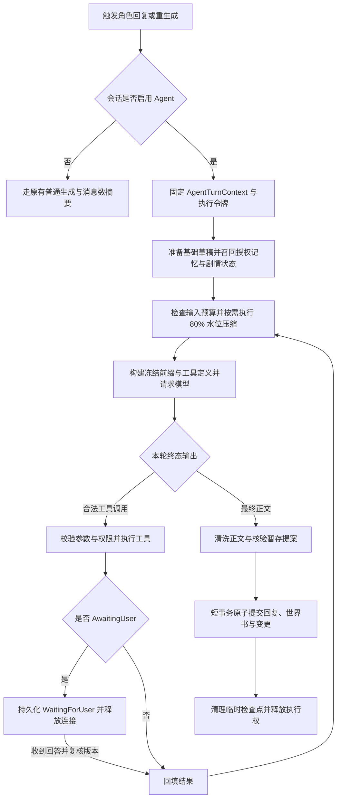

# Agent 工具链调用实施计划与架构规范

修订日期：2026-11-26。代码基线：`b0d51372`（分支 `feature/agent`，Room schema `v7`）。

本文面向执行 AI 直接实施，聚焦**本版本的核心 Agent 工具链调用能力**：五协议原生工具调用、单聊与群聊运行循环、全套本地内置工具（世界书、聊天历史、记忆读写/提升、掷骰、计算、剧情状态、`ask_user`）、80% 水位上下文压缩，以及配置化 HTTP 工具（含 `web_search` 与 `read_url`）与安全围栏。

已落地能力（Room `v7` 独立记忆仓库与普通回复召回、提示词预设记忆字段与 JSON 交换、Gemini Interactions 普通客户端）和本版本暂不处理的扩展功能（生图、MCP、后台任务、DAG 工作流、记忆自动查漏维护）均已从实施规格中移除。执行 AI 动工前须先阅读 [编码规范主入口](coding-guidelines.md)，新增 Kotlin 源码交付前按 [自动代码格式化](guides/code-formatting.md) 执行范围格式化与检查。

## 当前基线与本版本边界

### 已落地能力基线（直接复用）

- **独立记忆仓库（Room `v7`）**：`character_memories`、`chat_memories`、`group_chat_memories` 及修订/来源子表、触发器约束、`MemoryRepository`、`MemoryRetriever`、`NormalMemoryPromptComposer`、`MemoryPackageCodec`、`MemoryRestoreValidator`，以及 `feature/memorycenter`、`feature/memoryedit` 四个管理入口。
- **普通聊天只读召回与分支**：单聊/群聊表已含 `inheritCharacterMemory` 与 `recallMemoryInNormalChat`，已接入剩余预算召回、消息变更失效、分支复制与普通构建基线夹具 [NormalPromptBaselineTest](../app/src/test/java/me/kafuuneko/rpclient/libs/prompt/NormalPromptBaselineTest.kt)。
- **提示词预设扩展与导入导出**：`PromptType` 已含 `character_memory_context`、`character_memory_item`、`memory_extract`；`PromptPresetCodec` 与 `PromptTemplateListViewModel` 已支持预设 JSON 导入导出。
- **五种协议普通客户端**：[LLMClientFactory](../app/src/main/java/me/kafuuneko/rpclient/libs/llm/LLMClientFactory.kt#L36) 已装配 OpenAI Compatible、OpenAI Responses、Anthropic Messages、Gemini GenerateContent 与 Gemini Interactions 五种客户端及模型目录适配器。

### 本版本交付范围

- **五协议原生工具调用**：在不破坏普通生成契约的前提下，为五种协议补齐工具定义编码、流式与非流式调用解析、结果回传、续接载荷及 Provider 级工具能力设置。
- **单聊与群聊 Agent 运行引擎**：每会话独立 `agentEnabled` 开关与预设绑定；单聊内部工具循环、群聊“外层成员调度 + 内层成员工具循环”；关闭路径强制兼容原有普通生成；80% 输入预算水位压缩；聊天内默认折叠的任务卡。
- **首批本地内置工具与剧情状态**：
    - 世界书检索与读取（`search_lore` / `read_lore_entry`）
    - 当前聊天检索与读取（`search_chat` / `read_messages`）
    - 记忆检索、读写与范围提升（`search_memory` / `read_memory` / `upsert_memory` / `correct_memory` / `invalidate_memory` / `promote_memory_scope`）
    - 掷骰与受限数学计算（`roll_dice` / `calculate`）
    - 半结构化剧情状态（`get_scene_state` / `update_scene_state`）
    - 向用户提问暂停与恢复（`ask_user`）
- **配置化 HTTP 工具与联网能力**：`feature/toolsettings` 管理页、自定义 HTTP 工具定义与映射、内置 `web_search` 与 `read_url` 模板、Keystore 凭据加密、反 SSRF 与防数据外泄确认护栏。

### 明确延后与排除范围

以下能力**不在本版本实现**，编码时不得擅自引入：

- **图片生成**：不实现 `generate_image`、`AgentArtifact`、OpenAI Images 模板及工具图片展示/备份。
- **远程 MCP 客户端**：不实现 MCP Streamable HTTP 传输、握手、SSE 续流及 MCP 工具适配。
- **后台任务、DAG 流程与独立任务页**：不实现 `AgentExecutionService`（Android 前台服务）、`continueInBackground` 开关、DAG 流程模板编辑器、多会话批量执行与 `feature/agenttasks` 页面。退出聊天页沿用原有停止生成规则，仅 `WaitingForUser`（`ask_user` / 写入确认）持久化挂起供回到该会话后继续处理。
- **记忆自动查漏维护与手动历史提取**：本版本记忆写入仅由 Agent 主动调用记忆工具（或用户手动编辑）完成，不实现额外调用维护模型的 `MemoryMaintenanceRuntime`、`MemoryMaintenanceCheckpoint` 与记忆编辑页提取入口。
- **既有独立边界**：故事编辑器（`feature/storyeditor` / `libs/story`）不接入 Agent 与全局记忆仓库；单聊 `.jsonl` 归档（`ChatArchiveRepository`）维持酒馆兼容，不混入会话记忆或 `SceneState`；不引入浏览器/Node.js 插件宿主。

## 核心架构约束

沿用“保留普通生成路径，按会话旁路接入 Agent；工具执行与记忆仓库解耦”架构，遵守 Feature + MVI、Koin、Room、Kotpref 与 OkHttp 边界。以下约束为交付阻断条件：

| 风险点 | 强制约束 |
| --- | --- |
| 关闭 Agent 仍经过新引擎 | 入口先固定本次模式；关闭路径沿用原有单聊/群聊调用链，不进入 `AgentRuntime`、不预检工具能力、不创建 `AgentRun` |
| 单聊与群聊提交语义互相覆盖 | 两个会话适配器分别调用原有清洗与替换规则（单聊允许流式 partial，群聊原位重生成要求完整结果），仅 Agent 分支追加原子变更提交 |
| 运行锁死锁或长锁阻塞 | 短命令 `Mutex` 仅覆盖准入与状态切换，不跨网络或等待用户持有；会话排他性由持久化运行归属加提交版本校验维持 |
| 预算漏算系统指令或击穿缓存 | Agent 分支在最终发送投影上计量（含系统指令、工具 Schema、剧情状态与续接载荷）；工具循环内冻结前缀字节，仅在尾部追加交换段与引导 |
| 恢复载荷依赖日志或混入备份 | 协议续接与调用结果独立存放在 `noBackupFilesDir` 的 `AgentCheckpointStore`，不随调试日志丢失，也不进入系统备份或整库备份 |
| 模型为未发生剧情伪造证据 | 依赖待生成剧情的变更先暂存为提案，待正文清洗并被接受后核验证据范围与指纹，无法核验的提案不自动提交 |
| 外部读取引发内网探测或外泄 | `read_url` 及 HTTP 工具落实 DNS 解析后与每跳重定向的私网/回环拦截及解压后 2 MiB 限制；不可信外部输出后触发外发写入须显式确认 |
| 全量恢复引发并发崩溃或旧检查点碰撞 | 整库恢复前通过 `AgentRunManager` 终止全部活动运行并调用 `ContentSearchRepository.stop()`，恢复后清空本机 `noBackupFilesDir` 旧检查点 |

## 当前代码对接点

| 模块 | 现有代码入口 | 待接入改动 |
| --- | --- | --- |
| 协议工厂与装饰器 | [LLMClientFactory](../app/src/main/java/me/kafuuneko/rpclient/libs/llm/LLMClientFactory.kt#L36)、[LLMSystemPromptClient](../app/src/main/java/me/kafuuneko/rpclient/libs/llm/LLMSystemPromptClient.kt#L17)、[LLMTokenUsageTrackingClient](../app/src/main/java/me/kafuuneko/rpclient/libs/llm/LLMTokenUsageTrackingClient.kt#L26) | 在 `LLMClient` 增加独立工具轮次方法；系统指令装饰器防重复注入；用量统计增加按 `runId` 关联与估算补全 |
| 通用模型与校验 | [LLMModels](../app/src/main/java/me/kafuuneko/rpclient/libs/llm/model/LLMModels.kt#L148)、[LLMContentBlock](../app/src/main/java/me/kafuuneko/rpclient/libs/llm/model/LLMContentBlock.kt#L4)、[LLMResponseValidator](../app/src/main/java/me/kafuuneko/rpclient/libs/llm/LLMResponseValidator.kt#L24) | 新增独立工具轮次请求/响应/流事件模型；原有文本校验继续拒绝空正文，新校验接受合法工具响应 |
| 协议补丁与响应边界 | [RequestBodyPatch](../app/src/main/java/me/kafuuneko/rpclient/libs/llm/adapter/RequestBodyPatch.kt#L144)、[OpenAIResponsesResponseCodec](../app/src/main/java/me/kafuuneko/rpclient/libs/llm/adapter/OpenAIResponsesResponseCodec.kt#L83) | 补齐 Agent 模式保护路径（含 Interactions 的 `tools`、`generation_config.tool_choice` 等）；函数调用接入执行器，未支持类型继续显式报错 |
| 提示词预设与目录 | [PromptType](../app/src/main/java/me/kafuuneko/rpclient/libs/prompt/preset/PromptType.kt#L223)、[PromptTemplateSnapshot](../app/src/main/java/me/kafuuneko/rpclient/libs/prompt/preset/PromptTemplateSnapshot.kt#L6)、[PromptPresetCatalog](../app/src/main/java/me/kafuuneko/rpclient/feature/promptpreset/model/PromptPresetCatalog.kt#L9) | 补齐 Agent 分类与 6 个新键、会话级 `agentPromptPresetId` 覆盖与快照冻结 |
| Prompt 最终化与记忆 | [PromptRequestFinalizer](../app/src/main/java/me/kafuuneko/rpclient/libs/prompt/request/PromptRequestFinalizer.kt#L54)、[NormalMemoryPromptComposer](../app/src/main/java/me/kafuuneko/rpclient/libs/memory/NormalMemoryPromptComposer.kt#L21)、[MemoryRetriever](../app/src/main/java/me/kafuuneko/rpclient/libs/memory/MemoryRetriever.kt#L40) | 为 Agent 新增只读草稿输出入口与 `AgentPromptComposer`，复用已有记忆召回与检查器机制 |
| 单聊生成与提交 | [ChatViewModel](../app/src/main/java/me/kafuuneko/rpclient/feature/chat/ChatViewModel.kt#L880)（流式 `#L2628`、返回 `#L741`、摘要 `#L2828`）、[ChatRepository](../app/src/main/java/me/kafuuneko/rpclient/libs/room/repository/ChatRepository.kt#L1208) | 入口分流与繁忙注册；接入 `ChatAgentRuntime`、`AgentRunRepository` 原子提交与会话开关 |
| 群聊调度与提交 | [GroupChatViewModel](../app/src/main/java/me/kafuuneko/rpclient/feature/groupchat/GroupChatViewModel.kt#L2848)（批次 `#L2945`、成员 `#L3020`、摘要 `#L3351`）、[GroupChatRepository](../app/src/main/java/me/kafuuneko/rpclient/libs/room/repository/GroupChatRepository.kt#L887) | 保留外层成员调度，成员内部接入工具循环；处理 `deleteMessagesFrom` 的剧情状态回滚 |
| 公共消息气泡 | [ConversationMessageBubble](../app/src/main/java/me/kafuuneko/rpclient/ui/message/ConversationMessageBubble.kt#L141)（思考区 `#L496`） | 在公共消息气泡思考区接入无状态默认折叠任务卡组件，保留普通回复原思考块 |
| 内容检索与正则 | [ContentSearchRepository](../app/src/main/java/me/kafuuneko/rpclient/libs/room/repository/ContentSearchRepository.kt#L91)、[JavaScriptRegexCompiler](../app/src/main/java/me/kafuuneko/rpclient/libs/regex/JavaScriptRegexCompiler.kt) | 为工具封装限定范围与分页短结果；Regex 继续仅处理聊天正文，不改写工具参数与结果 |
| 数据库、备份与混淆 | [AppDatabase](../app/src/main/java/me/kafuuneko/rpclient/libs/room/AppDatabase.kt#L80)、[PortableBackupRepository](../app/src/main/java/me/kafuuneko/rpclient/libs/backup/PortableBackupRepository.kt#L39)、[proguard-rules.pro](../app/proguard-rules.pro) | 保持 Room `v7`（直接演进未发布的 `v7` schema 并维护从正式版 `v6 → v7` 的非破坏性迁移）；恢复前停止活动运行与搜索索引并清理检查点；为新增 Gson DTO 配置 `@SerializedName` 与 R8 保护 |

## 实现架构与模块边界

### 依赖方向与目录布局

```text
feature/chat、feature/groupchat
    ├── 普通分支：原生成逻辑 → 原 Builder → LLMRepository → 原提交规则
    └── Agent 分支：AgentRunManager → ChatAgentRuntime / GroupChatAgentRuntime
                                      ↓
                              AgentRuntime → ToolExecutor → AgentTool
                                      ↓                         ↓
                              LLMRepository                领域 Repository / HTTP 引擎
                                      ↓                         ↓
                             五协议 ToolCodec           AppDatabase (v7) → DAO

feature/toolsettings → ToolConfigRepository / ToolCredentialRepository
```

| 位置 | 放置内容 |
| --- | --- |
| `libs/agent/model/`、`libs/agent/runtime/` | 执行上下文、状态机、限额账本、控制命令、单聊/群聊适配器、`AgentPromptComposer`、`AgentCheckpointStore` |
| `libs/agent/tool/`、`libs/agent/connection/` | `AgentTool` 契约、`ToolRegistry`、`ToolExecutor`、全部内置工具处理器、HTTP 映射引擎、反 SSRF 校验与 `ToolCredentialRepository` |
| `libs/llm/model/`、`libs/llm/adapter/` | 工具轮次通用模型、五协议 `ToolProtocolCodec`、受控续接载荷及 `toolCallingSetting` 能力解析 |
| `libs/room/entity/`、`dao/`、`repository/`、`migration/` | `AgentRun`、`AgentStep`、`ToolInvocation`、`ConversationToolPolicy`、`ToolConnection`、`ToolDefinition`、`SceneState`、`SceneStateRevision`、合入 `v7` schema（维护 `v6 → v7` 迁移）与 `AgentRunRepository`/`SceneStateRepository`/`ToolConfigRepository` |
| `feature/toolsettings/` | 按 `Activity` + `CoreViewModelWithEvent` + `presentation/` + `ui/` 组织的工具与 HTTP 连接配置页 |

技术选型维持既有边界：使用 Kotlin 类型化状态机、结构化协程、Room 与 OkHttp，不引入外部编排框架或额外 HTTP 栈，不修改 `libs/core/`，不拆分 Gradle 模块。仅在真实多实现边界（工具处理器、协议编解码、检查点存储）定义接口，其余使用构造函数注入。

### 核心组件职责

| 组件 | 核心职责 |
| --- | --- |
| `AgentRunManager` | 进程内应用作用域控制入口，提供 `start`、`stop`、`answer`、`resume`、`observe` 与全局紧急停止（供全量恢复调用）；支持屏幕旋转复用订阅，页面退出调用 `stop` |
| `ConversationGenerationActivityRegistry` | 仅记录会话普通生成/摘要/代写活动标记的轻量注册表，阻止同会话并发重入；不持有 ViewModel 或 Context |
| `AgentRuntime` | 单次角色运行状态机，调度工具循环、轮次/Token/耗时限额、取消、重复只读拦截、等待用户及流事件发布；工具循环全局仅实现一次 |
| `ChatAgentRuntime` / `GroupChatAgentRuntime` | 分别准备单聊/群聊 Prompt 草稿、适配清洗与取消规则；群聊适配器同时负责 Agent 分支外层成员顺序调度 |
| `AgentTurnContext` | 冻结角色、模型、生成类型、会话开关与策略版本、实际人设、历史边界、提示词快照与有效工具定义 |
| `ToolRegistry` / `ToolExecutor` | 按稳定 `toolId` 注册工具、筛选本轮可用工具、强校验参数 Schema 与可见范围、执行超时/分页/幂等与受控并发 |
| `AgentPromptComposer` | 基于 Builder 原始草稿快照构建发送投影，冻结前缀并保护工具调用/结果交换段，计入系统指令、剧情状态、Schema 与续接开销 |
| `AgentRunRepository` | 持久化运行、步骤、调用与恢复引用；在短事务内校验运行资格并原子提交正文、世界书状态、已核验记忆提案与剧情状态 |
| `AgentCheckpointStore` | 在 `noBackupFilesDir` 使用临时文件加原子替换保存恢复必需的协议续接与调用结果，独立于调试日志开关 |
| `ToolCredentialRepository` | 在 `noBackupFilesDir` 使用 Android Keystore AES-GCM 加密保存 HTTP 连接凭据，配置导出仅保留凭据引用 |
| `SceneStateRepository` | 管理半结构化剧情状态、修订历史、分支快照及消息截断回滚 |

### 调度、状态机与生命周期

- **结构化并发与冷启动**：应用作用域使用注入的 `CoroutineScope(SupervisorJob() + Dispatchers.Default)`，禁止 `GlobalScope`。单次运行的模型与工具调用作为子协程受控取消。启动时在后台协程异步将异常中断的未完成运行标为 `Interrupted` 并清理孤立检查点文件（不放入 [RPClientApp.onCreate](../app/src/main/java/me/kafuuneko/rpclient/RPClientApp.kt#L104) 的 `runBlocking`），`AgentRunManager` 准入等待初始化完成。
- **状态机**：显式表达 `Preparing`、`RequestingModel`、`ExecutingTools`、`WaitingForUser`、`Committing`、`Cancelling` 及终态（`Completed`、`Failed`、`Cancelled`、`Interrupted`、`Expired`）。
- **高频流与持久化隔离**：流式文本增量通过有界事件流节流映射至 UiState，禁止逐 Token 写 Room；原始工具返回、凭据和协议续接 JSON 不进入 UiState。
- **短锁与执行令牌**：`ConversationRef` 区分 `Single(chatId)` 与 `Group(groupId)`。短命令 `Mutex` 仅包裹准入与状态切换；每次根运行获发含 `ownerRunId`、`settingsVersion`、`historyVersion` 与 `executionEpoch` 的执行令牌。群聊自身提交在同一事务推进历史版本并回写令牌，防止下一成员误判冲突。
- **页面退出、等待用户与关闭撤权**：
    - 退出发起聊天页时，若当前运行正在请求模型或执行工具，沿用现有返回处理触发 `stop` 与有界收尾（最长 5 秒）；若处于 `WaitingForUser`（`ask_user` 或写入确认），释放协程与连接并保留持久化挂起状态，用户重新进入该会话时可通过任务卡回答、确认或取消。
    - 关闭会话开关或停止运行时，先在短事务内持久化撤权并递增策略版本，再取消 Job 与有界本地收尾，绝不先等待长锁再撤权。用户发新普通消息前须先终止该会话的 `WaitingForUser` 运行。
    - 所有写库收尾由运行层与 `AgentRunRepository` 完成，不通过回调依赖页面存活。

## Agent 提示词预设与自定义边界

### 新增可编辑 Agent 提示词键

沿用现有提示词预设列表、编辑器及 `prompt_preset_entries(presetId, promptKey, content)` 稀疏覆盖机制。在 [PromptPresetCatalog](../app/src/main/java/me/kafuuneko/rpclient/feature/promptpreset/model/PromptPresetCatalog.kt) 中新增 Agent 分类及场景筛选，本地预览复用统一渲染函数。新增 6 个稳定键（既有记忆键保持复用）：

| 稳定键 | 作用与默认语义 | 渲染时机与位置 |
| --- | --- | --- |
| `agent_instruction` | 角色在 Agent 模式下的行动目标、事实核查与回复边界 | 构建单聊/群聊基础上下文时作为独立草稿注入固定区，工具循环内保持冻结 |
| `agent_group_instruction` | 补充群聊中成员使用工具与共享状态的发言纪律 | 仅群聊角色运行构建基础上下文时追加 |
| `agent_tool_guidance` | 指导何时查资料、何时写入记忆/状态、何时调用 `ask_user` | 与基础上下文一并冻结，各轮次复用 |
| `agent_finalize` | 达到轮次或预算边界、禁用工具后的最终收尾回复指令 | 仅在收尾请求尾部追加，避免破坏前缀缓存 |
| `agent_tool_error_guidance` | 收到可恢复工具错误时的修正与放弃原则 | 仅在包含错误工具结果的下一轮请求尾部追加 |
| `agent_compaction_guidance` | Agent 触发水位压缩时的保留重点（工具结论、未决事项、状态差异） | 仅实际发起 Agent 上下文压缩时追加在既有 `summarize`/`group_summarize` 之后 |

扩展规则：

- `PromptType`、`availableMacros`、`PromptTemplateSnapshot` 与 `PromptPresetCatalog` 同步更新；缺项自动使用默认值，显式空串表示省略该段。
- 复用 `MacroExpander` 与当轮冻结快照；工具结果、记忆正文和外部网页内容始终作为字面值，不二次展开其中的宏形文本。
- 会话表新增可空外键 `agentPromptPresetId REFERENCES prompt_presets(id) ON DELETE SET NULL`（`NULL` 表示跟随全局活动预设）。该选择仅覆盖上述 Agent 键及 Agent 压缩所用的摘要键；角色基础设定仍沿用既有解析规则。分支复制该绑定，整库备份保留引用。
- 一次运行开始时冻结预设快照、ID 与修订；运行中编辑或删除预设只影响新运行（删除绑定预设的会话自动回退跟随全局）。

### 工具与策略的自定义边界

| 配置对象 | 用户可编辑范围 | 程序强制契约 |
| --- | --- | --- |
| 内置本地工具 | 显示名称、面向模型的工具与参数说明、适用提示、契约允许调整的默认参数，以及每会话逐项启停 | 稳定 `toolId`、处理器、**固定模型函数名**（不开放内置工具改函数名，减少冲突与模型理解退化）、参数类型、作用域和授权门禁；关闭 `ask_user` 后应用级写入确认弹窗仍独立生效 |
| 配置化 HTTP 工具 | 新建、复制、编辑、测试、删除、导入导出；自定义模型调用名、说明、参数 Schema、连接绑定、结构化请求/响应映射及会话选用；提供 `web_search` 与 `read_url` 可复制模板 | 统一校验命名与 Schema，凭据由 `ToolCredentialRepository` 注入，走统一五协议调用路径与安全围栏 |
| 会话 Agent 策略 | 会话开关、绑定预设、工具集、记忆写入策略（工具主动写入 / 只读记忆）、写入确认策略、轮次/Token/耗时限额与压缩水位 | 根运行统一计量；作用域、体积上限、取消撤权与安全拦截由代码强制执行 |

内置工具覆盖按稳定 `toolId` 稀疏存储，恢复默认删除覆盖行。修改说明或默认值不撤销活动运行，停用工具或收紧权限立即生效并拒绝待执行调用。

## 工具扩展契约与统一执行器

工具业务逻辑与模型协议编解码完全解耦：`AgentTool` 经领域 Repository 或 HTTP 引擎执行，`ToolProtocolCodec` 负责五协议转换；工具处理器不直接拼接 Provider 请求体，也不自行启动下一轮模型请求。

- **稳定身份与统一命名**：每个工具具备唯一 `toolId`、契约版本与执行性质（`ReadOnly`、`NonDeterministicRead`、`LocalWrite`、`ExternalWrite`）。暴露给模型的函数名统一遵守跨五协议最大公约数正则 `^[a-zA-Z_][a-zA-Z0-9_-]{0,63}$`，避免维护多套协议别名。
- **幂等主键分离**：客户端 `invocationId` 由 `runId`、`stepId` 与本步调用序号确定性生成，作为重试去重与回放主键；远程 `callId` 仅用于协议回传关联，兼容无远程 ID 的模型并防止跨轮复用同一 `callId`。
- **通用参数 Schema 子集**：支持 `object`、`array`、`string`、`integer`、`number`、`boolean`、`null`、`enum`、`required`、`nullable`、数值范围、字符串长度、数组长度与 `additionalProperties`。使用类型化 Schema 树区分缺省字段与显式 `null`。对象默认 `additionalProperties = false`，最大嵌套 8 层，单次调用参数上限 64 KiB。
- **编码能力与本地校验分离**：协议无法原生表达的细粒度限制（如字符串长度范围）显式标记“仅本地校验”并附入参数描述，由 `ToolExecutor` 在执行前强校验；字段类型、必填、可空及授权身份约束不可静默弱化。
- **OpenAI `strict` 策略**：仅当定义满足 `additionalProperties = false` 且所有属性列入 `required` 且目标支持时启用 `strict = true`；否则显式传 `strict = false`（若能力限定 strict-only 则拒绝该定义），绝不把省略字段静默改写为必传 `null`。
- **结构化结果与分页截断**：统一返回 `Success`、`RecoverableError`、`FatalError` 或 `AwaitingUser`，并区分写入态 `Proposed` / `Committed`。列表与文本结果采用分页与游标返回（默认 20 条、上限 100 条；单页文本上限 8,000 字符，结构化 JSON 上限 64 KiB），显式标注是否截断，严禁硬截断破坏 JSON 结构。
- **可扩展性约束**：新增符合契约的本地工具只需补充定义、处理器、Koin 集合注册、本地化文案与测试，无需在单聊/群聊 ViewModel、循环状态机或五个协议 Codec 中增加按工具名分支的代码。检查点保存工具 ID、契约版本与定义快照，恢复时若工具已禁用或版本不兼容则明确终止，不套用新版本重放旧写入。

## 五协议工具调用与模型能力控制

### 通用传输契约

- 保留 [LLMClient](../app/src/main/java/me/kafuuneko/rpclient/libs/llm/LLMClient.kt) 现有 `generate` / `streamGenerate` 及 `LLMGenerationRequest` / `LLMGenerationResponse` / `LLMStreamEvent` 供普通路径使用，不改动其行为与序列化。
- 在 `LLMClient` 与 `LLMRepository` 新增 `generateToolTurn` / `streamToolTurn`，配套独立的 `LLMToolGenerationRequest`、`LLMToolTurn` 与 `LLMToolStreamEvent`。五个协议客户端、[LLMSystemPromptClient](../app/src/main/java/me/kafuuneko/rpclient/libs/llm/LLMSystemPromptClient.kt#L17) 与 [LLMTokenUsageTrackingClient](../app/src/main/java/me/kafuuneko/rpclient/libs/llm/LLMTokenUsageTrackingClient.kt#L26) 全部实现新方法，缺失实现显式抛出 `UnsupportedToolCalling`。
- `LLMToolGenerationRequest` 携带基础消息上下文、有效工具定义、工具选择模式（`Auto` / `None` / 指定模式）、有序工具交换段（保留原序正文、调用、结果、停止原因与协议续接引用）以及 `systemPromptApplied` 标记（避免 `LLMSystemPromptClient` 重复注入并确保计入预算）。
- 原 `ChatMessage` / `GroupChatMessage` / `LLMMessageRole` 不新增工具角色。
- 流式聚合以**协议轮次正常终态**为准：调用参数、关联 ID、必需签名完整且未被截断/拒绝、并通过 JSON 与 Schema 校验后才派发工具。参数因 `length` / `max_tokens` 截断时丢弃不完整调用并记录诊断，不执行半截参数。

### 五协议工具适配边界

| 协议 | 工具定义、调用与结果格式 | 必须处理的协议细节与续接约束 |
| --- | --- | --- |
| OpenAI Compatible | `tools`（`type: "function"`）、`tool_choice`、`assistant.tool_calls` 与 `role: "tool"` | 流式按 `index` 与 `id` 拼接，兼容网关缺 `index` 或重复发 `id` 的差异；保留同轮推理模型（如 DeepSeek 推理模式）要求的 `reasoning_content` 续接字段，不写入聊天正文 |
| OpenAI Responses | `tools`（`type: "function"`）、`function_call`、`function_call_output` 与有序 `output` Item | 沿用 `store = false` 本地历史，禁用 `previous_response_id`；原样保留工具链所需的 `reasoning` Item 及 `encrypted_content`（不以展示摘要替代）；未实现客户端 Item 继续显式报错 |
| Anthropic Messages | `tools`（`input_schema`）、`tool_choice`、`tool_use` 与 `tool_result` 块 | `tool_result` 紧随对应 `assistant` 轮次且置于 `user` 内容数组首部；开启扩展思考时必须在 `tool_use` 之前原样回传带 `signature` 的 `thinking` / `redacted_thinking` 块 |
| Gemini GenerateContent | `tools[].functionDeclarations`、`toolConfig`、`functionCall` 与 `functionResponse` Part | `functionResponse.response` **必须是 JSON Object**（纯文本或数组须包装为对象）；保留原序、可选 `id` 及 Part 级 `thoughtSignature`（不跨 Part 合并）；模型未返回 `id` 时严格按出现顺序关联 |
| Gemini Interactions | `POST /v1/interactions`，`store = false`，`tools`（`type: "function"`）、`generation_config.tool_choice`、`function_call` 与 `function_result` 步骤 | 将本轮模型返回的全部有序步骤（含签名）追加至原 `input` 历史，再附带 `name`、`call_id`、`result` 的 `function_result` 步骤；SSE 按步骤索引处理 `step.start`、`step.delta`（拼合 `arguments_delta` 并保留签名）、`step.stop`，仅在交互终态为 `requires_action` 且调用完整后派发工具 |

高级请求 JSON 合并规则：

- 仅在 Agent 工具请求中生效；普通请求维持原有 [RequestBodyPatch](../app/src/main/java/me/kafuuneko/rpclient/libs/llm/adapter/RequestBodyPatch.kt) 路径。
- Agent 请求先解析补丁中的服务端托管工具配置，再与 `ToolRegistry` 的客户端函数工具合并并校验重名；补齐各协议 Agent 保护路径（含 Interactions 的 `tools`、`generation_config.tool_choice`、`stream_function_call_arguments` 等），禁止补丁覆盖收尾禁工具策略、历史或授权。服务端托管工具结果独立标识，不交由本地 `ToolExecutor` 二次执行。

### 模型能力设置与验收矩阵

- 在 `LLMProvider` 新增持久化字段 `toolCallingSetting`（`Auto` / `Enabled` / `Disabled`，默认 `Auto`），迁移时旧配置赋 `Auto`。
- `Auto` 依据模型目录与协议已知能力判断：明确不支持时阻断运行；未知时界面给出提示并允许在会话开启 Agent 后直接原生请求（不额外付费探测）。`Enabled` 允许尝试，`Disabled` 显式禁止。
- 运行前检查当前模型（群聊检查本批全部拟发言成员）；明确不支持时列出模型与原因，由用户换模型或关闭 Agent，不静默降级为普通聊天或文本工具解析。

使用本地合成 HTTP 服务与五个真实 Codec 完成以下自动化验收（真实账号联调单列环境与结果，缺少凭据时如实标明未实测）：

| 协议 | Schema 与定义编码 | 非流式往返 | 流式分片与多调用关联 | 续接载荷（签名/推理）回传 | 截断、错误、停止与资源释放 |
| --- | --- | --- | --- | --- | --- |
| OpenAI Compatible | 必验 | 必验 | 必验 | 必验 | 必验 |
| OpenAI Responses | 必验 | 必验 | 必验 | 必验 | 必验 |
| Anthropic Messages | 必验 | 必验 | 必验 | 必验 | 必验 |
| Gemini GenerateContent | 必验 | 必验 | 必验 | 必验 | 必验 |
| Gemini Interactions | 必验 | 必验 | 必验 | 必验 | 必验 |

每行均须验证：关闭 Agent 时零工具字段；仅工具调用无正文可继续执行；未知或禁用工具拒绝执行；受控写入重试不重复提交；流式截断不触发执行。

## 每会话 Agent 开关与普通路径强制兼容

### 开关持久化与保存

- 在 `v7` 表结构（及 `v6 → v7` 迁移）中为 `chat_sessions` 与 `group_chat_sessions` 新增 3 列：`agentEnabled`（`INTEGER NOT NULL DEFAULT 0`）、`agentSettingsVersion`（`INTEGER NOT NULL DEFAULT 0`）与 `agentPromptPresetId`（`INTEGER NULL REFERENCES prompt_presets(id) ON DELETE SET NULL`）。
- 全局新增 `AppModel.defaultAgentEnabled`（默认 `false`），仅在新建会话时复制为初始值，不影响既有会话；迁移与旧备份缺失字段一律为 `false`。分支复制源会话当时的开关与策略。
- 会话级工具集、记忆写入模式、限额与水位保存在会话关联表，不在两处冗余存储 `agentEnabled`。
- 切换开关采用专门字段 UPDATE 并原子递增 `agentSettingsVersion`；单聊/群聊原设置页的 `updateSession` 在事务中保留实时 Agent 字段与版本号，防止旧表单草稿覆盖。

### 开关行为与兼容不变量

| 场景 | 预期行为 |
| --- | --- |
| `agentEnabled = false` | 入口直接走原有普通生成逻辑与原有消息数摘要策略；不建 `AgentRun`、不读工具注册表、不预检能力、不套用 Agent 限额；请求体不附加 `tools`/`tool_choice` 或空数组 |
| 普通生成中开启 Agent | 保存设置供下一次新操作生效，不中途升级当前普通响应；`ConversationGenerationActivityRegistry` 防止同会话并发重入 |
| Agent 运行或等待中关闭 | 短事务保存关闭、递增策略版本并撤权，再取消 Job 与有界收尾（最长 5 秒，超时标 `Interrupted`/`UnknownOutcome` 并完成逻辑交接）；同时停止剩余群聊自动批次；迟到结果零提交 |
| 重新开启 Agent | 新运行使用最新快照；已关闭或中断的旧调用不自动恢复 |

入口分流与保留差异：

- 空输入先按原规则解析替换词、附件与末条消息：单聊末条为用户消息时“继续”解析为 `Normal`（可进入 Agent）；真实 `Continue`、输入框/历史代写（`Impersonate` / `UserWriting`）与手动摘要沿用原有无工具路径。
- 单聊保留：用户正文/附件单次提交、失败回复重试不重发用户消息、流式 partial 收尾、Source/Display Regex 顺序与世界书原子提交。
- 群聊保留：四种成员选择策略、静音、自我回复、Swap/Join、原自动发言延迟（不受 Agent 批次限制）、冒名清洗与 `trimOtherSpeakers`、原位重生成仅完整替换旧回复。
- 关闭 Agent 后不回放未解决的工具链或其续接载荷；工具失配或外部连接不可达均不得阻断普通聊天。

## 单聊循环、群聊双层循环与 Prompt 预算

### 单聊运行循环



循环规则：

- 同一次角色运行固定角色与 Provider；无工具调用时一轮模型请求即产出最终回复。
- 同轮多个调用中，声明为独立且无共享写入的 `ReadOnly` 工具最多并发 2 个；写入及有依赖的调用按模型原序串行执行。
- 工具调用前的流式文字属于过程预览，若同轮伴随工具调用则归类为过程记录，不拼入最终回复；取消时仅已确定进入最终正文阶段的 partial 按会话规则收尾。
- 确定性只读工具跨轮连续 3 次出现相同参数、相同结果摘要且无状态进展时终止循环并提示原因；`NonDeterministicRead`（如 `roll_dice`）不触发此重复拦截，仍受总次数与预算约束。

### 群聊双层循环

- 外层复用现有成员选择与顺序队列；每位发言成员在其内部独立执行 `AgentRuntime` 工具循环，提交最终发言与共享状态后，外层再推进下一位。
- 成员 A 内部工具调用不触发重选发言者；成员 B 读取 A 已提交的最终发言、共享记忆与共享剧情状态，不读取 A 的私有记忆、未公开工具原始返回或协议续接载荷。
- 任一成员触发 `ask_user` 或写入确认时同时暂停当前成员与外层队列；停止群聊一并取消当前成员与所有剩余自动批次。

### Prompt 构建、前缀缓存与 80% 水位压缩

- 为 [ChatPromptBuilder](../app/src/main/java/me/kafuuneko/rpclient/libs/prompt/ChatPromptBuilder.kt) 与 [GroupChatPromptBuilder](../app/src/main/java/me/kafuuneko/rpclient/libs/groupchat/GroupChatPromptBuilder.kt) 增加只读草稿输出方法，复用同一套宏、世界书激活与 Prompt Regex，原 `build`/`buildWithMetadata` 行为不变。
- `AgentPromptComposer` 复用当次准备的草稿与世界书候选状态，工具循环内**不重复激活世界书或推进时序**，世界书下一状态只在最终正文接受提交时落库一次。
- **前缀缓存友好（Prefix Caching）**：同一次角色运行的工具循环内，系统指令、工具定义顺序、角色卡、世界书、初始召回记忆、初始剧情状态与历史前缀保持**字节级冻结不变**；后续轮次仅在尾部追加不可被后处理合并/拆散的工具调用与结果交换段。`agent_tool_error_guidance` 与 `agent_finalize` 仅追加在尾部，避免修改前缀击穿 OpenAI / Anthropic / Gemini 的前缀缓存。
- **同源发送投影与双层预算**：预算涵盖 Provider 系统指令、基础消息、剧情状态块、工具 Schema、已发生交换段与协议续接估算；Prompt Inspector 与实际编码共享同一投影。单次输入满足 `contextTokens - maxResponseTokens`；运行累计账本按唯一 `requestId` 预占并在成功后按实际用量核销关联至 [LLMTokenUsageRecord](../app/src/main/java/me/kafuuneko/rpclient/libs/room/entity/LLMTokenUsageRecord.kt)（不重复计数），失败/取消保守保留估算占用。接近上限时预留 1 次禁用工具的收尾请求。
- **80% 水位上下文压缩**：
    - 关闭 Agent 的会话继续使用原消息数自动摘要；开启 Agent 的会话改用基于可用输入预算 **80%**（可配置）的触发水位，在既有 `summarize`/`group_summarize` 模板后追加 `agent_compaction_guidance`，保留手动摘要及 Raw/Classic 历史选择语义。
    - 80% 为提前压缩水位而非硬拒上限：同一历史快照最多尝试压缩 1 次；无可压缩历史或压缩后仍高于 80% 但未超输入上限时继续请求，防止死循环；仅实际必需内容超限时报告预算不足。
    - 压缩只处理角色运行前的旧历史，绝不拆解活动工具链；摘要 `coveredMessageId` 仅推进到实际处理的消息。

## 内置本地工具、剧情状态与主动写入一致性

### 首批内置本地工具清单

客户端为每次调用自动注入当前会话、发言角色与已解析实际人设上下文，模型无法通过参数跨会话读取或写入其他会话：

| `toolId` | 执行性质 | 实现行为与关键边界 |
| --- | --- | --- |
| `search_lore` | `ReadOnly` | 搜索当前角色与会话获准启用的世界书，返回条目 ID 与短摘要分页 |
| `read_lore_entry` | `ReadOnly` | 按 ID 读取条目正文，执行前复核可见性并限制返回体积 |
| `search_chat` | `ReadOnly` | 复用 [ContentSearchRepository](../app/src/main/java/me/kafuuneko/rpclient/libs/room/repository/ContentSearchRepository.kt#L91) 搜索当前会话已提交历史，排除当前流式占位 |
| `read_messages` | `ReadOnly` | 读取当前会话指定消息及有限上下文窗口，校验消息归属 |
| `search_memory` / `read_memory` | `ReadOnly` | 复用 `MemoryRepository` 按作用域（通用继承 + 会话共享 + 当前发言者私有）先 SQL 过滤再检索与读取 |
| `upsert_memory` | `LocalWrite` | 新增或合并事实，校验来源、作用域、版本与重复写入 |
| `correct_memory` | `LocalWrite` | 修正已有记忆，追加新修订并保留修正依据 |
| `invalidate_memory` | `LocalWrite` | 标记记忆失效或被替代，保留追踪（物理硬删除仅限用户界面） |
| `promote_memory_scope` | `LocalWrite` | 将会话记忆提升至当前角色通用表；`autoPromoteMemory` 默认 `false`（弹确认），开启后仍禁止自动提升剧情事件与关系进度 |
| `roll_dice` | `NonDeterministicRead` | 解析 `NdM`、正负修正与 `kh`/`kl`；限制最多 100 颗、每颗最多 10,000 面；同一 `invocationId` 重试回放原结果，绝不重掷 |
| `calculate` | `ReadOnly` | 受限算术表达式解析器（四则、括号、幂、常用数学函数），限制表达式长度与运算步数，非有限结果显式报错 |
| `get_scene_state` / `update_scene_state` | `ReadOnly` / `LocalWrite` | 读写当前会话剧情状态，增量操作配合 `expectedRevision` 乐观锁与变更记录 |
| `ask_user` | `AwaitingUser` | 展示问题、选项或输入框并挂起当前运行，等待超时 24 小时标记 `Expired`（等待时间不计主动耗时） |

普通会话不开放修改角色卡、世界书、Provider、任意本地文件或执行任意代码的工具。

### 半结构化剧情状态（`SceneState`）

- 采用“固定核心域 + 轻量自定义键值分组”的半结构化模型，适配奇幻、现代、科幻、跑团等不同 RP 题材：
    - 固定核心域：当前地点、场景时间、角色属性键值表、物品清单、任务/目标状态；
    - 自定义分组：受限深度的类型化键值映射（字符串/数值/布尔/短标签列表），避免退化为无约束整段覆盖。
- `SceneStateRevision` 必须保存 **`effectiveAfterMessageId`**（`0` 表示会话起点，正值指向生效时的已提交消息边界），单会话保留最近 200 版修订，超限折叠最旧差异为基线快照。
- Agent 模式下非空 `SceneState` 渲染为独立来源块（`PromptSourceKind.SceneState`）进入基础上下文并计入预算；会话设置页提供状态查看、历史差异与撤销入口。

### 主动写入、来源核验与跨表原子提交

- 会话记忆写入模式简化为两档：**工具主动写入（默认）** 与 **只读记忆**。只读模式在执行器与事务入口均拒绝 Agent 记忆写入，用户仍可在记忆编辑页手动管理。
- **已提交来源 vs 待生成提案**：来源为已提交用户消息的事实允许在回复完成前校验提交；依赖本轮待生成角色剧情的记忆和状态变更先以 `Proposed` 暂存，同轮后续读取返回叠加暂存视图但标明未永久保存。
- **清洗后证据核验**：待生成事件提案须给出预期证据摘录。角色正文经群聊清洗、Source Regex 与接受规则后，程序核验预期证据确实存在于最终被接受正文中，再绑定真实消息 ID 与 SHA-256 指纹；被改写后无法匹配的提案不自动提交，避免伪造剧情事实。
- **跨范围隔离与写入归属**：自动写入的可读范围不得宽于证据来源范围，私有工具结果不得仅凭模型参数写成共享事实。客户端强制标记写入 `origin`（`UserEdit` / `AgentTool`），禁止模型冒充。
- **短事务原子提交**：清洗、Token 计算与网络 IO 一律在事务外完成。`AgentRunRepository` 通过内部 helper 复用既有单聊/群聊消息规则（避免 `ChatRepository` 反向依赖 `AgentRuntime`）：同一短事务内复核 `executionEpoch`、策略版本、历史边界与替换目标，写入正文、世界书下一状态、已核验记忆提案与 `SceneState` 差异并推进提交标识。外部 HTTP 写调用先持久化 `Dispatching` 与幂等键再发请求，断连或崩溃恢复时标为 `UnknownOutcome` 且不自动重发。

## 配置化 HTTP 工具、联网查询与安全防线

### 反 SSRF、防外泄与凭据隔离

因 [AndroidManifest.xml](../app/src/main/AndroidManifest.xml#L25) 与 [network_security_config.xml](../app/src/main/res/xml/network_security_config.xml) 为兼容本地模型允许明文流量并信任用户 CA，工具层的 HTTP 客户端必须建立独立安全围栏：

- **反 SSRF 地址拦截**：`read_url` 与默认 HTTP 工具连接禁止访问回环、私有网段、链路本地及保留地址（`127.0.0.0/8`、`10.0.0.0/8`、`172.16.0.0/12`、`192.168.0.0/16`、`169.254.0.0/16`、`::1`、`fc00::/7`、`fe80::/10` 等）。拦截必须在自定义 OkHttp `Dns` 解析出真实 IP 后以及**每一次 3xx 重定向跳转**时执行，防范 DNS Rebinding 与跳板重定向；最大重定向 5 次，跨源重定向不转发认证头；仅允许 `http` / `https`。用户确需调用局域网 HTTP 工具时，须在对应连接配置中显式开启“允许私有地址”。
- **体积与解压缩保护**：`read_url` 校验文本/HTML `Content-Type`，过滤脚本与样式后分页返回正文；最大响应 2 MiB 的上限必须作用于**解压后的读取字节流**，防范 gzip/deflate 压缩炸弹。
- **防间接 Prompt Injection 数据外泄**：网页与外部 API 返回一律视为不可信资料，不得改变指令或权限。所有 `ExternalWrite` 与自定义 HTTP 写工具默认需用户确认；同一运行在消费过不可信外部内容（`read_url` / `web_search` / 自定义外部 HTTP 返回）后，若模型尝试调用其他外部外发工具，强制弹出确认并展示目标主机与即将发送的参数摘要。
- **Keystore 加密凭据**：`ToolCredentialRepository` 使用 Android Keystore AES-GCM 在 `noBackupFilesDir` 加密保存 HTTP 连接密钥，不进入日志、模型上下文、工具导出包与全量备份（恢复整库后缺失凭据的连接显示 `NeedsConfiguration` 并引导重新绑定）。

### HTTP 工具引擎与内置联网模板

- 在 `feature/toolsettings` 支持连接与工具定义的新建、复制、编辑、测试、启停、删除与 JSON 导入导出。
- 连接配置含基础 URL、HTTP 方法、查询参数、静态请求头、凭据引用、超时、响应上限与私有地址开关；工具定义含参数 Schema、JSON 请求模板、响应/错误/分页路径映射。参数绑定采用结构化 JSON 路径赋值与 URL 编码，不执行脚本，支持 Bearer、API Key 与自定义认证头；模型参数不得覆盖连接固定认证与主机身份。
- `web_search`（提供可复制搜索模板，配置 URL 与标题/URL/摘要字段映射后即可运行，未配置显示 `NeedsConfiguration`）与 `read_url`（不携带任何 Provider 或连接凭据）均基于统一 HTTP 引擎与安全校验实现。

## 跨模块生命周期、数据迁移与混淆约束

- **数据库版本与迁移（保持 `v7`，维护 `v6 → v7`）**：当前开发分支对应的正式发行版处于 `v6`（`2026.4.5`），同一待发布软件版本内无需升级到 `v8`，允许对开发期 `v7` 结构直接演进（同版本内开发库允许破坏性更新/重装覆盖 `7.json`）。所有新增 Agent 表、`LLMProvider.toolCallingSetting` 与两张会话表的 3 个 Agent 列直接合入 `v7` schema，并同步维护从正式版 `v6 → v7` 的非破坏性迁移；从 `v6` 升级后既有会话 `agentEnabled = false`，历史消息与摘要保持不变。
- **分支与中间消息删除回滚**：
    - 单聊与群聊创建分支时，在同一事务内复制 `agentEnabled`、`agentPromptPresetId`、`ConversationToolPolicy` 及分支点 `effectiveAfterMessageId` 有效的 `SceneState` 快照。
    - 群聊消息菜单执行 [GroupChatRepository.deleteMessagesFrom](../app/src/main/java/me/kafuuneko/rpclient/libs/room/repository/GroupChatRepository.kt#L896) 删除截断点及后续消息时，在同一事务内将 `SceneState` 回滚至截断点前最近有效修订（无更早修订则归位初始状态）。
- **删除 `UserPersona` 联动**：[UserPersonaRepository.delete](../app/src/main/java/me/kafuuneko/rpclient/libs/room/repository/UserPersonaRepository.kt#L119) 同步取消受影响人设（含被替换默认人设的 `FOLLOW_DEFAULT` 会话）上的活动 Agent 运行。
- **全量备份与恢复协同**：[PortableBackupRepository](../app/src/main/java/me/kafuuneko/rpclient/libs/backup/PortableBackupRepository.kt#L39) 与 [BackupArchiveRepository](../app/src/main/java/me/kafuuneko/rpclient/libs/backup/BackupArchiveRepository.kt) 替换数据库前必须先通过 `AgentRunManager` 终止全部活动运行并调用 `ContentSearchRepository.stop()`；替换完成后清空本机 `noBackupFilesDir` 中的旧 `AgentCheckpointStore` 载荷防止跨库 ID 碰撞。全量备份保存权威配置、策略、`SceneState` 与运行摘要元数据，不导出协议续接载荷与加密凭据，恢复暂存库校验全部外键与不变量。
- **Release R8 混淆保护**：[app/build.gradle.kts](../app/build.gradle.kts#L70) 的 `release` / `demo` 构建开启代码混淆。所有新增 Gson 序列化 DTO（检查点载荷、Schema 树、HTTP 映射与工具导出模型）均须加 `@SerializedName` 或在 [proguard-rules.pro](../app/proguard-rules.pro) 补充 keep 规则，并以 `:app:assembleDemo` 核验。

## 页面交互与样式落地

独立管理页沿用 `AppPageScaffold`、现有顶栏与列表容器；嵌入控件跟随宿主背景与 Material 3 动态主题。所有新增可见文案、错误提示与无障碍描述同步补齐默认英文与全部已支持语言目录。

| 界面落点 | 参考组件 | 交互要点 |
| --- | --- | --- |
| 单聊/群聊任务卡 | [ConversationMessageBubble](../app/src/main/java/me/kafuuneko/rpclient/ui/message/ConversationMessageBubble.kt#L141) | 复用公共气泡思考区，置于正文之前，默认折叠为单行摘要（状态、步骤进度、展开箭头及等待态快捷“回答/确认”）；模型可展示思考内容并入同卡详情；展开后展示步骤摘要、累计估算 Token 与请求数；展开态按运行 ID 由页面持有，不随流式更新重置 |
| 单聊/群聊 Agent 设置 | [ChatSettingsPage](../app/src/main/java/me/kafuuneko/rpclient/feature/chat/ui/ChatSettingsPage.kt)、[GroupChatSettingsPage](../app/src/main/java/me/kafuuneko/rpclient/feature/groupchat/ui/GroupChatSettingsPage.kt) | 展示持久化开关、切换收尾态、绑定 Agent 预设、模型工具能力提示、会话工具集、记忆写入模式（主动写入/只读）及 `SceneState` 查看撤销入口 |
| 工具配置页（`feature/toolsettings`） | [PromptPresetLayout](../app/src/main/java/me/kafuuneko/rpclient/feature/promptpreset/ui/PromptPresetLayout.kt)、[RpJsonCodeEditorField](../app/src/main/java/me/kafuuneko/rpclient/ui/widgets/RpJsonCodeEditorField.kt) | 管理内置工具说明/默认参数覆写、HTTP 连接与凭据绑定、自定义 HTTP 工具与 `web_search`/`read_url` 模板编辑和测试 |

请求日志页保持原职责；关闭或清空调试日志不影响任务卡展示、等待恢复与运行历史查看。

## 默认配置与成本护栏

| 配置项 | 默认值 | 可配置与越界行为 |
| --- | --- | --- |
| 新建会话 Agent 开关 | `defaultAgentEnabled = false`，迁移固定 `false` | 会话独立开关，全局值仅影响新建 |
| 单角色运行限额 | 5 轮工具调用、20 次工具调用、8 次模型请求、累计 64,000 Token、单工具 30s、总耗时 180s | 支持调整，不可低于当前已消耗继续调度；接近上限预留 1 次无工具收尾 |
| 群聊 Agent 限额 | 单批 32 次模型请求、累计 256,000 Token；自动模式连续 3 批、主动执行 15 分钟 | 任一触顶即停止并说明；普通群聊自动发言不受此限 |
| Agent 上下文压缩水位 | 可用输入预算 80% | 允许调整；同历史快照最多压缩 1 次 |
| 记忆写入与提升 | 默认“工具主动写入”；`autoPromoteMemory = false` | 会话可切为“只读记忆”；关闭提升自动授权时弹窗确认 |
| `SceneState` 修订保留 | 单会话保留最近 200 版修订 | 超限折叠最旧差异为基线快照，保留当前状态与撤销能力 |
| 外部 HTTP 与结果分页 | `read_url` 解压后上限 2 MiB、最多 5 跳重定向、默认禁内网 IP；结果页上限 8,000 字符 / 64 KiB JSON | 超限返回分页游标或显式错误，不破坏 JSON 结构 |
| 收尾与检查点时限 | 关闭/退出收尾最多 5s；`WaitingForUser` 24h 过期；`Interrupted` 检查点保留 7 天 | 过期自动清理并标 `Expired` |

## 分里程碑实施顺序与验收判据

本版本拆分为两个可独立合入、回归与发布的增量里程碑。每个里程碑完成后均须执行改动范围的 `formatApply` / `formatCheck`、单元测试、仪器迁移/集成测试及 `:app:assembleDebug` / `:app:assembleDemo` 验证。

### 里程碑 A：五协议工具调用与本地工具链闭环

实施顺序：

- **数据层与通用契约（保持 Room `v7`）**：新增 6 个 Agent 预设键与会话 `agentPromptPresetId`、`LLMProvider.toolCallingSetting`、会话开关与策略表、`AgentRun`/`AgentStep`/`ToolInvocation`/`SceneState` 表，直接合入 `v7` schema 并更新 `v6 → v7` 迁移、导出 `7.json` 及备份校验；落地 `AgentTool`、Schema 树、`ToolRegistry`、`ToolExecutor` 与 `AgentCheckpointStore`。
- **五协议工具调用**：扩展 `LLMClient` / `LLMRepository` 工具轮次方法，完成五协议 `ToolProtocolCodec` 与系统指令/用量装饰器适配，跑通五协议本地合成 HTTP 验收矩阵。
- **核心运行引擎与本地内置工具**：实现 `AgentRunManager`、`AgentRuntime`、`ChatAgentRuntime`、`GroupChatAgentRuntime`、`AgentPromptComposer`（前缀字节冻结 + 80% 水位压缩）、`ConversationGenerationActivityRegistry`、全部 6 组本地内置工具、单聊/群聊设置接入及公共 `ConversationMessageBubble` 任务卡。

里程碑 A 验收判据：

- [ ] 普通路径差异回归矩阵（关闭 Agent 下单聊/群聊的请求树、历史选择、partial、原位重生成、代写、续写、消息数摘要与世界书状态）对照 [NormalPromptBaselineTest](../app/src/test/java/me/kafuuneko/rpclient/libs/prompt/NormalPromptBaselineTest.kt) 及真实 Room 集成测试零语义回归。
- [ ] 五协议工具调用矩阵（Schema 编码、非流式、流式分片与多调用、签名/推理续接、截断取消、仅工具调用无正文）全部通过本地合成服务验收。
- [ ] 同角色不同单聊/群聊开关独立持久化；普通生成中开启不中途升级；运行或等待中关闭先撤权再有界收尾，迟到回调零提交。
- [ ] 工具循环内前缀字节冻结且同源投影计量准确；80% 水位压缩保护活动工具链且不混用旧摘要边界；`SceneState` 支持分支快照与群聊 `deleteMessagesFrom` 回滚。
- [ ] 全部 6 组本地内置工具通过正向、错误、取消、幂等重试与作用域隔离测试；`ask_user` 挂起经退出重进及重启后可恢复或取消；单聊/群聊折叠任务卡在浅深色主题与小屏大字号下验证通过。

### 里程碑 B：配置化 HTTP 工具、联网查询与安全防线

实施顺序：

- **凭据存储与安全围栏**：实现基于 Android Keystore AES-GCM 的 `ToolCredentialRepository`、反 SSRF 自定义 DNS/重定向拦截器、解压后体积限制流与不可信输入后的外发确认护栏。
- **HTTP 工具引擎与配置页**：实现 `ToolConfigRepository`、结构化请求/响应映射引擎、内置 `web_search` 与 `read_url` 模板及 `feature/toolsettings` 管理与测试界面。
- **全量生命周期收口**：补齐全量恢复前全局停止活动运行与清理旧检查点、多语言文案补齐及 R8 混淆构建验证。

里程碑 B 验收判据：

- [ ] 自定义 HTTP 工具及 `web_search` / `read_url` 模板经本地合成服务在五协议下完成端到端调用、参数映射、分页截断与错误分类。
- [ ] 反 SSRF 用例验证私网/回环 IP、DNS 重定向绕过、超 5 跳重定向、非 HTTP(S) scheme 与 gzip 解压超 2 MiB 均被拦截；不可信外部返回后触发外部写工具弹出确认；Keystore 凭据不泄露至日志、导出包及模型上下文。
- [ ] 全量备份恢复前能安全中止活动运行并清理本机旧检查点，恢复后有效配置、策略与 `SceneState` 完整且缺失凭据标为 `NeedsConfiguration`。
- [ ] 全部新增可见文案与无障碍描述同步补齐默认英文与全部已支持语言；范围 `formatApply`/`formatCheck`、单元测试、仪器测试及 `:app:assembleDebug` / `:app:assembleDemo`（R8 混淆）全部通过。

## 实施进度

本次按里程碑 A 的“数据层与通用契约”推进，尚未开放聊天内 Agent 运行入口。

- 已实现会话独立开关、设置版本与 Agent 预设绑定、Provider 工具能力持久化；旧设置草稿保留最新 Agent 字段。
- 已加入运行、步骤、调用、工具策略、剧情当前状态和修订表，保持 Room `v7`，通过自动迁移维护正式版 `v6 → v7`。
- 已加入六个 Agent 提示词键、分类与场景筛选，绑定预设仅覆盖 Agent 段及压缩摘要模板；新增标签补齐全部现有语言。
- 已实现工具 Schema、稳定目录、统一执行器、短事务授权及本机原子检查点；已派发但未定案的调用不自动重试。
- 剧情状态采用受限 JSON 域及增量路径修改，支持版本冲突检查、最近 200 个完整修订、会话分支复制与消息删除回滚。
- 整库恢复验证 Agent 所有者、调用归属和剧情消息边界，撤销恢复库中的执行资格与不可恢复检查点引用。
- 下一任务为五协议独立工具轮次模型、`LLMClient` / `LLMRepository` 方法、协议 Codec 与本地合成 HTTP 验收；之后实现运行管理器、内置工具处理器及聊天设置/任务卡。全局停止活动 Job 和恢复后清理本机旧载荷随运行管理器及全量生命周期接入完成。

本轮验证结果：

- 范围 `formatApply` / `formatCheck`：60 个 Kotlin 文件通过；修正仪器测试声明后对该文件再次执行两项检查。
- `:app:testDebugUnitTest`：528 项通过，无失败、错误或跳过，包含普通 Prompt 基线回归。
- `:app:connectedDebugAndroidTest`：隔离 Android 34 模拟器上 76 项通过，无失败、错误或跳过；覆盖新增 12 项 Agent 基础回归，以及迁移、普通消息提交、摘要、分支、记忆与可移植备份回归。
- `:app:assembleDebug`、`:app:assembleDemo`：均通过，Demo 包含 R8 混淆和 Lint 检查。
- `git diff --check`、全部现有语言目录的新增资源校验通过；隔离测试模拟器及临时数据已清理。

本机使用项目指定 Android Studio 内置 JBR 21 运行验证，并为命令设置 `JAVA_TOOL_OPTIONS=-XX:+UseSerialGC` 避开本机 JBR 的 G1 崩溃。Demo 首次验证所缺的既有依赖缓存通过联网补齐，未修改依赖声明。当前尚未进行五协议工具调用矩阵或真实模型账号联调；这些属于下一实施任务。

## 官方资料索引

- [OpenAI Function calling](https://developers.openai.com/api/docs/guides/function-calling) · [OpenAI Reasoning 与无存储续接](https://developers.openai.com/api/docs/guides/reasoning)
- [Claude Define tools](https://platform.claude.com/docs/en/agents-and-tools/tool-use/define-tools) · [Claude Handle tool calls](https://platform.claude.com/docs/en/agents-and-tools/tool-use/handle-tool-calls) · [Claude Compaction](https://platform.claude.com/docs/en/build-with-claude/compaction)
- [Gemini GenerateContent API](https://aistudio.google.com/api-reference/generate-content) · [Gemini Interactions v1 REST](https://aistudio.google.com/api-reference/interactions-api/create-interaction.md?api-version=v1) · [Gemini 无状态工具调用](https://aistudio.google.com/docs/function-calling#stateless-function-calling)
- [Android Auto Backup](https://developer.android.com/identity/data/autobackup) · [Room 事务参考](https://developer.android.com/reference/kotlin/androidx/room/package-summary#withTransaction(androidx.room.RoomDatabase,kotlin.coroutines.SuspendFunction0)) · [SillyTavern Function Calling](https://docs.sillytavern.app/for-contributors/function-calling/)
