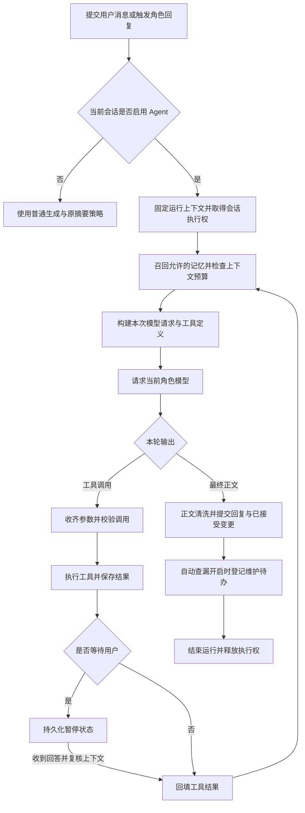

# Agent 工具调用与全局记忆仓库调研及实施计划

调研日期：2026-11-17。代码基线：`9ffae0a7`。

实施计划定稿：2026-11-18。本文直接交给 AI 实现。除明确标注为既有事实的调研材料外，本文的功能、接口、页面、迁移与验收条目全部纳入本次交付。记忆仓库可以单独交付并验收，其余工作包继续按本文依赖执行。

“当前项目代码评估”记录上述代码基线的现状，其余实现章节规定目标行为。执行 AI 开始工作时先读取项目开发约定并核对最新代码，在保留同等目标行为的前提下适配新增代码。本文定稿仅完成文档编写，不表示目标功能已经实现或验收通过。

架构复核：2026-11-18，复核提交 `beb377c7`。本次复核同时检查项目分层、单聊／群聊实际调用链、协议适配、事务和 Android 生命周期，并将结论直接修订为本文的实现约束。全部交付范围保持不变；下面的审查项均有确定的处理规则，不存在留给执行 AI 自行选择的架构悬项。

记忆仓库专项复核于 2026-11-18，基线 `ad94c749`。先独立实现三类记忆的存储、管理、普通回复注入及数据生命周期，再让 Agent 复用已交付的仓库。具体入口、表结构、注入算法和独立验收均列在本文的[记忆仓库实施设计](#memory-store)中。

## 架构审查结论

本项目采用“保留普通生成路径，按会话旁路接入 Agent；工具执行与记忆仓库独立”的架构。现有 Feature + MVI、Koin、Room、Kotpref 和 OkHttp 是实现边界。共享的是领域能力、协议编码及工具执行规则，单聊与群聊各自的历史选择、输出清洗、消息替换和取消语义继续保留。

原计划覆盖面完整，但仅按组件表实现不足以保证兼容。以下问题必须按修订后的约束实现，并作为交付阻断条件：

| 审查发现 | 具体风险 | 本文确定的处理规则 |
| --- | --- | --- |
| 关闭 Agent 只约束“不调用工具” | 普通聊天仍可能经过能力预检、新预算、任务宿主及限额，改变原行为 | 先分流；关闭路径沿用原入口及请求／提交链，不经过 AgentRuntime |
| 将两种聊天抽成统一提交实现 | 单聊流式重生成可保存 partial，群聊原位重生成要求完整结果，容易互相覆盖语义 | 两个会话适配器分别调用原有领域规则，仅 Agent 分支增加原子变更提交 |
| 会话运行锁缺少持有和重入规则 | 工作流调用 Agent、Agent 调用工具、关闭等待运行时可能相互死锁 | 短命令互斥加持久化运行归属；下层复用执行令牌，取消不等待长锁 |
| 预算只写“最终请求” | Provider 系统指令在现有 Finalizer 之后注入，仍可能漏算或重复注入 | Agent 分支在发送投影上计量；普通分支保留现有注入与预算行为 |
| 记忆召回直接参与原预算淘汰 | 即使只加记忆，也可能额外淘汰历史、改变世界书状态与摘要边界 | 普通聊天记忆只使用剩余额度；原有内容、激活及覆盖边界不因记忆改变 |
| 将运行恢复信息视作调试日志 | 关闭日志时无法恢复，存入主库又可能进入系统备份 | 恢复载荷独立私有存储；主库只保留必要运行元数据及业务结果 |
| 提案“与清洗后的正文核对”缺少可执行依据 | 模型可以给尚未发生的事件伪造证据，重生成也可能读到旧回复记忆 | 保存来源版本及可验证证据范围，无法核验的事件提案不自动提交 |
| Room 复合唯一键包含 nullable 归属 | SQLite 将多个 NULL 视为不同值，可能产生重复空间；REPLACE 还会删旧行 | 非空规范化唯一键、外键与结构约束；修订和关联主体不用 REPLACE |
| 通用工具模型忽略协议专用续接 | 文本正确仍可能因推理 Item、签名或 tool_result 顺序而被服务拒绝 | 有序调用模型加协议私有续接段，分别验证五协议回放 |

按 `ad94c749` 复核可维护性后，执行方案采用以下取舍。用户控制模型读到的文字和使用哪些工具；协议、权限和写入一致性由代码执行。

| 原方案容易产生的问题 | 修订决定 |
| --- | --- |
| Runtime 中各自拼提示，角色预设的空值又可能被默认文案覆盖 | 扩展现有提示词预设目录、覆盖表和快照。普通召回、Agent、提取和工作流在各自入口解析一次 |
| 配置描述、表单预览和五个协议各存一份工具定义 | 编辑、预览、授权筛选和协议编码使用同一份有效定义。工具身份与可编辑文案分开 |
| 为一次本地提交建立额外 Repository，再给三个记忆表各写一份业务校验和锁逻辑 | AgentRunRepository 持有提交事务，三张表通过类型化 DAO 共享字段与校验。跨会话改同一记忆由条件更新处理 |
| 对每轮回复预扣维护和重试额度，提取模型故障连带阻塞聊天 | 先保证角色回复，维护消耗剩余额度。来源仍在 Room 时保留未处理范围，允许继续聊天 |
| 只因一项工具失配而挡住整批任务，或把各供应商的真实账号作为本地回归的前提 | 按实际节点、角色和所需能力检查；共用确定性协议夹具，真实服务验证单列结果 |
| 从哪个页面进入就在哪里再写一份编辑、计数或授权逻辑 | 按业务归属划分模块。四个记忆入口共用按目标打开的编辑器和仓库；聊天页只订阅当前运行并发送用户操作 |

按当前代码估算，管理入口和预设字段扩展的复杂度较低，可直接复用现有页面。独立记忆仓库为中等偏高，主要工作在分支、来源修订、备份和普通 Prompt 预算兼容。完整 Agent 接入为高复杂度，集中在五协议的流式续接、跨轮取消和提交，以及群聊按成员恢复。实施顺序先验收可独立使用的记忆仓库，再让工具和工作流调用已经验证的能力。

## 必须完成的交付范围

- 将 Agent 流程直接融入现有单聊、群聊页面，同时实现工具配置、全局记忆中心和任务页面，普通聊天不要求切换到专用 Agent 页面。
- 单聊和群聊复用一个运行引擎，各自保留当前 Prompt Builder、消息提交和显示规则。
- 工具通过统一契约和注册表扩展。新增符合既有契约的工具，只需补充定义、处理器、注册和必要验证，运行循环及各协议适配器无需增加工具名分支。
- 在现有提示词预设页开放 Agent、记忆及收尾指令，在工具设置开放模型可见描述和声明式工具编辑。单聊和群聊分别选择本会话的 Agent 预设及工具集，工作流节点可添加本步任务。
- 保留 OpenAI Compatible、OpenAI Responses、Anthropic Messages、Gemini GenerateContent，新增可独立选择的第五种协议 Gemini Interactions。五种协议都支持普通生成和 Agent 工具调用，覆盖流式、非流式与结果回传。
- 实现每个单聊和群聊独立的 Agent 开关，设置随会话持久化；旧数据迁移关闭，新建复制默认 false 的全局初始值。全局初始值只影响新建会话，同一角色的既有会话互不影响。
- 群聊保留外层成员选择与顺序发言，在每个角色的一次回复内部增加工具循环。
- 实现内置工具表中的全部读写工具，包括剧情状态、用户交互、记忆范围提升、联网查询和图片生成。
- 全局记忆仓库独立于当前单段会话记忆／摘要，统一管理多条记忆，并在数据访问层区分角色通用、会话共享和会话内角色私有范围。
- 长期记忆按事实和事件维护；上下文摘要按预算需求执行。接入 Agent 不会自动替换现有按消息数触发的摘要逻辑，需要显式改造。
- 实现内置工具、配置化 HTTP 工具、远程 MCP、流程模板和受控后台任务。工具扩展宿主采用本文的统一契约，不建立 ST DOM 或 Node.js 插件宿主。

## 术语与职责

| 概念 | 本文含义 | 与其他能力的关系 |
| --- | --- | --- |
| 工具 | 带参数定义、执行入口和结果契约的能力 | 可以读取资料，也可以修改受控数据 |
| 工具循环 | 模型请求工具、客户端执行、结果回传、模型继续生成 | 一次循环可能包含多个调用，也可能直接结束 |
| Agent | 在给定目标、上下文和能力范围内选择下一步的运行过程 | 角色模型可以直接承担，不要求先引入规划器或多个模型 |
| 工作流 | 由程序或用户预先规定的步骤和分支 | 可以在某个步骤嵌入 Agent，也可以调用同一套工具 |
| 插件 | 工具、事件处理或其他扩展能力的交付机制 | 不决定聊天必须使用哪个页面 |
| 长期记忆 | 可单独检索、修正和失效的事实、事件或约定 | 保存到独立仓库，按作用域使用 |
| 剧情状态 | 当前地点、物品归属、属性、任务阶段等当前值 | 适合结构化存储并记录变更 |
| 会话摘要 | 对一段历史的剧情脉络压缩 | 服务上下文管理，不代表全部长期事实已经提取 |

## SillyTavern 现状与参考价值

### 已核实能力

ST 的 UI 扩展运行在浏览器环境，通过事件和内部 API 接入聊天；服务端插件运行在 Node.js 侧。二者依赖的宿主能力不同。[UI Extensions](https://docs.sillytavern.app/for-contributors/writing-extensions/)、[Server Plugins](https://docs.sillytavern.app/for-contributors/server-plugins/)

ST 提供函数工具注册、结构化参数、客户端执行和继续生成。普通调用可以在聊天中查看结果，默认递归上限为五轮，需要用户开启且 API 与模型支持。续写、用户代写和 quiet 等生成类型有额外限制；不能把“接口所属供应商支持工具”视为所有模型均可用。[Function Calling](https://docs.sillytavern.app/for-contributors/function-calling/)

截至 2026-11-18，ST 官方仓库仍将内置 MCP 客户端列为开放的功能请求。社区扩展可以连接远程 MCP 服务，将发现的工具注册到 ST 的 Function Calling 接口，供聊天中的模型调用。本文的“远程 MCP”指 RPClient 自行实现的客户端能力，独立于本地记忆仓库和内置记忆工具。[ST 官方功能请求](https://github.com/SillyTavern/SillyTavern/issues/3335) · [社区扩展的远程服务配置示例](https://github.com/Inversity/SillyTavern-MCP-Servers-Universal)

STscript 支持命令串联、管道、变量和条件，Quick Replies 提供脚本保存及事件自动执行，可用于组合多步流程。[STscript](https://docs.sillytavern.app/usage/st-script/)

### 对 RPClient 的启示

以上能力说明聊天宿主可以承载工具循环和脚本流程。RPClient 按本文实现自己的运行与扩展契约；ST 的相关资料用于能力与协议参考，不作为所有 Agent 编排功能都已由 ST 核心统一提供的证据。

RPClient 使用工具注册、按生成类型开放能力和限制循环等机制。Android 原生界面、现有 Repository 和本地数据生命周期作为项目边界；仅增加 JavaScript 引擎不足以兼容依赖 DOM、ST 上下文及 Node.js API 的插件。

## 当前项目代码评估

| 范围 | 当前实现与证据 | 接入需要补充的内容 |
| --- | --- | --- |
| 协议适配 | [LLMClientFactory](../app/src/main/java/me/kafuuneko/rpclient/libs/llm/LLMClientFactory.kt#L35) 已统一创建 OpenAI Compatible、Responses、Gemini GenerateContent 和 Anthropic 四种客户端 | 扩展四个既有适配器，新增独立的 Gemini Interactions 适配器与配置入口 |
| 通用模型 | [LLMModels](../app/src/main/java/me/kafuuneko/rpclient/libs/llm/model/LLMModels.kt#L142) 仅有 System、User、Assistant；请求、响应及事件未表达工具循环 | 增加工具定义、调用、结果、调用完成和协议续接数据 |
| 内容块 | [LLMContentBlock](../app/src/main/java/me/kafuuneko/rpclient/libs/llm/model/LLMContentBlock.kt#L4) 表达文本和图片 | 新增独立工具对话结构，保存调用与结果顺序；原聊天内容块不承载工具过程 |
| 空响应校验 | [LLMResponseValidator](../app/src/main/java/me/kafuuneko/rpclient/libs/llm/LLMResponseValidator.kt#L24) 以有效正文作为主要成功条件 | 新工具方法接受合法工具响应，原文本方法继续拒绝空正文 |
| Responses 边界 | [响应编码器](../app/src/main/java/me/kafuuneko/rpclient/libs/llm/adapter/OpenAIResponsesResponseCodec.kt#L82) 遇到客户端工具 Item 明确报告等待结果 | 为已支持的函数调用接入执行器；其他未实现类型继续明确失败 |
| 单聊生成 | [generateCommittedReply](../app/src/main/java/me/kafuuneko/rpclient/feature/chat/ChatViewModel.kt#L701) 构建请求后执行一次流式或非流式生成 | 将一次模型请求扩展为一次角色运行 |
| 群聊调度 | [generateReplyBatch](../app/src/main/java/me/kafuuneko/rpclient/feature/groupchat/GroupChatViewModel.kt#L2068) 顺序执行选定成员 | 每位成员内部运行工具循环，完成后继续下一位 |
| Prompt 最终化 | [PromptRequestFinalizer](../app/src/main/java/me/kafuuneko/rpclient/libs/prompt/request/PromptRequestFinalizer.kt#L49) 负责后处理、预算和同源检查报告 | 计入工具定义、返回结果和续接数据，保护调用与结果的完整关系 |
| 用量统计 | [LLMTokenUsageTrackingClient](../app/src/main/java/me/kafuuneko/rpclient/libs/llm/LLMTokenUsageTrackingClient.kt#L33) 记录单次模型请求 | 增加运行聚合，估算覆盖工具相关输入及输出，避免重复计数 |
| 内容检索 | [ContentSearchRepository](../app/src/main/java/me/kafuuneko/rpclient/libs/room/repository/ContentSearchRepository.kt#L82) 提供统一搜索、分页与结果复核 | 封装面向工具的限定范围和短结果格式 |
| 正则兼容 | [JavaScriptRegexCompiler](../app/src/main/java/me/kafuuneko/rpclient/libs/regex/JavaScriptRegexCompiler.kt#L3) 转换 JS 风格表达式并使用 Kotlin Regex | 继续只处理对应文本，不承担通用插件执行 |
| 持久化 | [AppDatabase](../app/src/main/java/me/kafuuneko/rpclient/libs/room/AppDatabase.kt#L67) 已管理角色、会话、摘要等业务表 | 新增运行、调用、记忆及修订数据并提供迁移 |

Responses 已可通过高级 JSON 配置某些服务端托管工具；现有原生接入文档也明确声明没有通用客户端工具执行器。两者需要分别建模，不能将服务端工具输出再误交给本地执行。[现有 Responses 契约](archive/OpenAI-Responses接入与规范复核.md)

## 实现架构与分层

### 框架约束与技术选择

每个工作包先读编码规范主入口，再按改动读取专题。页面遵守 Feature + MVI，运行与存储按项目已有的领域和数据层分工。跨模块公开能力的中文 KDoc 写明调用方需要知道的归属、可见范围及取消或提交语义。格式化和验证只覆盖本次改动。[编码规范](coding-guidelines.md) · [项目结构与分层](guides/project-structure-and-layers.md) · [Room 数据层](guides/room-data-layer.md) · [Koin 与 Kotpref](guides/koin-and-kotpref.md) · [RPClient 领域规范](guides/rpclient-domain.md) · [注释与 KDoc](guides/comments-and-kdoc.md)

| 方案 | 适配本项目的成本与取舍 | 决定 |
| --- | --- | --- |
| Kotlin 类型化状态机、现有 LLMClient、协程、Room 和 OkHttp | 可在四个既有协议旁接入第五个适配器，复用高级 JSON、Prompt Inspector、Regex 及本地数据生命周期 | 采用；只增加业务包，不重写 libs/core 或拆分 Gradle 工程 |
| 完整 Agent 框架接管 Prompt、模型和检查点 | 框架具有执行与持久化能力，但还需接入本项目现有的角色、群聊和提交规则 | 本次不引入 Koog 等编排框架，避免同时维护两套生成及恢复权威来源 |
| MCP 官方 Kotlin SDK 的完整客户端 | 已提供 Streamable HTTP 和续流，公开传输接口使用 Ktor HttpClient | 本次用现有 OkHttp 实现本文限定的 MCP 客户端，复用项目网络取消及日志边界 |
| 服务端 Agent 或新的独立聊天宿主 | 需要增加部署、身份和同步，并移动本地角色与对话资料 | 保持 Android 本地执行，任务页只是同一运行系统的管理入口 |

以上是结合当前代码与交付范围作出的架构选择，并非声称外部框架不具备相关能力。Koog 的状态机、工具与检查点设计可作为实现参考；官方 MCP Kotlin SDK 可作为传输互操作参考。[Koog Agents](https://docs.koog.ai/agents/)、[Koog Persistence](https://docs.koog.ai/features/agent-persistence/)、[MCP Kotlin StreamableHttpClientTransport](https://kotlin.sdk.modelcontextprotocol.io/kotlin-sdk-client/io.modelcontextprotocol.kotlin.sdk.client/-streamable-http-client-transport/index.html)

Repository 作为数据入口、单向数据流及协程／Flow 的使用也与 Android 官方建议一致。应用作用域只用于需要跨页面的 Agent 工作，普通聊天继续使用原有 ViewModel 任务生命周期。[Android 架构建议](https://developer.android.com/topic/architecture/recommendations)、[协程最佳实践](https://developer.android.com/kotlin/coroutines/coroutines-best-practices)

### 依赖方向与目录

```text
feature/chat、feature/groupchat
    ├── 普通分支：原生成逻辑 → 原 Builder → LLMRepository → 原提交规则
    └── Agent 分支：AgentRunManager → ChatAgentRuntime / GroupChatAgentRuntime
                                      ↓
                              AgentRuntime → ToolExecutor → AgentTool
                                      ↓                         ↓
                              LLMRepository                领域 Repository
                                      ↓                         ↓
                             五协议 Codec              AppDatabase → DAO

feature/memorycenter、feature/memoryedit → MemoryRepository
普通 Builder 的可选记忆块 ← MemoryRetriever（不依赖 AgentRuntime）
feature/agenttasks → AgentRunManager / WorkflowRepository
WorkflowRuntime → 同一执行令牌下的 AgentRuntime / ToolExecutor
AgentExecutionService → AgentRunManager（只提供系统宿主）
```

| 位置 | 必须放置的内容 |
| --- | --- |
| libs/agent/model/、libs/agent/runtime/ | 执行上下文、状态机、限额、控制命令、单聊与群聊适配器及工作流运行 |
| libs/agent/tool/、libs/agent/connection/ | 工具契约、Registry、Executor、内置处理器、HTTP／MCP 协议与传输 |
| libs/memory/ | 召回、来源验证、维护、冲突计算及记忆 Prompt 数据块构建 |
| libs/llm/model/、libs/llm/adapter/ | 工具对话的通用传输模型、五协议编解码、受控续接段及能力设置 |
| libs/prompt/、libs/groupchat/ | 各自的原 Prompt 构建和可选草稿输出；单聊与群聊不互相套用 Builder |
| libs/room/entity/、dao/、repository/、migration/ | 所有权威实体、DAO、跨表事务与结构迁移；Repository 的唯一 AppDatabase 入口 |
| libs/upgrade/ | 确有跨偏好／文件存储的幂等业务升级，结构迁移完成后执行 |
| feature/memorycenter/、feature/memoryedit/、feature/toolsettings/、feature/agenttasks/ | 各自 Activity、ViewModel、presentation/ 和 ui/，继续使用项目 MVI 基类 |
| libs/agent/service/、RPClientApp.kt | 前台服务桥接、应用作用域和 Koin 装配 |

当前 Gradle 工程只有 `:app`。沿用其内部按业务组织的模块，在已有 Koin 装配处连接共享对象。DAO 由 Repository 使用，协议 Codec 只处理传入的请求和响应。运行与工作流共用现有 LLMRepository／LLMClientFactory 的高级配置、系统指令和统计。[工程模块](../settings.gradle.kts) · [应用装配](../app/src/main/java/me/kafuuneko/rpclient/RPClientApp.kt)

### 模块所有权与依赖边界

| 变更归属 | 公开给调用方的能力 | 实现留在模块内的部分 |
| --- | --- | --- |
| 角色与会话记忆 | 编辑页和工具把带类型的目标交给 MemoryRepository；两个 Prompt Builder 取得当前发言者可见的召回结果 | 数据入口负责目标路由、可见范围和事务，召回与来源规则归记忆领域。查询、编辑、提案提交共用相应规则。记忆代码可在没有任何 Agent 对象的情况下使用 |
| 工具与运行 | 会话适配器以当前角色和回复目标启动运行。状态机通过 ToolRegistry／ToolExecutor 取得有效定义并执行调用 | 状态机只解释调用、结果、等待和终止。具体工具处理器调用所属领域的 Repository 或连接；工具设置只修改定义、覆盖及授权。工作流的 Tool 节点走同一执行器 |
| 模型与提示词 | 运行层传入有序工具记录、有效定义及冻结的提示词快照。LLM 适配器返回协议事件和续接信息 | 协议层负责请求与回放格式，预设层负责选值与宏，记忆层负责选择事实。Codec 不读取授权、Room 或界面状态；提示词预设不引用工具处理器 |
| 页面与系统宿主 | 页面之间通过目的页公开的目标类别和 ID 导航。聊天页与任务页按 runId 观察同一运行，由各自 ViewModel 转成展示状态 | 草稿、筛选和对话框归所属 feature。设置入口、角色编辑、单聊及群聊不引用目标页的 ViewModel、私有组件或 UiState。服务和页面通过运行管理器发出命令，领域代码不依赖 feature |

接入聊天时先复用现成的 Prompt Builder、群聊输出清洗器和消息 Repository。若两个路径都需要一段目前写在 ViewModel 的业务规则，只移动该段到它所属的单聊或群聊领域包，由原入口和 Agent 适配器共同调用。原页面继续拥有流式展示、草稿、普通任务取消及返回状态；用普通路径的差异回归验证这次抽取。

按实际变更范围评审模块边界。增加一种符合现有契约的本地工具，改动应集中在定义、处理器、注册和该工具的验证。增加同类工具时如果还要改两套聊天 ViewModel 或五个协议 Codec，就把按名称分支的逻辑移回工具模块。调整某协议的结果编码只需改对应适配器和协议夹具。调整记忆目录的计数规则只需改记忆查询及其验证，四个入口继续使用原有导航和刷新契约。

单页使用的行组件、UiModel 和转换函数就近放在该 feature。两个页面确实共享相同交互时，只提取接收展示值和回调的无状态组件到 `ui/widgets` 或 `ui/dialog`。公开边界以外的实现收窄可见性；单一实现的小函数直接调用。依赖方向可以在改动的 import、构造参数和对应行为用例中核对。

### 组件职责

| 业务职责及其归属 | 主要职责 |
| --- | --- |
| AgentRuntime | 调度单次角色运行、循环限制、取消、等待用户及事件发布 |
| ChatAgentRuntime / GroupChatAgentRuntime | 分别准备本会话 Prompt、适配正文目标及原有清洗／取消规则；群聊承担 Agent 分支的外层顺序调度 |
| AgentTurnContext | 固定角色、模型、生成类型、会话 Agent 开关及策略版本、用户人设、历史边界、有效提示词快照与工具定义 |
| ToolRegistry | 按稳定标识注册工具实现，校验冲突并按运行上下文筛选本次可用工具 |
| AgentTool | 提供与模型协议无关的工具定义、参数校验及领域执行处理器 |
| ToolExecutor | 校验参数及范围，执行工具，产生结构化结果并处理幂等 |
| ToolProtocolCodec | 在协议适配器内转换统一工具定义、调用和结果，保留协议要求的续接信息 |
| ConversationAgentSettingsRepository | 读取和保存单聊／群聊的 Agent 开关，提供运行分发和提交所需的策略版本 |
| AgentRunRepository | 保存运行、步骤、调用和恢复引用。其提交方法在一个短事务内校验运行资格并提交正文、已接受变更、世界书状态及步骤结果 |
| AgentCheckpointStore | 在 noBackupFilesDir 原子保存恢复所必需的协议续接和调用结果；不随调试日志开关丢失 |
| AgentPromptComposer | 复用 Builder 的原始草稿快照，追加受保护调用链，完成 Agent 专用预算与发送投影 |
| NormalMemoryPromptComposer | 为普通角色回复增加可省略的只读记忆块，保证原有内容及世界书选择不被额外淘汰 |
| MemoryRepository | 管理记忆、作用域、来源、修订和可见性 |
| MemoryRetriever | 在允许范围内召回记忆，并参与预算选择 |
| MemoryMaintenanceRuntime | 处理已提交消息的事实提取、合并、冲突和待办恢复 |
| SceneStateRepository | 管理结构化剧情状态及对应变更 |
| HttpToolAdapter / McpToolAdapter | 将 HTTP 定义和 MCP 远程工具适配到统一工具契约 |
| WorkflowRuntime / WorkflowRepository | 保存、校验和执行流程模板，复用工具及角色运行 |
| AgentRunManager / AgentExecutionService | 在应用作用域管理运行、会话互斥、前台服务与页面订阅 |

每项职责都应接入真实调用路径。单聊和群聊适配器只提供准备、清洗和提交差异，工具循环仅在 AgentRuntime 实现一次。只被一处调用的计算和转换使用包内函数；Koin 注册跨页面或跨领域共享对象。运行层协调 Repository 和协议层，不持有 Activity 或 Compose 状态。ViewModel 启动运行、发送用户动作并将事件映射为 UiState；Compose 继续只渲染和发送 Intent。

组件名用于划清职责，不要求每个类都增加 Interface／Impl。仅在工具处理器、协议转换、存储或传输替换等真实多实现边界设置接口；Repository 和普通业务类保持项目现有的构造函数注入方式，不引入通用事件总线、反射插件加载或全量事件溯源框架。

记忆仓库独立于 AgentRuntime。手动编辑、普通聊天只读召回、历史提取和 Agent 工具使用同一仓库；仓库、管理页面与普通召回构成可独立使用的交付单元。Agent 自动维护依赖这个单元。

角色级、会话级配置和大型业务数据使用 Room；AppModel 仅保存必要的轻量全局默认项。新增依赖通过 Koin 注册，保持现有 Feature + MVI 分层。

### 调度、状态与运行归属

- AgentRunManager 是控制入口，提供 start、stop、answer、resume、pauseBatch 和 observe；start 返回 runId，observe 只读状态，重复订阅或旋转屏幕不会再次执行请求。
- 应用作用域使用注入的 CoroutineScope 和 SupervisorJob，每个根运行的子任务保持结构化并发；一个会话失败不取消其他会话，一个运行停止会取消自己的模型、工具和维护子任务。不得使用 GlobalScope。
- 状态机显式表达 Preparing、RequestingModel、ExecutingTools、WaitingForUser、Committing、Maintaining、Cancelling 以及终态。成功正文已提交而维护失败时使用 CompletedWithWarnings，避免把重试维护误当成重新生成正文。
- 持久化状态与检查点驱动恢复和页面展示；高频文本增量只走有界事件流并节流更新 UiState。运行中的原始工具返回、凭据及协议 JSON 不放 UiState，也不逐 Token 写 Room。
- ConversationRef 在 Kotlin 中区分 Single(chatId) 与 Group(groupId)；持久化保留可校验的两种外键。每个 Agent 根运行获得包含 ownerRunId、策略版本、历史版本和 executionEpoch 的执行令牌。
- 自身成功提交后的历史版本在同一事务推进并回写令牌，不能让下一成员误把前一成员的正常提交视作外部冲突。正文、目标身份、成员和权限变更参与提交校验；可编辑的模板文案、说明及预算默认值在新运行读取，列表浏览和单纯活跃时间更新不导致无关中断。
- 短命令 Mutex 只覆盖准入和状态转换，不跨网络、模型、等待用户或耗时维护持有。活动运行的排他性由持久化运行归属加提交版本校验维持，不把长时间 withLock 当作运行状态。
- 工作流取得一次根运行归属，Agent 节点、Tool 节点和维护器复用该令牌；这些下层操作不再次获取根归属。同一根运行按调用顺序提交。不同会话更新同一角色通用记忆时由 Room 事务和 expectedRevision 仲裁，冲突返回最新版本供核验。
- WaitingForUser 释放协程栈、连接和物理锁，保存问题、剩余调用及执行令牌。继续普通聊天须先终止该等待运行；恢复前原子比较版本，不能在变更后的历史上直接回填旧结果。
- 关闭与停止命令先更新持久化执行资格，再取消 Job 并等待短收尾，不能先等待运行锁或 cancelAndJoin 再撤权。活动运行无法永久阻塞关闭操作。
- 以上 Agent 归属、限额与状态系统只管理开启路径；普通生成的现有 Job／摘要互斥继续按原实现工作。关闭切换完成前完成一次交接，之后普通请求不依赖残留 Agent 运行记录是否可读。

现有普通生成、摘要和代写 Job 通过只记录活动标记的 ConversationGenerationActivityRegistry 暴露繁忙状态，所有权和取消仍归原 ViewModel。标记在读取本次执行模式前注册，Agent 准入原子检查其他活动标记，允许复用当前发起操作的标识；普通操作未结束时拒绝在同一会话另启 Agent。标记在原 finally 清理，不创建 AgentRun、不加长运行锁，也不改变普通操作的原并发判断。页面不把 ViewModel 或 Context 保存到该 Registry。这样可避免普通生成中开启开关后，从任务页抢先启动另一条写入链。

Runtime 不能通过回调要求页面负责最终写库：在无页面或进程恢复时，ChatAgentRuntime／GroupChatAgentRuntime 与 AgentRunRepository 负责完成业务收尾。Activity 仅处理导航、通知权限及系统选择器。聊天遇到记忆确认或 ask_user 时，任务卡摘要提示“等待确认”或“等待你回答”。用户点击处理入口后，由既有 DialogSwitch 展示对应的确认或回答界面。

Koin 注册不自动启动执行。Application 启动只恢复元数据和标记异常中断，不自动握手外部工具、请求模型或重放写调用；这些动作须由明确的新运行、连接测试或用户恢复操作触发。

## 用户可编辑的提示词、工具与策略

### 在现有预设中编辑 Agent 提示词

沿用设置中的提示词预设列表和编辑器。系统默认预设可预览、复制；用户在副本编辑、保存、启用或逐字段恢复默认。在编辑器增加 Agent 分组及适用场景筛选，显示字段用途、可用宏，用同一渲染函数和示例数据本地预览。在单聊／群聊的 Agent 设置显示当前预设名称，提供选择与跳转编辑。工具和记忆的展示名称、说明及错误提示走现有本地化资源，用户输入的模板正文原样保存。[现有编辑目录](../app/src/main/java/me/kafuuneko/rpclient/feature/promptpreset/model/PromptPresetCatalog.kt) · [预设仓库](../app/src/main/java/me/kafuuneko/rpclient/libs/room/repository/PromptPresetRepository.kt)

| 在何处使用 | 可编辑字段及建议稳定键 | 渲染时机 |
| --- | --- | --- |
| 单聊／群聊角色运行 | `agent_instruction` 定义角色使用 Agent 时的目标和行为，`agent_group_instruction` 补充群聊发言要求，`agent_tool_guidance` 说明何时查询、写入或询问用户 | 在现有角色与会话提示基础上，将相应非空指令作为带来源的独立草稿加入基础上下文。每个角色构建一次，工具轮次沿用 |
| 收尾及工具错误 | `agent_finalize` 定义停止调用工具时如何回复，`agent_tool_error_guidance` 定义收到可恢复错误时的应对方式 | 分别只进入实际收尾请求或包含错误结果的下一次模型请求。调用 ID、错误码和原生结果块仍由 Codec 成对发送 |
| 记忆展示 | `character_memory_context` 定义含 `{{memory}}` 的参考块，`character_memory_item` 定义含 `{{fact}}` 的单条格式 | 先过滤权限并逐条渲染，再按预算组块。普通召回和 Agent 共享格式；普通路径只接受允许的通用条目 |
| 手动提取与自动维护 | `memory_extract` 定义应记住什么、如何判断长期价值及冲突，复用于单聊、群聊与用户显式发起的提取 | 当前范围、允许读取的来源和待比较条目由调用方提供。增量字段、类型、证据校验和提交规则由提取器执行 |
| 上下文压缩 | 单聊、群聊直接使用相应预设已有的 `summarize`、`group_summarize`；Agent 特有的压缩侧重点放在可选字段 `agent_compaction_guidance` | 只有实际发起 Agent 压缩时追加。原手动／普通摘要只读取原字段 |
| 工作流和图像请求 | 在流程编辑器编辑 Model 节点指令、Agent 节点任务补充、AskUser 提问及选项；在工具设置编辑图像／搜索请求模板、参数绑定与结果映射 | 节点文字属于 WorkflowNode，接口映射属于 ToolDefinition。引用本步获准访问的变量，带入已冻结的运行快照 |

引入新键时同步更新 `PromptType`、`availableMacros`、编辑目录和实际调用方。默认指令只在对应模板默认值定义一次，业务代码按键取值。只在 `prompt_preset_entries(presetId,promptKey,content)` 保存用户覆盖，恢复默认删除覆盖行。旧预设缺项自动得到新键默认值，显式空串表示省略该段。记忆外层或条目模板清空时省略对应内容；非空格式模板保存、导入时提示并定位缺失的正文槽。可选行为指令清空后，Runtime 仍依据模型原生工具调用、预算和授权执行。复用 MacroExpander 与各字段实际需要的 MacroScope，名字、人设和群成员取本轮快照。事实、证据和工具结果按字面数据处理，插入的 `{{char}}` 不再作为模板执行。[模板及稳定键](../app/src/main/java/me/kafuuneko/rpclient/libs/prompt/preset/PromptType.kt) · [快照的缺项与空串语义](../app/src/main/java/me/kafuuneko/rpclient/libs/prompt/preset/PromptTemplateSnapshot.kt) · [宏值类型](../app/src/main/java/me/kafuuneko/rpclient/libs/macro/MacroScope.kt)

会话的 `agentPromptPresetId` 为可空正 ID，外键指向 prompt_presets，删除预设时 SET NULL。NULL 表示跟随现有全局活动预设，系统默认虚拟 ID 保持在预设层。此选择只覆盖 Agent／其维护和压缩使用的**新增字段与相应摘要任务字段**；角色基础提示仍按原角色卡、群聊覆盖及全局生成配置解析。普通角色记忆格式和用户显式提取使用原全局活动预设。分支复制会话选择，整库备份保留引用。新会话默认跟随全局。

一次根操作在开始时捕获基础预设及选中预设的有效值、ID 和 revision，群聊逐个角色展开宏。工作流节点文字只补充当前步骤。两个入口共用现有 Repository 的快照解析，按 ID 读取时也带上当前实际构建偏好。运行中编辑、切换或删除模板只影响新操作；恢复使用检查点中已采用的值，授权撤销仍即时生效。Inspector 标明渲染来源、模板键和修订，展示最终进入请求的内容。预设列表增加版本化 JSON 导入／导出，沿用 Activity 的系统文件选择器。导入为新自定义副本，保留未知键和显式空值，用户主动选择才启用。文件只携带预设元数据和字段覆盖。

例如全局启用“日常”，群聊甲选择“调查”。甲中 A、B 两位发言者分别读取自己的角色卡，工具指导都来自“调查”。B 发言前用户修改了“调查”，此批仍沿用原快照。下一批才用新版。甲关闭 Agent 后，若普通记忆召回开启，就用“日常”的记忆格式；若召回也关闭，按原 Builder 生成请求。错误恢复和收尾指令通过 Composer 在合法位置添加，原生调用和结果之间始终相邻。

### 工具和策略的自定义边界

| 用户可配置的对象 | 编辑与生效方式 | 客户端负责的契约 |
| --- | --- | --- |
| 内置本地工具 | 在工具设置编辑显示名、模型调用别名、工具及参数说明、适用提示和该工具声明可调的默认参数。恢复默认删除覆盖。会话工具集可以逐个关闭，包括记忆写入、提升和 ask_user | 稳定工具 ID、处理器、参数类型、受众、执行性质和授权判断。关闭 ask_user 后，必要的应用授权仍走应用确认流程 |
| 用户定义的 HTTP 工具 | 创建、复制、编辑、测试、删除、导入和导出工具，自定义模型调用名、说明、参数 Schema、连接及结构化请求／响应映射，按会话选用。联网搜索和出图提供可复制的配置模板 | 执行器校验映射与参数，凭据由连接注入。自定义工具与内置工具走相同五协议调用路径 |
| MCP 工具 | 选择连接及暴露的工具，设置本地别名、说明和会话授权。服务刷新后保留仍适用的用户覆盖 | 原始工具名、远程调用契约和连接身份用于工具回传。参数变动使旧映射失配时只停用受影响工具并说明原因 |
| 工具策略和工作流 | 在会话 Agent 设置选择工具集、写入确认方式、维护模式、预算、水位、超时、后台继续；普通回复的召回条数和 Token 上限放在记忆设置。流程编辑器管理任务、节点、变量、条件和结果 | 共享额度由根运行计量；可见范围、协议体积上限、取消及已撤销权限由程序保证 |

按稳定工具 ID 保存稀疏覆盖。内置处理器从注册表取得，工具定义表保存配置化工具与用户覆盖，五协议共用一次合并后的有效定义。名称冲突在保存或导入时定位到工具；展示名允许重复，模型调用名在一次可用工具集中须唯一。参数预设只用于契约允许省略且已有默认语义的字段；执行前仍须校验最终实参。工具配置导入生成待选配置，凭据引用在本机绑定，既有会话的启用状态和授权由用户选择。需要新的本地 Android 能力时按下一节增加处理器；用户可以直接通过设置新增 HTTP 工具、接入 MCP 工具或编排已有工具。

编辑器允许为模型设置面向任务的工具描述和用例，将覆盖后的描述放入原生工具定义。工作流节点、会话授权和执行记录引用稳定 ID。恢复时用检查点中的别名表解析已经发出的调用，重新检查当前授权。改名、改示例及改模板不撤销运行，停用或收紧权限立即生效。协议强制字段与类型化结果由 Codec 生成，模型可见的自然语言指导统一来自预设、节点或工具定义。

## 工具扩展契约

工具业务实现与协议编码分别扩展：AgentTool 通过 Repository 完成领域动作；ToolProtocolCodec 统一处理该协议的 Schema、调用与结果格式。工具不直接生成 Provider 请求体，也不自行启动下一轮模型请求。

### 工具定义与执行接口

| 契约部分 | 实现内容 | 扩展规则 |
| --- | --- | --- |
| 稳定身份 | toolId、契约版本、名称与描述 | 标识不依赖展示名称；重复标识或不明确的版本在注册阶段拒绝 |
| 输入输出 | 参数 Schema、结构化结果契约和支持的内容类型 | 使用已定义的通用 Schema 子集，具体协议转换由适配层处理 |
| 可用条件 | 生成类型、角色与会话范围、所需模型能力 | 请求前筛选，执行时再次复核当前策略 |
| 执行性质 | 只读、非确定性读取、本地写入或外部写入 | 决定结果回放、幂等、并发和提交规则；骰子重试也要复用原结果 |
| 执行策略 | 超时、返回体积、是否可并行读取、可取消性 | 公共执行器统一落实，不由每个处理器复制一套流程 |
| 领域处理器 | 接收受控上下文和已校验参数，返回结构化结果 | 通过依赖注入取得业务依赖，不持有 Activity、Compose 状态或页面 ViewModel |

执行上下文由客户端提供，包括会话、当前角色、实际人设、runId、调用 ID、策略版本和暂存视图。工具结果统一表达成功、错误或等待用户，并分别标记变更处于 proposed 还是 committed；AwaitingUser 不提前作为已完成结果回传模型。

客户端 invocationId 与远程 callId 分开：前者由 runId、执行步骤 ID 及本步骤调用位置稳定确定，作为幂等主键；模型步骤关联 modelRequestId，直接 Tool 节点关联节点执行 ID。后者仅用于协议关联。流式重复事件或恢复不能生成新的 invocationId，无远程 ID 的协议也可安全关联；不能假定不同模型请求绝不会复用同一个 callId。

通用参数 Schema 实现 object、array、string、integer、number、boolean、null、enum、required、nullable、数值范围、字符串长度、数组长度及 additionalProperties。使用类型化 Schema 树并保留远程原始定义，区分字段不存在与显式 null；各协议按自身支持的字段编码。对象默认禁止未声明字段，最大嵌套八层，调用参数最多 64 KiB。协议编解码器显式转换该子集；超出契约的远程工具显示不可用原因，执行端仍完整校验参数。

协议的 Schema 编码能力与本地校验能力分别记录。能够完整表达语义时原生编码；只有本地可落实的长度等限制可以在明确记录“仅本地校验”的情况下转成参数说明，并在执行前强制校验，不把它宣传为模型服务已保证。字段类型、可空语义、必填关系或授权所必需的身份关系不能无声弱化。内置工具使用五协议可编码的定义，Schema 不可适配的远程工具明确不可用，不能导致其余工具全部失效。

OpenAI strict=true 要求对象 additionalProperties=false 且全部属性列入 required。Codec 显式选择 strict：定义满足约束且模型支持时开启；不满足时明确使用受支持的 strict=false，能力限制为 strict-only 时拒绝该定义。不能擅自把“省略字段”改成“传入 null”，更不能依赖 Responses 对省略 strict 的自动归一化改变工具语义。[Strict mode](https://developers.openai.com/api/docs/guides/function-calling#strict-mode)

运行引擎依赖 ToolRegistry 查找处理器，再交由 ToolExecutor 执行。Koin 装配工具集合，新增工具不要求在单聊、群聊、循环和五个协议适配器中逐处登记业务分支。

### 增加一个工具的流程

- 定义稳定标识、输入输出 Schema、作用域要求和执行性质。
- 实现领域处理器，复用既有 Repository 或增加必要的业务封装。
- 注册到工具集合，并提供需要的本地化展示与配置入口。
- 对新增算法、执行边界或协议兼容点完成必要验证；复用公共五协议契约测试核对工具能被编码和回传。
- 实现文本、JSON 和本地资源引用结果，图片生成结果保存为资源引用并通过结构化元数据回传模型；资源由页面通过 Repository 读取并展示，不把 Base64 写入普通结果或日志。

运行保存本次工具标识、版本及定义快照。恢复时发现工具已经卸载、禁用或契约版本不再可用，明确结束并提供重新发起入口，不能自动替换为新版本后重执行旧写入。工具定义或授权变化不在活动运行中静默生效；撤销权限时取消受影响的运行。

## 每个会话独立的 Agent 开关

### 存储与生效范围

记忆仓库迁移先为 ChatSession 和 GroupChatSession 增加 inheritCharacterMemory（默认 true）与 recallMemoryInNormalChat（默认 false）。Agent 迁移另增 agentEnabled、agentSettingsVersion、continueInBackground 和 agentPromptPresetId，默认分别为 false、0、false 和 NULL。各字段由 Repository 保存。基础字段以会话表为唯一来源，工具集、预算及范围策略保存到会话关联表，不在两处复制 agentEnabled。开关属于会话，不绑定到角色卡或 Provider，也不能只保存为一个全局偏好。

- 同一角色的会话 A 开启、会话 B 关闭时，两者各自分发；修改 A 不改变 B。
- 群聊开关决定该群聊是否使用成员内部 Agent loop；成员工具授权和模型能力是其上的进一步限制。
- 开启群聊自动发言不隐式开启 Agent，关闭 Agent 也不关闭原有普通自动发言能力。
- 提供全局 defaultAgentEnabled 设置，初始 false，仅在新建会话时复制为会话初始值；历史迁移固定为 false，既有会话不随全局值改变。
- 从现有会话创建分支时复制该会话当时的开关值，新分支之后独立修改。
- 全量备份恢复包含各会话的开关；缺少字段的旧数据按 false 处理，不依据当前全局默认值批量开启。

### 开关的行为契约

| 状态或操作 | 预期行为 |
| --- | --- |
| Agent 关闭 | 使用原普通生成路径；除显式开启的只读角色记忆外，执行、调度、请求、持久化及摘要规则与接入前一致 |
| Agent 开启 | 按当前角色、模型能力和工具授权构建定义，并启动受限制的运行循环 |
| 普通生成期间开启 | 保存设置供下一次新运行使用，不把正在进行的普通响应中途升级为 Agent |
| Agent 运行或等待用户期间关闭 | 短事务先保存关闭、递增策略版本并撤销执行资格，再取消并等待本地收尾；切换中阻止新请求，收尾完成后 UI 显示关闭；同时停止尚未执行的 Agent 调度及相关维护待办 |
| 重新开启 | 新运行使用最新快照；已关闭或中断的旧调用不会自动恢复 |

每次切换时递增策略版本，并与开关原子保存；本地自动写入在提交事务内复核开关、策略版本、executionEpoch 和目标修订，每次调度也复核执行资格，防止迟到结果继续执行工具或写入。数据库撤权失败时保持原值并提示，不先显示成功。撤权成功而执行宿主尚未结束时显示关闭收尾中，重启也按已关闭恢复，不重新授予旧令牌。已经完成提交的记忆和状态保留，用户通过变更记录撤销；外部副作用按工具执行记录处理，不能靠切换开关假定已回滚。

设置保存使用专门的字段更新与版本条件，原会话设置页保存标题、人设、世界书等字段时不能用过期 UiState 中的整份会话对象覆盖新 Agent 字段。遇到原有整行更新入口，在 Repository 事务中保留实时 Agent 字段，原业务字段仍按其既有规则更新。

Agent 开关控制工具运行与其自动维护。Agent 运行按授权召回相关记忆；普通生成只有 recallMemoryInNormalChat 为 true 时才增加只读召回，且不触发自动记忆维护。记忆中心手动管理和原有自动摘要遵循各自设置，关闭 Agent 不删除历史记忆。

关闭后的普通请求继续使用已提交正文和适用摘要，不回放尚未解决的工具链或其协议续接载荷，避免出现没有对应工具结果的历史结构。

请求入口先读取持久化设置，再固定到运行上下文，不能仅通过 UI 隐藏按钮限制执行。未知或不支持工具的模型按模型能力检查规则处理，不能显示已开启却静默退回普通聊天。

## Agent 关闭时的强制兼容契约

### 分流位置与不变量

兼容比较针对相同的已提交数据、Provider、预设、人设、用户操作与模型返回。关闭不会撤销已接受的 Agent 正文、摘要或外部动作；在这些数据上重新使用原有普通处理规则。模型回复本身存在随机性，不能用两次真实生成的文字是否相等替代调用链兼容验证。

- 在入口固定本次执行模式。false 直接调用原有单聊／群聊逻辑，true 且属于 Normal 或 Regenerate 才进入 Agent；Continue、Impersonate 和手动摘要保留各自原入口。
- 空输入先按原有替换词、附件和末条消息规则解析生成类型。单聊末条是用户消息时，“继续”实际解析为 Normal；不能只按按钮名将它错误排除。群聊 Continue 维持只生成一条且不触发原自动摘要的规则。
- 普通路径不创建 AgentRun，不取得 Agent 运行归属，不读取工具 Registry／连接／维护检查点，不做工具能力预检，不启动前台服务，不套用 Agent 请求、耗时或自动批次数限制。
- 普通根操作固定模式至结束。操作中开启 Agent 不改变本次响应及其摘要；正在连续普通自动发言的群聊保持本次根操作的调度，新的发起操作才使用新设置。UI 显示设置对下一次发起生效。
- 旧摘要入口依然只依据原设置、暂停状态、消息数、历史选择和输出限制工作，不因有待维护记忆、缺少工具模型或新 Token 水位而增加、减少或延迟请求。
- 未开启 Agent 的普通协议请求不新增 tools、tool_choice、functionDeclarations 或其他 Agent 标记；默认值为 null 的扩展结构不序列化为空数组、空对象或强制禁用工具字段。
- 用户原有高级 JSON 及服务端托管工具配置继续按旧合并与校验规则处理。只有 Agent 请求使用新的授权合并规则；关闭 Agent 不擅自清除用户已有服务端工具配置，也不启用客户端函数执行。
- 原有空响应、仅推理、异常断流、错误展示、Provider 选择与路由、成功请求用量记录规则保持不变。仅工具响应有效的校验只适用于明确的 Agent 工具请求，不全局放宽原空正文判断。
- continueInBackground 只在 Agent 路径读取；普通生成的停止、返回、ViewModel 销毁及 partial 收尾完全维持原行为。

### 必须保留的单聊与群聊差异

| 领域边界 | 关闭 Agent 后必须保持的行为 | 代码依据 |
| --- | --- | --- |
| 单聊发送及失败恢复 | 用户正文／附件只提交一次；失败后回复重试不重发用户内容 | [generateCommittedReply](../app/src/main/java/me/kafuuneko/rpclient/feature/chat/ChatViewModel.kt#L701) |
| 单聊流式与重生成 | 保持原占位、Source／Display Regex 顺序，以及停止时原目标 partial 的保存规则 | [generateStreaming](../app/src/main/java/me/kafuuneko/rpclient/feature/chat/ChatViewModel.kt#L2088) |
| 单聊消息与世界书提交 | 沿用原消息创建／更新、摘要失效、活跃时间与 timed effects 原子提交 | [commitGenerationResult](../app/src/main/java/me/kafuuneko/rpclient/libs/room/repository/ChatRepository.kt#L1017) |
| 群聊成员与自动发言 | 成员选择、顺序、静音、自我回复、Swap／Join、原自动延迟和停止条件保持原样 | [launchGeneration](../app/src/main/java/me/kafuuneko/rpclient/feature/groupchat/GroupChatViewModel.kt#L1981) |
| 群聊批次与失败恢复 | 当前角色完成后再推进待发言成员；用户触发图片保护只作用于原规定的批次 | [generateReplyBatch](../app/src/main/java/me/kafuuneko/rpclient/feature/groupchat/GroupChatViewModel.kt#L2068) |
| 群聊正文与重生成 | 保留冒名发言清洗、trimOtherSpeakers 和 Source 正则顺序；原位重生成仅完整成功后替换旧回复 | [generateSpeakerReply](../app/src/main/java/me/kafuuneko/rpclient/feature/groupchat/GroupChatViewModel.kt#L2137) |
| 摘要、分页和手动操作 | Raw／Classic、coveredMessageId、摘要暂停恢复、历史窗口、编辑删除和分支正文行为保持原规则 | [单聊摘要](../app/src/main/java/me/kafuuneko/rpclient/feature/chat/ChatViewModel.kt#L2241)、[群聊摘要](../app/src/main/java/me/kafuuneko/rpclient/feature/groupchat/GroupChatViewModel.kt#L2407) |

新记忆来源的失效、分支复制及删除清理可以在原 Repository 事务中增加本地关系维护；它们不触发提取模型，不改变原正文、消息 ID、作者、摘要内容或覆盖边界。不得借接入 Agent 修改这些既有业务语义。

### 普通聊天只读角色记忆的唯一例外

recallMemoryInNormalChat 默认 false；角色通用记忆“允许继承”只决定可见范围，不等于默认注入。显式开启时，仅 Normal／Regenerate 的角色回复增加本地只读召回；Continue、用户代写、连接测试、Raw／Classic 摘要不增加新记忆块。

- 只读取当前发言者、实际人设可见且本会话允许继承的角色通用条目，排除被有效会话覆盖的通用事实；不发起提取、重排、Embedding、联网或维护模型请求。
- Builder 先按原数据完成世界书扫描、原有内容选择及预算裁剪，保存原请求和世界书下一状态。召回内容不作为世界书激活文本或群聊成员选择输入。
- NormalMemoryPromptComposer 以该原结果为基线，在历史区之前插入独立且有来源边界的参考数据块，只消耗剩余 Token／请求体额度；重新核算后只允许减少记忆内容，不额外淘汰基线的历史、图片、世界书或固定提示。
- 原内容保留顺序与业务文本，协议后处理仍使用原模式。无可用额度时连同记忆包裹指令一起省略，返回原请求；“置顶”记忆在普通模式也不能迫使原历史被裁剪或触发摘要。
- 空召回或开关关闭直接返回原构建结果，不产生空消息、额外分隔符或后处理占位项。记忆读取失败或超过二百五十毫秒本地召回时限时使用原结果，面板可查看省略原因，普通回复继续；CancellationException 必须正常传播。
- Prompt Inspector 增加 Memory 来源及 MemoryBudget／MemoryUnavailable 省略原因。仅记忆不足不触发原“聊天上下文被裁剪”的提示或改变世界书状态提交。
- 记忆块按资料处理，不将记忆内容变为高于原规则的指令；它引起的模型回答内容变化属于本功能允许的差异，原流程、请求数量及持久化规则不变。

关闭 Agent 时，未配置维护模型、禁用工具、损坏的流程模板、不可用 MCP 服务及历史维护失败均不能阻止普通聊天。只读记忆异常也不能使既有普通回复失败。

## 单聊运行循环



### 每轮请求的规则

- 没有工具调用时，一次模型请求即可产生最终回复。
- 每次发起工具调用、恢复等待和提交自动维护前检查会话开关及策略版本；角色级工具设置不能绕过会话关闭状态。
- 同一次角色运行固定角色和 Provider；切换模型时创建明确的新运行边界，不把另一模型当作透明续接。
- 初始角色、世界书及历史快照保持稳定；下一轮请求只追加有效调用、结果及明确的状态变化，并重新执行预算检查。
- 世界书随机激活、sticky/cooldown 等状态按既有逻辑边界处理。内部请求不增加聊天消息计数，也不重复抽取或提交一份新的时序状态。
- 普通角色回复与重生成开放按会话授权的工具；续写、用户代写和摘要使用原有无工具路径；记忆维护使用受限的无工具增量提取。运行入口显式标记生成类型并执行该限制。
- 流式参数必须完成并通过 JSON 与 Schema 校验后才能执行。半段参数不触发 IO 或写入。
- 同轮多个调用分别关联结果。已声明独立且无共享写入的只读工具最多并发两个；写入和依赖前一结果的调用按原始顺序执行。本地跨会话冲突由数据库条件更新解决，外部写入按连接的幂等契约执行。
- 可恢复的参数和执行错误转换为工具结果；鉴权、取消、协议损坏及范围违规按策略终止或拒绝执行。
- 工具调用前的进度文字属于过程记录。流式候选正文若随后伴随工具调用，应重新归类，不能直接拼成最终角色回复。
- 工具定义和结构化参数不经过用户 Regex 改写；最终正文继续应用原有清洗与正则规则。

### Agent Prompt 的构建与预算边界

两个现有 Builder 增加可选的只读草稿输出能力，原 build／buildWithMetadata 继续调用原 Finalizer 并返回原结果。新增入口复用相同的宏、世界书、Regex 和草稿算法，不复制一份角色提示构建器。AgentPromptComposer 接收同一次准备得到的草稿、来源、历史边界和世界书候选状态；工具循环不重复激活世界书，也不把已经裁剪过的普通请求当作完整历史重新压缩。

- Agent 基础内容先做原有 Prompt Regex 和消息后处理，已建立的调用／结果交换段按协议原序追加，并作为不可被合并或拆散的分组。不能让 SingleUser／合并同角色等文本模式将工具交换段压成普通文字。
- 世界书下一状态从本次已冻结的激活结果和实际发送保留项计算，只在接受最终角色正文时提交一次；内部模型轮次和维护请求不单独推进 timed effects。
- Agent 预算从 Builder、工具集及高级 JSON 的发送投影计算，涵盖 Provider 系统指令、原消息、工具定义、结果和必需续接；协议专用开销缺少精确算法时明确标为代理估算并预留余量。
- [LLMSystemPromptClient](../app/src/main/java/me/kafuuneko/rpclient/libs/llm/LLMSystemPromptClient.kt#L17) 当前在 Finalizer 之后注入模型指令。新增工具请求显式记录系统指令是否已进入发送投影，保证只注入一次并计入 Agent 预算；原文本方法仍维持现有“独立注入、额度由用户预留”的行为。
- Agent 专用高级配置校验禁止覆盖受保护的历史、调用关联、模型身份和执行策略；对工具／采样参数完成合并后再计量。Inspector 与实际编码使用同一个投影，不能在预算之后再加入一套未计量的工具 Schema。
- 输入上下文预算和运行累计预算分别记录。一次输入必须满足 contextTokens 减本次输出预留，不能把“额外收尾额度”再当成第二份输出从单请求上下文重复扣除；运行只为角色最终收尾预留额度，启用的维护及其重试按实际剩余额度申请。
- 每个模型请求有唯一 requestId，先预占估计消耗，完成后按可得实际用量核销。成功请求仍只进入一条现有用量记录，运行账本通过关联聚合；失败／取消的预占保守保留并标记估算，不能与同一成功请求重复相加。
- 普通路径不使用以上 Agent 发送投影或水位策略。普通记忆注入只使用“普通聊天只读角色记忆的唯一例外”规定的剩余额度，不改变原系统指令注入策略。

### 限制、取消与恢复

实现可配置的工具轮数、调用总数、模型请求数、运行 Token 和耗时限制。默认每角色五轮工具调用、二十次工具调用、八次模型请求、累计 128000 Token、普通工具三十秒超时、单角色运行一百八十秒；图片工具超时一百二十秒，仍受运行总时限约束。工具轮数、个数与请求次数分别计量。

运行预算覆盖每次内部请求及重试，不依赖“最终回复成功后才汇总”的统计方式。服务端用量缺失时记录估算性质；缓存、推理等用量明细不与其所属总量重复相加。失败或取消请求的实际消耗可能无法完整取得，限制策略需要保守处理。

接近限制时预留一次禁用工具的收尾请求；没有剩余预算时报告未完成，不能把尚有待执行调用的运行标为成功。确定性只读工具跨模型轮次连续三次出现相同参数、相同结果摘要且无状态进展时终止循环并说明原因；随机工具不使用此重复判定，但仍受次数与预算限制。

用户停止时取消当前请求、工具及等待操作，并禁止再次调度。已有最终回复部分内容继续遵循项目的 partial 保存策略；没有成为正文的工具返回和临时剧情不作为角色发言保存。

Agent 的候选流式文字在尚不能判断本轮是否包含工具调用时只作为过程预览。只有已确定属于最终正文阶段的 partial 才按对应会话规则收尾；取消时仍无法确定的文字保留在过程状态，不自动提交为角色事件。此限制只用于 Agent，原普通流式 partial 保存规则保持原样。

关闭／停止时允许记录审计状态、删除空占位和保存撤权前已接收且可接受的正文快照；该收尾不拥有新增记忆、剧情状态或推进维护的权限。关闭收尾最多等待五秒，超时则持久化 Interrupted 或 UnknownOutcome、保持旧令牌失效并结束逻辑交接；迟到回调不能阻挡普通聊天恢复或再次获得提交资格。NonCancellable 仅包裹有限的本地收尾，不包裹模型、外部工具或整个运行。

进程异常中断后，将未完成运行标为 Interrupted。已保存的工具结果可回放；无法确认是否完成的外部写操作标为 UnknownOutcome，不自动重试。实现幂等键、执行查询和用户核查入口，按每个外部工具实际提供的能力启用，不能宣称客户端能普遍保证外部系统的 exactly-once。

当前返回聊天页面会取消生成。[当前返回处理](../app/src/main/java/me/kafuuneko/rpclient/feature/chat/ChatViewModel.kt#L544) Agent 路径实现页面退出停止与前台服务继续运行两种模式，具体行为按“任务页面、流程模板与后台运行”执行；普通路径继续保持原返回处理。

## 群聊的双层循环

```text
外层：依据现有策略选择本批次成员 A、B
    A：构建自己的上下文和工具范围
       执行工具循环，提交 A 的最终发言及对应变化
    B：读取最新已提交历史和允许共享的变化
       执行工具循环，提交 B 的最终发言及对应变化
外层：判断自动模式是否进入下一批次
```

- A 的内部工具调用不会触发选择下一位角色。A 完成后，外层调度才继续。
- 各角色沿用自己的模型配置、角色定义与能力设置，复用同一运行引擎。
- 同一会话中的正文和剧情状态写入顺序执行；发言请求与摘要、记忆维护的提交也需要版本校验或串行协调。
- 下一角色可以读取前一角色最终发言和共享状态；不会自动得到对方全部工具原始返回、私有记忆或协议续接数据。
- 内层限制每角色消耗，外层另限制批次或自动连续运行的总消耗，避免成员数放大请求量。
- 默认每个群聊批次最多六十四次模型请求、累计 512000 Token；Agent 自动发言最多连续十个批次、累计主动执行三十分钟，任何一项到达限制即停止并显示原因，均提供用户配置。
- ask_user 或确认步骤暂停当前角色及外层发言队列。恢复前复核会话版本；用户选择继续普通聊天时先终止原等待运行。
- 停止群聊时一并停止当前角色和所有尚未执行的自动批次。
- 自动查漏模式按角色发言登记私有范围，共享范围在批次结束时统一处理；共享维护请求只读取公开及共享来源，不包含角色私有记录。当前角色明确提交的共享剧情状态立即供下一角色使用。

使用现有成员选择器，普通角色工具不递归调用整个群聊生成流程。Agent 工具循环、模板执行和记忆维护使用同一个根执行令牌；子过程不重入获取会话归属。关闭路径继续使用原有群聊循环，不进入这里的 Agent 批次预检、限额和维护。

## 工具协议与 Provider 适配

### 全协议覆盖要求

OpenAI Compatible、OpenAI Responses、Anthropic Messages、Gemini GenerateContent 和 Gemini Interactions 分别完成工具定义编码、流式与非流式调用解析、结果回传和下一轮生成。用户在模型配置中显式选择协议，单聊、群聊和任务沿用已有 Provider 路由。

五类协议共用工具契约、Registry、Executor 和循环状态机。协议适配器只转换通用结构与自身续接信息，工具业务处理器对所用协议保持无感。

### 通用契约

通用模型表达工具定义、调用 ID、工具名、参数、结构化结果、调用完成、停止原因及有序交错内容。响应允许是最终文字、有效调用，或两者共同存在；空回复校验以这些语义判断成功。

保留 LLMClient 原有 generate／streamGenerate、LLMGenerationRequest、LLMGenerationResponse 与 LLMStreamEvent 的文本调用契约；在同一客户端增加 generateToolTurn／streamToolTurn，使用独立的 LLMToolGenerationRequest、LLMToolTurn 与 LLMToolStreamEvent。LLMRepository 提供对应的工具轮次方法，只有 Agent 分支调用。五个适配器及系统指令／用量装饰器全部实现新方法，缺失实现明确报告 UnsupportedToolCalling。

工具请求包含原 Builder 产生的基础上下文、工具定义和有序的工具交换段。每个完整模型轮次保存正文片段、调用、原顺序、停止原因及协议续接引用；每个结果明确关联调用，不能只存一个按工具名索引的 Map。原 ChatMessage／GroupChatMessage 及 LLMMessageRole 不增加工具角色，现有文本／图片块和普通流式事件也不承载工具增量，避免影响历史导出及所有原调用方的校验分支。

Agent 编码器可以复用原编码器的纯 helper，但工具编码入口单独测试，原入口不借机调整请求字段、消息合并或错误语义。最终禁用工具的收尾请求仍属于工具轮次请求，保留已完成链路与续接，只关闭新调用能力。

协议层保留当前工具链必需的续接字段。此类数据仅作为受控协议载荷，不作为普通 UiState、聊天正文或长期记忆；未完成及等待用户运行由 AgentCheckpointStore 保存到 noBackupFilesDir，终态清理。Interrupted 运行最多保留七天续接状态，读取过期状态时标为 Expired 并清理；完整备份不导出协议续接载荷，跨设备恢复从已提交业务数据创建新运行，不伪装成旧链路续接。

运行记录不保存 API Key 或完整请求头。记忆正文和工具返回沿用受控日志开关、脱敏与长度限制，不因新增 Agent 调试入口而默认完整记录。

恢复必需的准确参数、结果和续接数据属于执行检查点，不受调试日志关闭影响；持久化的是有上限且仅用于续接的载荷。Room 保存 checkpointId、序号、哈希和状态，私有文件使用临时写入加原子替换，成功后再发布数据库指针；启动清理孤立文件，缺失／损坏载荷明确中断，不能重新执行结果不明的写操作。持久化用户问题只保存已脱敏展示数据及调用关联。

### 适配边界

| 协议 | 需要处理的结构 | 实施约束 |
| --- | --- | --- |
| OpenAI Compatible | assistant tool_calls、调用关联及 tool 结果 | 流式按索引与 ID 拼接；兼容网关需要能力设置和容错，不能仅凭协议名判断模型支持 |
| OpenAI Responses | function_call、function_call_output 与有序 output Item | 保留调用关联、原 output 顺序及工具链所需 reasoning／encrypted_content；沿用 store=false 的手动上下文，不改用 previous_response_id |
| Anthropic Messages | tool_use、tool_result 内容块 | tool_result 紧邻对应 assistant 调用轮次，结果块位于 user 内容首部；保留模型要求的 thinking 等原生续接块 |
| Gemini GenerateContent | 现有 generateContent／streamGenerateContent 的函数调用与结果 Part | 保存 functionCall／functionResponse 的原序及模型提供的 ID；保存原 Part 上的 thoughtSignature，不拼进正文、不跨 Part 合并 |
| Gemini Interactions | 通过同一 `POST /v1/interactions` 发起普通及流式请求，使用 `input`、`steps`、`function_call` 和 `function_result` | 以调用步骤的 `id` 关联结果的 `call_id`。在本地保存该工具轮次原始有序步骤，完整回传模型给出的签名。流式与非流式生成相同的可回放记录 |

依据：[OpenAI Function calling](https://developers.openai.com/api/docs/guides/function-calling)、[Claude Define tools](https://platform.claude.com/docs/en/agents-and-tools/tool-use/define-tools)、[Claude Handle tool calls](https://platform.claude.com/docs/en/agents-and-tools/tool-use/handle-tool-calls)、[Gemini GenerateContent 参考](https://aistudio.google.com/api-reference/generate-content)、[Gemini Part 与函数结构](https://aistudio.google.com/api-reference/caching)。

Google 将 Interactions 作为新开发首选接口，并继续支持 GenerateContent。两者有独立的端点、请求体、流事件和工具续接格式，分别实现、分别验收。Google 的协议示例可以作为测试夹具的依据。[官方迁移对照](https://aistudio.google.com/docs/migrate-to-interactions) · [Gemini API 版本说明](https://aistudio.google.com/api-reference/api-versions)

Responses 工具链所需的 reasoning Item 不等同于界面显示的推理摘要，不能用摘要代替原生续接。当前官方文档说明 store=false 时原生推理载荷会返回 encrypted_content，兼容网关可能存在差异；Codec 保留实际返回的必需字段，无法获得模型强制要求的续接时明确失败，不伪造推理数据。[Reasoning 与无存储续接](https://developers.openai.com/api/docs/guides/reasoning)

流式聚合以协议轮次终态为准：调用参数、必需签名和关联完整、轮次未被截断／拒绝且通过校验后，才允许执行工具；“参数刚好能解析成 JSON”本身不是执行条件。并行调用一次性形成完整调用组，所有结果完成或被明确拒绝后再组成合法的下一轮请求。[Claude 结果顺序](https://platform.claude.com/docs/en/agents-and-tools/tool-use/handle-tool-calls)、[Gemini Part 签名字段](https://aistudio.google.com/api-reference/caching)

### 第五种协议 Gemini Interactions 的项目接入

| 接入位置 | 必须实现的行为 |
| --- | --- |
| 供应商配置与存储 | 在 `LLMProviderProtocol` 末尾新增稳定值 `GeminiInteractions`，仍使用 `LLMProviderType.Gemini`。模型配置编辑器提供“Gemini GenerateContent”和“Gemini Interactions”两个选项及对应预设，列表、用量统计可辨认协议。现存 Room 和备份中的 `Gemini` 仍指向 GenerateContent，原模型绑定与高级 JSON 原样读取。协议按名称存储，这项新增枚举本身无需重写旧行或变更表结构。Interactions 预设使用本协议的默认请求体补丁 `{}` |
| 客户端与普通生成 | 在 `libs/llm/adapter` 实现独立 Interactions 客户端和编解码，通过 `LLMClientFactory` 装配，复用现有 OkHttp、取消、系统指令和用量装饰器。预设基础地址为 `https://generativelanguage.googleapis.com/v1`，在该地址下追加 `interactions`；用户填写的网关前缀和版本路径同样保留。向该端点 POST，认证使用 `x-goog-api-key`，正文的 `model` 与 `stream` 指定模型和输出方式。沿用自定义基础地址及请求头。连接测试、聊天、群聊、摘要和代写均可通过普通 LLM 接口调用它 |
| 模型列表与图片 | 模型目录工厂复用 Gemini 的分页和条目解析，Interactions 预设读取 `GET /v1/models`，按本协议可用的能力信息筛选。旧解析器的 `supportsGeminiGeneration()` 只认 GenerateContent。目录缺少 Interactions 或工具能力标记时标为未知，保留手填模型与显式测试。普通和工具请求使用 Interactions 内容块编码文本、图片，沿用现有图片能力判断、预算与本地资源读取 |
| 请求与本地历史 | 把已确定的系统指令映射至 `system_instruction`，历史在 `input` 中按原顺序表达为 `user_input` 和 `model_output`，从返回的 `steps` 取展示文本。所有请求显式设置 `store:false`，由本地构建历史。请求体补丁沿用现有校验，保护 `model`、`input`、`stream`、`store` 及本地历史归属，排除 `previous_interaction_id` 和服务端后台／托管 Agent 模式。生成参数使用本协议字段。Agent 关闭时使用普通入口；不会因选择 Interactions 自动开启工具 |
| 工具与流式续接 | 有效工具定义编码为 `tools` 中的 `type: function`。模型请求工具时按有序步骤取 `id`、名称及参数，交给现有执行器。将本轮所有原始模型步骤（包括签名）接在原输入之后，再追加带 `name`、`call_id` 和 `result` 的结果步骤发起下一轮。SSE 按步骤索引处理 `step.start`、`step.delta`、`step.stop`，拼合 `arguments_delta` 并保留签名。等本轮返回允许执行的状态 `requires_action` 且所有调用完整后才派发。取消、错误或提前断流丢弃未完成调用；正常终态按单次请求记录用量 |

实现只在模型配置及协议层区分两个 Gemini 客户端。单聊、群聊、工具处理器和记忆仓库继续消费统一契约。高级 JSON、Prompt Inspector 和用量预估采用同一最终请求投影。先验收关闭 Agent 的普通 Interactions 请求，再以同一配置打开 Agent 验收工具往返。[协议持久化](../app/src/main/java/me/kafuuneko/rpclient/libs/room/Converters.kt#L83) · [模型配置预设](../app/src/main/java/me/kafuuneko/rpclient/feature/llmprovideredit/model/ProviderPreset.kt) · [模型目录](../app/src/main/java/me/kafuuneko/rpclient/libs/llm/catalog/adapter/GeminiModelCatalogClient.kt) · [稳定版 REST 契约](https://aistudio.google.com/api-reference/interactions-api/create-interaction.md?api-version=v1) · [稳定版模型列表](https://aistudio.google.com/api-reference/models/list-models.md?api-version=v1) · [无状态工具调用](https://aistudio.google.com/docs/function-calling#stateless-function-calling) · [流式事件](https://aistudio.google.com/docs/streaming.md)

### 模型能力与显式失败

协议层具备适配能力，不代表通过该协议连接的每个模型和第三方网关均支持工具。实现 Provider 级 toolCallingSetting：Auto、Enabled、Disabled，默认 Auto。Auto 使用目录与协议已知能力，明确不支持时阻止运行；未知时显示能力未知并允许用户开启 Agent 后的原生请求，不额外发起付费探测。Enabled 表示用户允许原生尝试，Disabled 明确禁止。能力判断还覆盖所选流式模式、工具选择方式、Schema 子集和必需续接数据。

- 会话开启 Agent 时，在运行前检查当前模型及所选模式。明确不支持时指出具体模型和原因，由用户更换模型或关闭本会话 Agent 后继续普通聊天。
- 群聊在每个批次开始前检查实际参与发言的全部成员；不支持的成员需要明确列出，不静默跳过成员或替该成员关闭 Agent。
- 未知模型在用户配置允许时可尝试原生调用。网关拒绝工具字段或响应不符合契约时报告能力错误，不自动切换协议或降级为文本工具解析。
- 适配器无法表达某工具 Schema 的必要约束时，在请求前给出不可用原因，不静默删掉约束。工具执行端继续校验完整参数，不能把 Schema 当作唯一校验。
- 工具选择模式等协议差异由能力与编码层处理；不为每个工具单独维护按协议重复的业务实现。

### 全协议验收矩阵

以下矩阵用本地合成 HTTP 服务和五个实际 Codec 验收。真实模型联调使用已有且获准使用的连接，单列服务、版本与观测结果；缺少凭据时标记未实测。

| 协议 | 工具与 Schema 编码 | 非流式循环 | 流式参数与多调用关联 | 结果与续接回传 | 错误、停止与资源释放 |
| --- | --- | --- | --- | --- | --- |
| OpenAI Compatible | 必验 | 必验 | 必验 | 必验 | 必验 |
| OpenAI Responses | 必验 | 必验 | 必验 | 必验 | 必验 |
| Anthropic Messages | 必验 | 必验 | 必验 | 必验 | 必验 |
| Gemini GenerateContent | 必验 | 必验 | 必验 | 必验 | 必验 |
| Gemini Interactions | 必验 | 必验 | 必验 | 必验 | 必验 |

每种协议还需验证：关闭 Agent 时不附加 Agent 工具定义；仅工具响应无正文能继续执行；未知或禁用工具不会执行；受控写入重试不会重复提交。运行层的统一错误语义须保留足够的协议诊断分类，普通界面继续使用本地化且脱敏的提示。

仅在 Agent 请求中，高级请求 JSON 先解析服务端工具配置，再与 Registry 提供的客户端函数工具有序合并并校验名称冲突。客户端函数只允许引用已注册处理器；Runtime 决定有效定义及工具选择策略，适配器编码到各自的原生字段，包括 Interactions 的 `tools` 及 `generation_config.tool_choice`。高级配置不能扩展授权或覆盖收尾时禁用工具的规则。服务端工具单独标识归属，不交由本地处理器再次执行。普通请求继续使用原高级 JSON 合并路径。

## 随应用提供的工具与配置模板

下表定义随应用交付的能力。记忆、场景、掷骰等需要本地处理器；搜索和出图共用配置化连接与结果映射，图片资源绑定复用媒体仓库。模型可见说明按工具设置解析。使用表中稳定标识，客户端为每个调用注入受控会话、角色与人设上下文，模型不能通过参数任意切换到其他会话。外部工具未配置连接时显示 NeedsConfiguration，配置完成即可使用；不能以此代替实际处理器实现。

| 工具 | 实现行为 | 关键边界 |
| --- | --- | --- |
| search_lore | 搜索允许使用的世界书，返回 ID 和短摘要 | 遵循角色、会话关联和条目启用策略 |
| read_lore_entry | 按 ID 读取指定条目 | 再次检查可见性，限制返回体积 |
| search_chat | 搜索当前会话已提交历史 | 返回来源、作者和消息 ID，排除当前占位内容 |
| read_messages | 获取指定消息和有限上下文 | ID 必须属于当前可用历史范围 |
| search_memory / read_memory | 检索与读取有效记忆 | 先过滤作用域，再计算相关性 |
| upsert_memory | 新增或合并同一事实 | 检查来源、作用域、版本和重复写入 |
| correct_memory | 修正已有记忆 | 保留旧修订和修正依据 |
| invalidate_memory | 标记事实失效或被替代 | 自动流程保留追踪信息，用户可执行彻底删除 |
| roll_dice | 解析骰子表达式并返回单颗结果和总值 | 支持 NdM、正负修正、kh／kl 取高低；限制最多一百颗、每颗最多一万面，同一调用重试不重掷 |
| calculate | 计算四则、括号、幂和常用数学函数 | 使用受限表达式解析器，限制长度和运算次数，错误及非有限结果明确报告 |
| get_scene_state / update_scene_state | 读取和修改地点、属性、背包和任务状态 | Schema、expectedRevision 校验、变更记录及会话作用域 |
| ask_user | 显示问题、选项或文本输入，暂停并恢复原调用 | 支持取消、进程重建和版本复核；等待超过二十四小时标记过期，等待时间不计主动执行耗时 |
| promote_memory_scope | 复制或合并一条会话记忆为角色通用记忆 | 保留原会话版本和来源关系，按用户配置执行提升授权 |
| web_search | 调用用户配置的搜索接口，返回标题、URL 和摘要 | 使用 HTTP 工具连接与结果映射，分页并限制条数 |
| read_url | 获取 HTTP／HTTPS 文本或 HTML 并提取正文 | 最大响应 2 MiB，过滤脚本与样式，分页返回正文；其他 URL scheme 拒绝 |
| generate_image | 调用用户配置的图像生成接口并保存本地资源 | 实现 OpenAI Images 兼容接口及配置化 HTTP 映射，支持 Base64 与 URL 结果，复用现有资源校验和取消清理 |

角色名、当前发言者等已有小体量上下文直接注入。普通会话不默认开放修改全局角色卡、世界书、Provider、任意文件或任意代码执行的工具。

剧情状态实现类型化属性、物品清单、任务状态和场景时间，不把全部状态直接覆盖为一段无约束文本。update_scene_state 接受限定字段的增量操作，在本地事务中核对版本；状态页面提供历史差异和撤销。

图片结果使用本地资源 ID、MIME、尺寸和说明组成工具结果，页面展示图片并提供查看和导出操作。工具调用由哪一种 LLM 协议发起，与图片服务选择分开；相同生成处理器通过五类工具调用协议工作。[图像生成接口依据](https://developers.openai.com/api/docs/guides/image-generation)

## 主动写入与一致性

### 写入触发

用户明确要求记住某事、已确认的新事实、承诺、关系变化、线索以及剧情状态变化，都可以触发主动写入。新信息与旧事实冲突时，进入修正或冲突记录，而非无条件追加一条相反内容。

模型负责提出变更，Repository 和执行策略负责检查来源、可见性与版本。推测、计划、角色说谎和已确认事件需要区分；不把角色卡设定、引用文本或待生成计划直接记成已经发生的事件。

### 提交规则

- 来源已经提交的用户事实，在回复完成前允许保存；模型请求失败不会撤销真实存在的用户消息。
- 依赖本轮待生成剧情的变更先作为提案暂存；回复最终清洗完成后，核对已接受正文，再与对应消息和状态差异提交。
- 工具返回区分 proposed 与 committed。下一次内部调用读取当前运行暂存视图，但不能把暂存结果描述为已永久保存。
- 本地正文和本地变更使用短事务提交；模型请求、外部 IO 和复杂转换均不放进数据库事务。
- 被截断、清洗移除或取消的剧情不自动形成已确认记忆。partial 正文保存为未完成来源，维护器只提取其中已经明确成立的用户事实；依赖未完成角色行动的提案保持未提交。
- 同一调用通过 runId、调用 ID 和参数摘要识别；传输重试不得重复提交。同一运行中不同调用 ID 的重复语义写入另做合并处理。
- 对相同记录采用 expectedRevision 等乐观校验，用户手动修改或另一运行提交后，旧请求不能静默覆盖。
- 重生成创建新的正文修订和运行边界，识别旧回复衍生记忆；有其他有效来源支持的记忆不直接删除。

### 来源验证与跨表原子提交

MemorySource 保存来源消息 ID、内容版本或指纹、作者身份、证据摘录及原文范围。沿用实现时仓库已有的消息修订结构；没有消息版本表时保存规范化内容哈希与会话历史版本，不为了本功能复制或抢先实现另一套回复多版本系统。重生成的 Prompt 与召回同时排除目标旧回复作为唯一证据的派生记忆，不能只从 messages 中去掉原回复。

待生成事件提案必须给出预期证据。最终正文经过群聊清洗、Source Regex 和接受规则后，验证证据确实存在于被接受的正文中，再绑定真实消息及其版本；被改写后无法匹配的提案不自动提交，交由针对已提交正文的维护请求重新提取。证据存在性与作用域可由程序验证，现实真假、角色是否说谎及语义蕴含不能被宣称为纯算法已保证，仍用 Confirmed／Reported／Hypothesis 和冲突记录表达。

自动写入的可读范围不能宽于证据允许的范围，私有工具结果不能仅凭模型选择 Conversation 就写成共享事实；跨范围公开必须满足提升授权，或具有已经接受的公开正文证据。确需持久化外部资料时保存有界证据摘录、URL／资源引用、调用标识及来源指纹，作为权威 MemorySource 管理；原临时协议载荷清理不删除该证据，也不能把外部返回标为用户已确认。

AgentRunRepository 的提交方法位于数据层，持有 AppDatabase 并通过内部写入 helper 复用两个原 Repository 的消息规则，不要求 Runtime 直接接触 DAO，也不让 ChatRepository 反向依赖 AgentRuntime。

| 提交种类 | 同一短事务内的操作 |
| --- | --- |
| 已提交用户来源的记忆 | 复核会话资格、来源指纹和目标修订；写记忆及来源；登记该调用已提交 |
| 接受 Agent 角色回复 | 复核 epoch、历史及替换目标；按单聊／群聊规则写正文、更新适用世界书状态、提交已核验提案及剧情状态、仅在自动查漏启用时登记待办，并推进运行提交标识 |
| 记忆维护增量 | 复核策略及完整输入快照；应用通过校验的修订、来源与冲突；推进本次实际完整检查的边界 |
| 用户编辑、删除、分支 | 沿用原正文事务并同步处理新来源／修订关系；不请求模型，不重写原摘要语义 |

正文清洗、语义提取、Token 计算、文件下载与网络请求在事务外完成。事务内执行短时校验与写入；网络不跨事务，写入时重新检查源数据。Room withTransaction 在异常或协程取消时不会成功提交，因此不能把协程正常返回视作唯一一致性措施，也不能为逃避取消而把全部业务包进 NonCancellable。[Room 事务契约](https://developer.android.com/reference/kotlin/androidx/room/package-summary#withTransaction(androidx.room.RoomDatabase,kotlin.coroutines.SuspendFunction0))

提案、AgentStep 和 ToolInvocation 的状态更新与对应本地副作用尽可能同事务完成。无法放入同一事务的外部请求，先记录 Dispatching 与幂等键，再发送并记录结果；恢复时 Dispatching 而无确切结果视为 UnknownOutcome，不把它转换成“尚未执行”。

在用户已开启自动记忆的作用域内，可以自动写入，并显示记录、来源和撤销入口。跨会话提升使用单独策略，避免每次普通记忆写入都打断对话。

写入来源在客户端使用 UserEdit、UserExtraction、AgentTool、Maintenance 或 WorkflowStep 等明确类型，不允许模型提供或冒充该类型。角色／会话编辑器中的手动编辑及会话内显式历史／摘要提取属于用户动作，可在 Agent 关闭时独立使用；自动工具、维护和工作流仍须通过 Agent 门禁。显式提取使用有界提取器及同样的来源验证，不嵌入普通回复，也不推进原摘要边界。

<a id="memory-store"></a>

## 独立的全局记忆仓库

### 与现有单段记忆的关系

现有会话摘要继续承担历史压缩。新仓库用多条记录表示事实、事件和约定，两者拥有独立的更新方式与生命周期。

普通聊天也可以召回仓库内容；是否启用工具调用，不应决定用户能否查看或手动编辑记忆。新仓库不写入角色卡 extensionsJson，也不在 Kotpref 维护第二份完整副本。

### 作用域

| 作用域 | 归属条件 | 可见范围 | 示例 |
| --- | --- | --- | --- |
| Character | 角色 ID 必填；人设 ID 允许为空 | 当前角色允许继承通用记忆的会话 | 用户明确希望该角色跨会话记住的约定 |
| Conversation | 单聊或群聊会话 ID | 当前会话允许共享的角色上下文 | 本段剧情获得的线索与公共事件 |
| CharacterInConversation | 角色 ID 加具体会话 ID | 当前会话中的指定角色 | 只有 A 获知的秘密 |

“全局”描述统一存储和管理，不默认赋予所有角色全库读取权限。在现有 AppDatabase 中增加权威业务表，使用作用域过滤与本地关键词检索，不引入独立数据库服务。

记忆所有者、被提及对象和读取者分别表达。A 保存“B 藏有钥匙”，B 不因此自动成为所有者或获得读取权限。

会话默认继承适用人设的角色通用记忆，单聊与群聊使用相同规则，并提供会话级关闭开关。自动生成的剧情记忆默认归当前会话。autoPromoteMemory 初始 false；关闭时 promote_memory_scope 在 UI 请求确认，开启时仅对已确认且显式适合跨会话的偏好或长期约定自动提升，剧情事件和关系进度不得自动提升。

角色关系或玩家偏好与用户人设相关时，使用已解析的实际人设 ID 限定。不能把 FOLLOW_DEFAULT 等配置占位值当作记忆主体，也不能假定不同人设代表同一剧情身份。

### 角色目录与会话编辑入口

采用三张记忆主表。每张表有一个明确的所有者和删除边界，现有 Room 主库即可完成会话删除、分支复制和证据更新事务。领域层共享编辑、修订、检索和导入规则，Repository 通过带类型的目标把操作路由到具体 DAO。角色通用数据只保存一份，各会话在构建请求时引用。SillyTavern 的 Data Bank 也区分角色与当前聊天资料，角色在群聊发言时仍只使用自己的角色资料。这里借鉴其可见范围，条目、修订和注入规则按 RPClient 实现。[SillyTavern Data Bank](https://docs.sillytavern.app/usage/core-concepts/data-bank/)

| 用户位置 | 点击后到达 | 允许编辑的数据 |
| --- | --- | --- |
| 主设置的“提示词与记忆”区域 → 角色记忆管理 | 全部角色卡，显示头像、名称和记忆总数，包括零条角色。点击打开该角色的编辑器 | 所选角色的跨会话记忆 |
| **具体角色卡编辑页** → 管理角色记忆 | 与从总管理页点击该角色打开同一个编辑器 | 同一角色的跨会话记忆 |
| 已打开的单聊 → 会话设置 → 管理本对话记忆 | 标明对话标题的编辑器 | 当前单聊的共享或指定角色私有记忆 |
| 已打开的群聊 → 群聊设置 → 管理本群记忆 | 标明群聊标题的编辑器，区分“群内共享”和选定成员私有 | 当前群聊，私有条目绑定所属成员 |

新增 `feature/memorycenter`（角色目录）和 `feature/memoryedit`（范围编辑器），各自使用 Activity、ViewModel、presentation 与 ui。已有角色列表沿用角色卡管理功能。四条导航均由 UiIntent → ViewModel → Activity ViewEvent 发起。编辑器参数为 `Character(characterId)`、`Chat(sessionId)` 或 `Group(sessionId)`，均使用正 Long，Intent 只传类别及 ID，内部 Activity 在 manifest 注册为非导出。ViewModel 打开及提交时复核归属，目标已删除时提示并退出。创建角色尚无持久化 ID，入口显示“保存角色卡后可管理记忆”，沿用当前保存并返回的行为。已有角色往返编辑器须保留未保存的角色草稿；群聊设置同样保留待保存的会话草稿。记忆保存即时生效，与角色卡或会话设置的保存按钮独立。[主设置](../app/src/main/java/me/kafuuneko/rpclient/feature/main/ui/MainSettingsPage.kt) · [角色编辑](../app/src/main/java/me/kafuuneko/rpclient/feature/characteredit/CharacterEditViewModel.kt) · [单聊设置](../app/src/main/java/me/kafuuneko/rpclient/feature/chat/ui/ChatSettingsPage.kt) · [群聊设置](../app/src/main/java/me/kafuuneko/rpclient/feature/groupchat/ui/GroupChatSettingsPage.kt)

目录数量定义为该角色所有仍保存的通用条目，包含不同人设以及待核实、已失效条目。角色编辑器默认“全部”，与目录数字一致。一个条目有多条证据或多个修订仍只计一次。使用以下 DAO 聚合返回轻量列表并通过 Room Flow 更新，覆盖改名、删除和从编辑器返回。

```sql
SELECT c.id, c.name, c.avatar, COUNT(m.id) AS memoryCount
FROM character AS c
LEFT JOIN character_memories AS m ON m.characterId = c.id
GROUP BY c.id, c.name, c.avatar
ORDER BY c.id DESC;
```

编辑器支持新增、修改正文、类型、重要度、置顶、按状态与人设筛选、查看证据与修订、失效和确认删除。新建角色通用条目时显式展示“适用人设”，默认不限人设，涉及玩家身份的条目可指定实际人设。会话编辑器另设只读“本会话可继承”预览，标明角色和来源，编辑会话条目不会覆盖通用原件。群聊管理者能按成员查看私有条目，模型读取另按当前发言者授权。历史或摘要提取由用户在相应会话页发起，默认写入该会话。向角色通用范围提升的操作须展示目标角色、人设和影响范围。

### 三类记忆的 Room 表结构

以下三张表分别存放**完整当前条目**，另按相同归属为每一类创建修订和来源子表。领域标识为 `MemoryRef(表类别, 本地 id)`，跨设备包使用 `(表类别, uuid)`。即使三个本地 ID 相等，编辑、读取、索引、导入与 Inspector 跳转也能分辨。Room 一对多关系和 SQLite 外键可以直接表达这组所有权。[Room 关系](https://developer.android.com/training/data-storage/room/relationships) · [SQLite 外键](https://www.sqlite.org/foreignkeys.html)

| 物理主表 | 必填所有者外键，删除时 CASCADE | 私有读者与范围 |
| --- | --- | --- |
| `character_memories` | `characterId INTEGER NOT NULL → character.id` | 所有者就是可继承该记忆的发言角色 |
| `chat_memories` | `sessionId INTEGER NOT NULL → chat_sessions.id` | `privateCharacterId INTEGER NULL → character.id ON DELETE CASCADE`。空为会话共享，非空须等于该会话的 characterId |
| `group_chat_memories` | `sessionId INTEGER NOT NULL → group_chat_sessions.id` | `privateCharacterId INTEGER NULL`。空为全群共享，非空经复合外键 `(sessionId,privateCharacterId) → group_chat_members(sessionId,characterId) ON DELETE CASCADE` 绑定本群成员 |

群聊主外键始终生效。私有角色列为空时 SQLite 不检查可空复合外键，正好保留共享条目。移出成员会清理其群内私有记忆及子记录，确认移除前显示受影响条数；重新加入按新成员关系处理。禁言、排序和改名使用 UPDATE，保留成员身份及其记忆。删除群聊只清理本群所有的条目；删除证据消息还须按来源规则复核依赖它的跨会话事实。[当前成员主键](../app/src/main/java/me/kafuuneko/rpclient/libs/room/entity/GroupChatMember.kt)

| 各主表共有列 | SQLite 类型及规则 |
| --- | --- |
| `id`、`uuid` | INTEGER PRIMARY KEY AUTOINCREMENT；TEXT NOT NULL UNIQUE，由客户端生成 UUID |
| `personaId` | INTEGER NULL REFERENCES user_personas(id) ON DELETE CASCADE。空为适用于所有人设，正 ID 为指定人设。写入前解析 FOLLOW_DEFAULT |
| `subjectKey`、`factKey`、`slotKey` | TEXT NOT NULL。主体与事实的稳定键，缺少可判断的事实键时分配独立 UUID。slotKey 按下文生成 |
| `body`、`kind`、`status` | TEXT NOT NULL。非空正文；类型为 fact/event/preference/promise/relationship/clue；状态为 Active/Disputed/Invalidated |
| `importance`、`pinned` | INTEGER NOT NULL，默认 50 和 0，允许 0–100 和 0/1 |
| `currentRevision`、`createdAt`、`updatedAt` | INTEGER NOT NULL。修订从 1 递增，时间为 epoch 毫秒 |
| 仅会话两表增加 `overrideCharacterMemoryId` | INTEGER NULL REFERENCES character_memories(id) ON DELETE SET NULL。只有同一可见角色、人设兼容且主体和事实匹配，才允许局部覆盖。删除目标时复核局部记录自身证据 |

以 `(所有者列,slotKey,subjectKey,factKey)` 建普通 Room 唯一索引。slotKey 是 `实际人设ID或0/私有角色ID或0` 的规范十进制串，通用表最后一段固定为 0。实际主外键始终使用真实 ID 或 NULL，0 仅用于计算唯一键。为每个外键、来源消息、群成员复合键和 `(所有者列,status,pinned,importance)` 建索引。共用 SQL 安装器仅为 slotKey 与真实归属一致、单聊私有角色属于本会话两项跨字段约束建立 INSERT/UPDATE 触发器。正文、枚举、重要度和修订的业务校验集中在共享的 Kotlin 写入校验器，编辑、导入、维护、暂存恢复复用。三套物理实体使用 Room 的 @Embedded 复用同构字段，各 DAO 保留可静态检查的查询。主表所有者和身份键在普通编辑中固定，人设／受众调整通过显式范围变更事务完成。恢复库校验同样的约束。这样可避免 NULL 参与 SQLite 唯一索引时的重复事实。[SQLite 唯一索引](https://www.sqlite.org/lang_createindex.html#unique_indexes)

| 子表族 | 列与关系 |
| --- | --- |
| `character_memory_revisions`、`chat_memory_revisions`、`group_chat_memory_revisions` | `id INTEGER PK`、`entryId INTEGER NOT NULL FK → 对应主表 ON DELETE CASCADE`、`revision INTEGER NOT NULL`，UNIQUE(entryId, revision)。保存当版 body、kind、status、importance、pinned，及可选覆盖目标的稳定引用。另有 origin TEXT、reason TEXT、createdAt INTEGER，均非空。会话两类保存 effectiveAfterMessageId INTEGER，0 表示会话起点，正值记录该次变更生效的本会话已提交消息边界 |
| `character_memory_sources`、`chat_memory_sources`、`group_chat_memory_sources` | `id INTEGER PK`、`revisionId INTEGER NOT NULL FK → 对应修订 ON DELETE CASCADE`、`sourceKind TEXT`、`confidence TEXT`、`valid INTEGER`、`sourceKey TEXT` 非空，UNIQUE(revisionId,sourceKey)。可空的 chatMessageId、groupMessageId、groupSummaryId 分别外键至 chat_messages、group_chat_messages、group_chat_summaries，ON DELETE CASCADE。其余按类型保存 authorKey、fingerprint、quote、rangeStart、rangeEnd、originRef。时间字段 createdAt 为 INTEGER NOT NULL |

手动编辑写 UserEdit 证据，即使从空仓库起步也能创建条目。消息来源按类型恰有一个非空消息外键，单聊摘要引用 source=Summary 的 chat_messages，群聊摘要引用 group_chat_summaries。手动或外部资料使用对应来源快照。验证消息所属会话、证据范围及可见性。证据摘录、外部调用标识和稳定 UUID 足以追踪来源，记忆子表可在任何 Agent 表创建前建立。提升复制已授权证据并记录源条目及修订的稳定引用。人设变更或扩大受众须按目标范围重新授权。排序、置顶等元数据变更沿用原证据，不把操作本身当作对正文的确认。

一次写入在同一 Room 事务内校验目标、比较 expectedRevision、更新主表快照、追加不可变修订及该版**全部仍有效证据**。首次写入用 ABORT，更新影响零行时提示刷新并展示冲突，不使用 REPLACE。消息编辑、重生成与删除先按外键收集受影响条目，再在原事务内使证据失效或清理，重新评估剩余独立证据。删除后清理受影响修订中可反推出被删来源的摘录和无其他支持的派生正文，保留用户独立确认的记录。分支按已提交边界选择有效修订，复制会话范围并重映射来源；全局角色条目按当前继承策略读取。硬删除、隐私清理优先于修订保留。[SQLite REPLACE 行为](https://www.sqlite.org/lang_conflict.html) · [项目 Room 规范](guides/room-data-layer.md)

以当前已导出的 v6 schema 为迁移起点，记忆包使用非破坏性 v6→v7 迁移并提交新版 Room schema。两个会话表均新增 `inheritCharacterMemory INTEGER NOT NULL DEFAULT 1` 和 `recallMemoryInNormalChat INTEGER NOT NULL DEFAULT 0`。仓库负责局部字段更新，防止旧会话草稿覆盖新值。升级创建空表，已有单聊和群聊摘要继续由原入口管理。全量备份包含三族权威数据与开关，暂存恢复先验证外键、slotKey、当前修订快照及来源有效性，再接受恢复。旧备份执行同一迁移。角色卡 PNG/JSON 导出只携带原卡设定，独立记忆包按明确目标映射 UUID、人设及证据。派生检索索引可以重建。[当前 Room schema](../app/schemas/me.kafuuneko.rpclient.libs.room.AppDatabase/6.json) · [备份编码器](../app/src/main/java/me/kafuuneko/rpclient/libs/backup/BackupDatabaseCodec.kt)

### 通用角色记忆如何进入 Prompt

**普通角色回复采用本地选择、历史之前的独立参考块、只用剩余额度。** 用户为当前会话同时允许继承和普通回复召回时生效。普通生成只自动取当前角色通用表的内容。会话表可手动管理，在 Agent 请求中提供相应会话事实。可见且有效的局部覆盖会屏蔽相应通用记录，普通模式也不会发出已被本剧情明确覆盖的旧事实。Agent 按授权另读本会话共享记录和发言者在本会话的私有记录。

| 决策点 | 实现规则 |
| --- | --- |
| 谁、什么时候读 | 解析实际人设并使用本次角色 ID。单聊用 session.characterId，群聊在选定每位 speaker 后独立选择；Join、Swap 和静音卡片显示均不扩大读者范围。普通发送与重生成角色回复适用，真实 Continue、代写、摘要、连接测试及故事编辑走原构建路径 |
| 候选与排序 | SQL 先限定角色、人设为 NULL 或精确匹配、Active 状态及有效来源。排除唯一证据来自重生成目标的记录。先取置顶，再按当前用户触发文本和最近最多两条可见正文的词项命中数、importance、id 稳定排序；非置顶至少命中一个有效词项。仅有图片时用可见前文，无有效词时只取置顶。中文等连续文字可用相邻双字，其他文字按词分隔，统一大小写与 Unicode 规范化。授权原文查询为基准；索引只加速候选，最终复核仍在授权范围内 |
| 数量与预算 | 普通回复默认最多 6 条、512 个估算 Token，用户可在记忆设置调整全局默认值。实际可用量取该上限和原请求剩余额度的较小值，含边界标签、协议正规化、图片请求字节及 tokenizer 原有预留。逐条装入，放不下的整条略过。置顶只提高顺序，预算和可见性始终生效 |
| 放在哪里 | 单聊在新对话标记之后、历史与 depth 项之前，群聊在 beforeHistory 固定区之后、历史与 depth 项之前。即使历史为空也放在尾部任务引导之前。使用已选快照的记忆模板生成一个 User 资料草稿，按条附来源标识供 Inspector 使用。只把转义后的事实正文发给模型，业务 ID、私有证据与来源摘录留在本地 |
| 如何保住原有上下文 | 两个 Builder 分别按原算法得到无记忆基线，并让 Finalizer 内部返回其**已保留的有序原始草稿及插槽**。基线只构建一次，原草稿的世界书激活、随机选择、宏、Regex 和时序只运行一次。记忆模板独立展开，预算重试复用已展开的条目。把记忆插在已保留草稿上，用相同后处理和协议正规化重新计量，只能减少记忆。不能从 Inspector 的已合并消息反推插槽。无条目、预算不足或 250 ms 本地检索超时直接使用基线。协程主动取消照常传播 |
| 如何检查 | 新增 Memory 来源，每项带表类别、本地 ID、修订和选中或省略原因。Merge、Strict、SemiStrict、SingleUserMessage 与协议正规化均保留来源标记。不存在记忆时发送的请求与普通基线字节语义一致。使用同一已提交世界书状态。同一会话类型的各协议均由原 Builder 提供基础消息。先在四个既有协议验收，Interactions 普通客户端接入时以本协议样例复验。普通召回不增加 Agent 工具字段和模型调用 |

例如，同一角色在两场剧情都知道“玩家喝茶不加糖”，而“钥匙在钟楼”只属于群聊甲。把前者置顶、在甲中把后者指定给角色 A。当群聊乙里的 A 普通发言且召回已开启时，使用示例模板且额度足够时得到下列参考资料。甲里其他角色的 Agent 也不能通过搜索记忆拿到 A 的私有钥匙线索。

```text
以下是角色记得的背景资料，仅供当前回复参考。
<character_memories>
  <memory>玩家喝茶不加糖。</memory>
</character_memories>
```

正文中的标签字符按文本转义，宏或工具调用样式按字面保留。参考块在宏、Regex、世界书扫描完成后进入草稿。角色隔离由 Repository 和实际请求构建保证，标签只帮助模型理解资料边界。选择这个位置兼顾角色定义等固定前缀的稳定性和当前用户发言的位置，是项目设计取舍，具体上限用真实 tokenizer 的边界用例验收。[单聊 Builder](../app/src/main/java/me/kafuuneko/rpclient/libs/prompt/ChatPromptBuilder.kt) · [群聊 Builder](../app/src/main/java/me/kafuuneko/rpclient/libs/groupchat/GroupChatPromptBuilder.kt) · [Finalizer](../app/src/main/java/me/kafuuneko/rpclient/libs/prompt/request/PromptRequestFinalizer.kt) · [Claude 提示结构](https://platform.claude.com/docs/en/build-with-claude/prompt-engineering/claude-prompting-best-practices) · [OpenAI 前缀缓存原理](https://developers.openai.com/api/docs/guides/prompt-caching)

### 记忆工作包的独立验收

依次完成 Room 迁移及三族 DAO、共享 MemoryRepository、目录与编辑器及四个入口、两种聊天 Builder 的只读注入、来源清理与分支、记忆包和备份恢复。Repository 注册到现有 Koin，ViewModel 使用 Activity 的 viewModels()。新用户文案和无障碍说明同步到英文默认资源和全部已支持语言。手动编辑和普通召回即可验收整条路径。Agent 的工具、提取维护和任务接入同一写入事务及可见性查询，按本文的 Agent 验收矩阵验证。

| 验收场景 | 通过条件 |
| --- | --- |
| 全新或旧 v6 库、两张同名卡、三张表主键相同 | 目录显示所有卡含零条，按角色 ID 直达同一编辑器。新增、失效、硬删除后的数字与编辑器全部条目一致，单聊和群聊条数不计入 |
| 角色编辑和群聊设置有未保存草稿 | 往返编辑器保留原草稿，记忆单独保存。未落库新卡显示保存提示 |
| A、B 两个同角色单聊和 ID 相同的群聊 | 分别新建、编辑、删除和恢复时只改变指定表及目标。切换人设不显示另一人设私有条目 |
| 群聊 Join 多成员、私有条目、移出与重新加入 | 管理者可切换共享与成员视图。A、B 实际请求和工具结果各自只含授权内容。移除 A 清掉 A 本群私有记录，保留共享及其他角色的记录 |
| 并发编辑、撤回唯一证据、硬删除原会话、较早分支 | 条件更新冲突可见，无半写修订。自动事实随失去证据被清理，已独立手动确认的跨会话条目保留。分支看不到越过截断点的剧情 |
| 既有四协议的独立验收及新增 Interactions 接入复验，覆盖图片／世界书／合并模式、零额度及检索超时 | 比较原请求和实际编码请求。记忆关闭或为空时与同协议的无记忆请求等价；开启时只增加允许的参考资料及必要协议包装，原内容、图片、时序及摘要覆盖边界一致。原摘要和真实 Continue 不触发召回 |
| 迁移、全量备份、标准角色卡导出、独立记忆包 | 旧摘要完整、开关默认正确、恢复所有权及证据链可核验。标准角色卡不含私人记忆，显式记忆包重导入无重复且不按角色名误绑定 |

### 记忆与 Agent 数据的衔接

| 模型 | 关键数据 | 用途 |
| --- | --- | --- |
| MemoryMaintenanceCheckpoint | 会话、所有者／范围、人设、跟踪区间、来源版本、处理边界、策略版本和待办状态 | 标记哪些已提交内容完成检查，支持中断续跑；未提取历史不冒充已检查 |
| AgentRun / AgentStep / ToolInvocation | 会话、角色、模型快照引用、阶段、调用、结果、预算与状态 | 支持执行记录、关联用量和恢复 |
| SceneState / SceneStateRevision | 会话、状态 Schema、版本、属性、物品、任务和差异 | 支持状态更新、分支快照与撤销 |
| ToolConnection / ToolDefinition / ConversationToolPolicy | 连接类型、凭据引用、Schema、版本和会话授权 | 保存 HTTP／MCP 配置及工具启用状态 |
| Workflow / WorkflowNode / WorkflowRun | 模板、节点、变量绑定、会话目标和执行快照 | 支持流程编辑、执行、批量任务与恢复 |
| AgentArtifact | 运行、调用、本地资源 UUID、内容类型和生命周期 | 保存图片及外部工具的资源结果 |

factKey 在同一空间及主体中帮助识别同一事实；去重不依赖文字完全一致。若无法判定两个说法是否等价，保留证据并标记待核查，不能仅按最近更新时间决定真伪。

记忆检索索引属于可重建数据；正文、修订、归属及来源属于权威业务数据。接入现有索引启停策略：索引不可用时使用限定范围的原文查询，作用域过滤始终在访问和检索层落实。

## 召回、维护与上下文压缩

### 召回流程

```text
解析当前会话、角色、实际用户人设及继承策略
    ↓
按运行模式选择获准访问的物理表、所有者与读者，排除失效和不可见修订
    ↓
选取置顶内容、相关事实及近期事件，并处理冲突
    ↓
按 Token 预算加入 Prompt，记录选中和省略的原因
    ↓
模型通过工具补查允许范围内的详细记忆
```

角色卡和世界书仍是设定来源，记忆不能直接改写其配置。局部事实通过显式 overrideOf 关系覆盖同一事实；没有覆盖依据的矛盾内容标为 Disputed 并保留来源，不能仅靠“会话级优先”或更新时间掩盖冲突。

### 主动调用与记忆维护

在单聊和群聊设置分别提供“工具主动写入并自动查漏”（默认）、“仅工具主动写入”、“只读记忆”。前两种模式只开放会话已授权的写工具；仅默认模式自动登记维护待办。只读模式在执行与事务入口拒绝 Agent／工作流记忆写入，用户仍可在编辑器管理或显式提取。收紧权限当即撤销相应写入资格。待办携带创建时策略版本，执行与提交时复核。

实现独立的记忆维护模型配置，未单独选择时复用现有摘要 Provider 选择器。自动查漏模式下，每个已提交单聊回合登记一次维护范围；群聊按角色登记私有范围并按批次登记共享范围。相邻的同范围待办可以一次提取。维护请求纳入运行预算，读取新增已提交来源及相关既有记忆，输出完整检查边界和增量变更；没有新增事实时返回空变更，不能以“本轮有任意写入”代替完整检查。

MemoryMaintenanceRuntime 使用一次有界的无工具模型提取请求，返回类型化 JSON 增量，经过统一 MemoryMutationValidator 再交 Repository 提交；不嵌套启动 AgentRuntime，也不允许维护模型生成剧情或执行外部工具。模型支持结构化输出时使用其原生能力，否则解析普通文本承载的 JSON 数据并严格校验；这是数据提取，不能用于替代角色工具调用的原生协议。原普通摘要入口不调用本维护器。

维护检查点按会话、所有者／范围、实际人设和策略分别记录，并保存输入消息版本。共享维护只有共享输入，角色私有维护仅取得该角色有权读取的数据；不能先拼一份全成员私有上下文再在保存时过滤。相同新增来源范围只登记一个待办，连续待办可以合并，但不能合并成丢失范围／版本的“检查过”标记。

在已启用 Agent 的会话进入自动查漏模式时登记跟踪起点，从该操作之后的新提交来源开始维护；起点之前的普通历史标记为未提取历史，不伪造为已检查。历史与摘要的补提取由用户在当前会话的记忆编辑页显式发起。关闭期间不登记自动维护；重新开启建立新跟踪区间，旧失败待办保留，用户在任务页选择后以新策略重新核验，不自动恢复旧调用。

仅在有新增已提交来源且维护策略启用时请求提取模型。正文优先使用预算。剩余额度足够时才运行维护，暂时的网络故障在剩余额度内至多重试一次。配置、权限和校验错误直接显示原因。失败或额度不足则保留可重试的来源范围和原检查点，标明维护未完成。关闭 Agent 时停止自动调度。

历史退出模型上下文前，从 Room 按来源版本确认未维护范围已有可定位的待办。压缩或 Prompt 窗口淘汰只改变模型输入，原文仍可用于补提取；此时维护失败只产生提示，预算容许的角色回复继续。硬删除遵循用户删除语义，在同一事务清理待办和来源。实际必需输入超限且无法压缩时，按原预算错误处理。

### 从消息数触发调整为双机制

当前自动摘要依据未摘要消息数触发，默认二十条；摘要记录实际覆盖边界。Raw 选择连续增量历史，Classic 选择当前普通上下文，两者都会调用模型生成摘要。[当前配置](../app/src/main/java/me/kafuuneko/rpclient/libs/AppModel.kt#L78)、[单聊摘要调度](../app/src/main/java/me/kafuuneko/rpclient/feature/chat/ChatViewModel.kt#L2241)、[摘要模式](../app/src/main/java/me/kafuuneko/rpclient/libs/prompt/model/SummaryMode.kt#L3)

| 机制 | 实现触发条件 | 维护目标 |
| --- | --- | --- |
| 事实记忆 | 确认事实、事件、关系或约定发生变化 | 更新适用范围内的独立记录 |
| 维护检查 | Agent 及自动查漏均开启时，在回合或群聊批次提交后登记，旧内容退出上下文前复核待办与来源版本 | 查漏、去重、冲突与待办恢复 |
| 上下文压缩 | 完整请求接近输入预算上限 | 压缩历史脉络，保留近期原文和正在执行的工具链 |

摘要压缩与外部记忆在主流工具体系中也是分别提供的能力。记忆工具负责持久化和按需读取，压缩负责将较早上下文替换为摘要。[Memory tool](https://platform.claude.com/docs/en/agents-and-tools/tool-use/memory-tool)、[Compaction](https://platform.claude.com/docs/en/build-with-claude/compaction)

预算检查包含系统指令、角色、世界书、召回记忆、历史、工具 Schema、工具返回和协议续接开销，并预留输出及一次收尾额度。达到可用输入预算百分之八十时触发压缩，水位在设置中允许调整；使用同源最终请求估算，不能只按消息条数代替。

工具结果按记录或字段分页、限量，并显式标记未返回的部分；不以直接截断 JSON 字符串的方式破坏结构。大结果在进入下一次请求前处理，避免已经超过预算才开始裁剪普通历史。

当前调用和结果配对保留，协议要求的推理或签名按适配契约回传。在角色运行前压缩旧历史；活动工具链本身超限时限制结果或终止，不把未解决链路交给普通聊天摘要器。压缩后必需内容仍超限时报告预算不足，不能提交无效请求。

百分之八十是 Agent 的提前处理水位，不是必需内容超过它就拒绝运行的硬上限。每份相同历史快照最多执行一次压缩尝试；无可压缩历史或压缩后仍高于水位但实际满足输入上限时继续请求，防止反复摘要形成循环。实际超出上限且无法缩减必需内容时才报告预算不足。

MemoryMaintenanceCheckpoint 与摘要 coveredMessageId 各自维护：前者表示哪些内容完成记忆检查，后者表示哪些历史已经被一份摘要替代。主动保存一条记忆，不能推进整个摘要覆盖边界。

关闭 Agent 的会话继续使用原有消息数摘要策略；开启 Agent 的会话使用事件记忆与预算压缩，不再以消息数作为主要记忆触发。保留手动摘要及 Raw／Classic 历史选择语义，自动压缩的覆盖边界只能推进到实际处理的消息。

## 生命周期、分支与数据交付

| 场景 | 必须实现的行为 |
| --- | --- |
| 新建同角色会话 | 按继承策略读取角色通用记忆，不自动继承其他会话剧情 |
| 新建或迁移会话 | 新建复制用户设置的全局初始值，未改设置时为 false；旧数据迁移固定 false，不通过角色或模型配置隐式开启 |
| 分支 | 选择分支点有效的记忆和状态修订，复制为独立快照并重映射来源；复制创建分支时的会话设置，此后独立更新 |
| 重生成 | 对被替换正文的衍生记忆重新核验；保留其他有效来源支持的事实 |
| 编辑或逻辑撤回消息 | 失效旧证据并重新评估关联修订；有其他有效证据的记录保留，自动事实失去全部证据时失效 |
| 硬删除消息或会话 | 清理该会话拥有的数据及相应来源摘录；跨范围自动记忆失去全部有效证据时物理清理，仍有其他证据或手动编辑来源的记录保留并移除被删来源 |
| 删除角色 | 清理其拥有的通用及私有空间；共享记忆保留有有效证据的内容，已删除角色的主体关联设为不可跳转快照 |
| 复制或重新导入角色卡 | 新角色默认拥有独立记忆空间；跨角色复制记忆作为明确操作 |
| 切换用户人设 | 重新计算可用记忆范围，固定旧运行的身份快照，防止迟到结果跨身份提交 |
| 删除用户人设 | 清理归属该实际人设的记忆空间和来源，取消相应活动运行；不能把其记忆重新绑定到默认人设而泄露到其他身份 |
| 全量备份恢复 | 保存预设及会话引用、工具定义及稀疏覆盖、开关、权威记忆、修订、来源及维护进度。旧备份缺失开关时按 false 处理，恢复后验证关系并重建派生索引 |
| 角色卡与记忆导出 | 标准角色卡只导出设定；提供用户主动触发的独立记忆包导出／导入，包含格式版本、稳定 UUID 和作用域映射，不混入角色卡 extensionsJson |

当前分支实现会复制截止点之前的消息与有效摘要，并重映射 ID。新记忆需要纳入同一业务过程；只引用“源会话当前最新记忆”会使未来剧情进入较早分支。[现有分支实现](../app/src/main/java/me/kafuuneko/rpclient/libs/room/repository/ChatRepository.kt#L318)

分支选择依据修订的有效消息／事件边界，不仅比较墙上时钟或当前内容；来源关系和记忆曾经何时生效需要分别保存。角色通用范围只放允许跨剧情继承的内容；独立时间线可关闭继承。

数据库新增表必须提供非破坏性结构迁移，既有会话摘要不自动拆成角色通用记忆。实现显式提取动作，默认写入原会话，来源标记为 SummaryDerived 并记录摘要 ID；不能把有损摘要视为原文级证据。记忆包导入先选择或创建目标角色／会话，再映射 UUID 和来源，不按角色名称自动归并。

当前备份编码按数据库 schema 处理表与数据。本次同时完成新实体的快照、恢复校验、旧版本升级及派生数据重建验证，不能仅凭通用编码器推断所有新关系均已支持。[BackupDatabaseCodec](../app/src/main/java/me/kafuuneko/rpclient/libs/backup/BackupDatabaseCodec.kt#L23)

恢复先在暂存库校验三类所有者外键、来源、修订链和资源引用，再接受为正式业务库；新权威数据的非法关系不能依靠通用悬挂行清理静默丢弃。结构约束安装和导入顺序须兼容新装／迁移／恢复，失败保留原库并提供脱敏原因。

完整备份和 Android 系统备份均不得包含 AgentCheckpointStore 的载荷。noBackupFilesDir 不参与 Android Auto Backup，也不放进本项目业务文件归档扫描范围；主库仅保存无秘密的检查点引用，恢复缺失引用时清理活动归属并显示不可续接。新 ToolCredentialRepository 在 noBackupFilesDir 保存连接凭据的私有副本，工具配置／记忆包／运行归档只保留凭据引用，恢复时缺失凭据显示 NeedsConfiguration。[Android Auto Backup 排除目录](https://developer.android.com/identity/data/autobackup)

AgentArtifact 分别标记临时、已绑定消息／执行记录和可清理状态。终态清理协议检查点不删除已经绑定的图片；取消或事务失败清理未绑定临时文件，启动恢复时清理孤立暂存。文件先以稳定资源 ID 保存并校验，再在短事务绑定，失败时通过可重试清理记录回收；文件删除与 Room 事务不能伪称同一原子提交。权威资源按现有备份文件规则一起保存与校验。

## 必须实现的页面与交互

| 入口 | 展示与操作 |
| --- | --- |
| 单聊／群聊 | 为当前会话开关 Agent、选择工具集、查看运行进度、停止、展开执行记录、查看记忆变更 |
| 各会话设置 | 显示该会话持久化的 Agent 开关及模型可用性，其他会话保持各自设置 |
| 主设置 → 角色记忆管理 | 列出全部角色卡及各自通用记忆总数，含零条。点卡片进入该角色的跨会话记忆编辑页 |
| 具体角色卡编辑页 → 管理角色记忆 | 按已保存的角色 ID 直达同一编辑页 |
| 单聊设置／群聊设置 → 管理本会话记忆 | 分别编辑当前单聊表或群聊表的条目，查看本轮变化、来源和修订。继承的通用条目只读预览；群聊按共享或成员私有区分 |
| 提示词预设列表／编辑器 | 在现有界面复制、编辑、预览、恢复字段、导入导出并启用预设；会话 Agent 设置可绑定自定义预设 |
| 工具配置页面 | 管理内置工具的稀疏覆盖、HTTP 自定义工具、MCP 别名、连接、启用范围、限制及写入策略 |
| 任务页面 | 流程模板、批量操作、跨会话维护、运行历史及后台任务管理，复用运行引擎 |

**聊天中的任务卡放在角色回复气泡内原有的思考区，位于回复正文之前，默认折叠为一行。** 单聊每次 Agent 回复显示一张，群聊每位发言者的当次回复各有一张。运行开始即在该位置显示摘要，即使模型未返回思考块也可显示工具进度。模型已有的可展示思考内容收在同一卡的详情内，只保留一个展开入口。普通模式生成的回复沿用原有思考块。

折叠时只显示当前状态和展开箭头，例如“正在查询角色记忆”“等待你回答”或“已完成 · 2 个步骤”。用户点摘要行才展开步骤及简短结果，再点即可收起；等待输入时，摘要行的“回答”或“确认”可直接处理问题。流式更新、工具切换、等待、完成或失败都只更新内容，保留用户当前的展开选择。展开状态归页面，以当次角色回复的运行标识区分，新回复默认折叠。调用 ID、协议载荷和完整原始请求只进入受控调试入口。

开关通过单聊和群聊各自的 UiIntent 写入 Repository，UI 显示已保存状态及必要的切换中状态。写入失败时保持原值并提示；不能先显示已关闭却让后台继续运行。用户可直接操作的总开关与工具细分配置分别展示，不依赖进入调试页面。

### 页面样式与开发范式

布局前对照项目 README 截图及相邻页面的 Compose 实现。独立管理页沿用 `AppPageScaffold`、现有顶栏和列表容器；嵌入聊天的设置行与任务卡沿用宿主已有的页面背景和内容边距。字号、颜色、形状和弹窗跟随应用主题、动态配色及页面外观设置。[应用截图](../README.md#screenshots) · [通用页面容器](../app/src/main/java/me/kafuuneko/rpclient/ui/widgets/GeneralPageSurfaces.kt) · [主题](../app/src/main/java/me/kafuuneko/rpclient/ui/theme/Theme.kt)

| 页面 | 对照已有实现 | 本次落点 |
| --- | --- | --- |
| 设置入口与角色记忆目录 | [主设置](../app/src/main/java/me/kafuuneko/rpclient/feature/main/ui/MainSettingsPage.kt) · [角色列表](../app/src/main/java/me/kafuuneko/rpclient/feature/characterlist/ui/CharacterListLayout.kt) | 主设置用同组的设置行打开目录。目录沿用头像、名称和列表密度，数量使用次要文本，整行点击。零条记忆的角色仍可进入创建首条 |
| 角色和会话记忆编辑 | [角色编辑](../app/src/main/java/me/kafuuneko/rpclient/feature/characteredit/ui/CharacterEditLayout.kt) · [单聊设置](../app/src/main/java/me/kafuuneko/rpclient/feature/chat/ui/ChatSettingsPage.kt) · [群聊设置](../app/src/main/java/me/kafuuneko/rpclient/feature/groupchat/ui/GroupChatSettingsPage.kt) | 具体角色页、单聊和群聊各在现有设置分组增加入口。编辑器共用列表、字段、保存和修订视图，在标题和范围控件中显示实际角色或会话。只在群聊私有范围显示成员选择 |
| 提示词、工具与流程表单 | [提示词预设](../app/src/main/java/me/kafuuneko/rpclient/feature/promptpreset/ui/PromptPresetLayout.kt) · [提示词编辑弹窗](../app/src/main/java/me/kafuuneko/rpclient/ui/dialog/AppPromptEditorDialog.kt) · [JSON 编辑控件](../app/src/main/java/me/kafuuneko/rpclient/ui/widgets/RpJsonCodeEditorField.kt) | 预设字段进入原编辑器。工具及流程表单复用分组、字段和适用的宏／JSON 控件，在有映射或 Schema 的字段提供结构编辑。流程草稿和校验结果归任务 feature 的编辑界面 |
| 任务列表与运行详情 | [通用页面容器](../app/src/main/java/me/kafuuneko/rpclient/ui/widgets/GeneralPageSurfaces.kt) · [通用列表](../app/src/main/java/me/kafuuneko/rpclient/ui/widgets/RpLazyColumn.kt) | `feature/agenttasks` 展示任务、运行历史与详情，通过 AgentRunManager 处理停止、恢复等操作。历史数据来自 AgentRunRepository |
| 单聊与群聊任务卡 | [单聊思考块位置](../app/src/main/java/me/kafuuneko/rpclient/feature/chat/ui/ChatNormalPage.kt#L799) · [群聊思考块位置](../app/src/main/java/me/kafuuneko/rpclient/feature/groupchat/ui/GroupChatNormalPage.kt#L971) | 在各自的消息内容区接入同一个无状态任务卡组件，沿用思考块的摘要行和展开交互。各自 ViewModel 订阅当前会话的 AgentRunManager，按角色回复映射卡片内容并处理用户操作 |

请求日志页只负责查看、导出和清理 LLM 请求日志。关闭日志记录或清空日志后，任务历史仍可查看，当前聊天仍可显示运行进度和回答待处理问题。

新增页面按 `feature/<name>/{presentation,ui}` 组织。Activity 沿用 `CoreActivityWithEvent`、`by viewModels()` 与状态收集，处理导航和系统文件选择。ViewModel 沿用 `CoreViewModelWithEvent` 和 `@UiIntentObserver`，用按用户动作命名的 Intent 更新不可变状态。按实际界面拆分列表、草稿、保存和弹窗子状态；业务弹窗通过 `DialogSwitch` 复用现有公共弹窗。Compose 接收状态和事件回调，查询、授权、序列化及写入交给对应领域入口。[现有页面宿主](../app/src/main/java/me/kafuuneko/rpclient/feature/promptpreset/PromptPresetActivity.kt) · [MVI 与状态树](guides/mvi-and-uistate-tree.md) · [Intent 与 ViewEvent](guides/intent-and-viewevent.md) · [ViewModel、Activity 与 Compose](guides/viewmodel-activity-compose.md)

页面验收走真实入口。以一个零记忆角色从设置进入、添加一条、返回看到计数变为一，再从角色编辑页打开同一条目；另从会话设置新增一条，返回目录核对角色计数。用浅色和深色主题、小屏及放大字体检查标题、长文本、保存与返回是否可见，核对加载、空列表、失败重试及有未保存草稿时的返回行为。用户可见文案与无障碍描述沿用项目字符串资源和全部已支持语言。能通过往返操作检查的展示胶水记录实测结果，业务分支和数据契约使用对应自动测试。

## 配置化 HTTP 与远程 MCP

### HTTP 工具连接

- 实现连接与工具定义的新建、编辑、测试、启用、禁用、删除及配置导入导出。
- 连接配置包含基础 URL、HTTP 方法、查询参数、请求头、凭据引用、超时和响应上限；工具定义包含参数 Schema、JSON 请求模板、响应数据路径、错误路径和分页映射。
- 参数绑定使用结构化 JSON 赋值和 URL 编码，不执行任意脚本。凭据仅在连接仓库读取，不进入工具描述、模型上下文、普通日志或工具配置导出包。
- 实现 Bearer、API Key 和用户配置请求头认证。认证失败以结构化连接错误显示，不把真实认证头回显到界面。
- 同一连接和工具版本使用稳定标识，字段变更生成新修订；运行持有固定快照，禁用时撤销相关运行资格。
- 将返回结果映射为文本、JSON 或资源引用，落实取消、分页、体积限制及错误分类；HTTP 成功但业务失败仍返回工具错误。
- 外部写入默认需要用户确认。提供会话级预先授权、幂等头配置和状态查询映射；没有幂等或查询能力的写入遇到结果不明时标为 UnknownOutcome，不自动重试。

外部返回是资料和执行结果，不能变为系统指令、工具授权或自动范围提升依据。read_url 使用不携带 Provider／工具连接凭据的请求；各连接的认证与重定向策略隔离，跨源重定向不转发秘密请求头。配置模板不能让模型参数覆盖固定认证及连接身份。

web_search 使用上述连接定义查询字段及标题、URL、摘要映射；generate_image 同时提供 OpenAI Images 兼容模板和通用 JSON 映射。用户配置 URL、模型和凭据后直接运行，不要求修改代码。

### MCP 工具连接

本次互操作目标固定为 MCP 2025-11-25。2026-07-28 已采用按请求声明版本的契约，以下握手与会话流程专指所选版本。连接只支持其他版本时报告双方版本，避免误判为认证或模型错误。[MCP 版本规则](https://modelcontextprotocol.io/specification/versioning)

实现 MCP 2025-11-25 的 Streamable HTTP 工具客户端，包括 initialize、能力协商、initialized 通知、tools/list 分页、tools/call、工具错误、进度、取消通知及连接释放。[生命周期](https://modelcontextprotocol.io/specification/2025-11-25/basic/lifecycle)、[工具接口](https://modelcontextprotocol.io/specification/2025-11-25/server/tools)、[传输契约](https://modelcontextprotocol.io/specification/2025-11-25/basic/transports)

- 支持 application/json 和 text/event-stream 响应、服务端会话标识、协议版本头、会话失效与重新初始化；只有读取请求或可证明幂等的请求才能自动重试。
- 连接认证使用与 HTTP 工具相同的 Bearer、API Key 和请求头配置。服务要求未提供的认证方式时返回明确连接错误，不显示连接成功。
- 消费服务端 tools 能力，把工具映射为统一 AgentTool；服务端的只读等注解仅作为提示，执行性质和授权由本地连接策略决定。
- 使用连接 ID 与远程工具名生成稳定本地身份，模型侧名称按各协议命名约束生成别名并保存反查映射；同名远程工具不得互相覆盖。
- notifications/tools/list_changed 触发工具定义刷新，更新只进入新运行。活动运行恢复前核对定义修订；不匹配时结束旧运行并显示原因。
- MCP 文本和 structuredContent 映射为统一结果，图片内容保存为本地资源；isError 与 JSON-RPC 错误分别保留分类。
- 客户端只声明实际实现的能力；未实现的服务端反向请求返回协议规定的错误，不暗中执行模型采样或任意本地动作。
- 提供连接测试、工具列表、Schema 可用性和每会话授权界面；不兼容通用 Schema 子集的工具显示具体原因。

Streamable HTTP 实现 POST 的 Accept 协商、202 通知确认、JSON／SSE 分发、GET 事件流与不支持 GET 的 405 分支；为 SSE 限制单事件体积并按 JSON-RPC ID 关联响应。支持服务端 event ID 时以 GET 携带 Last-Event-ID 续流，重放事件去重；断流不等于请求未执行，不能为续流重新 POST 一次写调用。404 失效会话只对安全请求重新握手，活动写调用按 UnknownOutcome 核查。DELETE 释放按服务端支持处理，关闭共享连接前确认没有其他活动引用。[MCP Streamable HTTP](https://modelcontextprotocol.io/specification/2025-11-25/basic/transports)

本任务交付的远程传输为 Streamable HTTP。接口和 UI 不接受本地 stdio 命令、ST 脚本包或 Node.js 执行入口，这些不是挂起的实现条目。

## 任务页面、流程模板与后台运行

### 流程模板

实现持久化的流程编辑、校验、执行、复制、删除及 JSON 导入导出。使用表单编辑步骤、分支和变量，提供只读流程图预览，不要求用户编辑运行时代码。

| 节点 | 必须实现的行为 |
| --- | --- |
| Model | 使用明确 Provider 生成结构化或文本结果，不自动开放工具 |
| Agent | 使用指定会话与角色的 AgentRuntime，继承其开关、授权和限额 |
| Tool | 调用统一 Registry 中的已授权工具，使用相同执行与提交契约 |
| Condition | 按字段存在性、相等、大小、包含及布尔组合选择分支 |
| AskUser | 持久化问题并等待用户回答，恢复原运行 |
| End | 汇总结果、输出资源或展示失败原因，结束当前目标的流程 |

模板定义为有向无环图，保存前检查节点 ID、边、可达性、输入类型和终止路径。节点内的 Agent 循环仍受统一限额，不以图中的环绕过限制。变量使用受限字段路径读取与类型化绑定，不执行 JavaScript、Shell 或表达式代码注入。

每次执行保存模板版本、目标会话、角色和变量快照。提供用户主动选择多个会话的批量运行，每个目标单独建立上下文与检查点，默认顺序执行；不同会话的私有结果不会隐式作为另一个会话输入。

Agent 节点沿用角色回复提交及提案规则，每个成功节点只提交一次对应发言；Model 节点默认只产生流程变量，End 展示流程结果，不重复提交前面已接受的角色正文。直接 Tool 节点按用户发起的流程动作授权执行，真实本地操作可以和该节点的执行记录原子提交，来源标记为 WorkflowStep 并关联 AgentStep；模型生成的剧情设想仍是提案，不能仅因进入工作流就记为 Confirmed。

变量与节点结果携带目标会话、角色及可见范围。Condition 和汇总也不能读取无权访问的私有输出；批量上下文通过不同根运行隔离。工作流每目标默认最多六十四次模型请求、二百次工具调用、512000 Token 及三十分钟主动时间，提供配置；Model、Agent、维护和重试共同计量，子节点限制只能进一步收紧，不能重置根预算。

按目标预检会话开关，并按实际节点检查依赖。Model 节点只需对应生成能力；直接 Tool 节点检查目标工具及会话授权；Agent 节点使用角色工具能力检查。列出不可运行的目标及原因，用户可以一次选择执行其余合格目标。群聊对已选发言成员仍按原顺序和商定的整批预检规则执行。任务页不会绕过关闭的会话，也不会替用户批量开启 Agent。跨会话记忆维护使用相同预检和各自的维护器。

### 运行宿主

AgentRunManager 在应用作用域持有运行，页面通过 runId 订阅；停止、恢复和确认均走运行控制接口，不将执行 Job 绑定到某个 Compose 组件或临时页面实例。

- continueInBackground 默认 false，退出发起会话时停止其运行并完成本地收尾；设置为 true 时允许跨页面和锁屏继续执行。
- 后台继续模式使用用户从应用前台主动启动的 AgentExecutionService，网络数据传输采用 dataSync 前台服务类型，声明对应权限并提供运行通知、停止动作和任务页面跳转。
- 实现通知权限请求及拒绝分支、前台服务启动失败、系统超时回调和停止处理；宿主启动或维持失败时保存 Interrupted 与原因，不能默默保留无宿主的运行。POST_NOTIFICATIONS 被拒绝本身不等于系统禁止启动前台服务，仍依法调用 startForeground 并在任务页提供停止入口。
- 等待用户时持久化 WaitingForUser，释放网络资源并停止空转的前台服务；用户回到界面继续执行时复核设置、版本和历史，再启动执行宿主。
- 进程死亡后在任务页展示 Interrupted，用户选择恢复时回放已完成结果，从安全检查点继续；UnknownOutcome 写操作必须先核查，不能直接重新发送。
- 用户关闭会话 Agent 时，无论任务来自聊天、流程还是批量入口，都取消该会话关联执行并阻止迟到提交。
- 提供批量任务的暂停、继续、停止和逐目标状态；暂停仅在可保存的节点边界完成，活动写操作按既有取消与结果核查规则收尾。

前台服务不创建第二个 AgentRuntime 或重复恢复任务，只按活动运行引用维持系统宿主；一个会话等待或结束时，仍有其他后台运行则不停止公共宿主。service 未成功前台化前不发起后台模型请求，onTimeout／销毁只撤销相应运行资格并执行有界清理。禁止 START_STICKY、开机广播或 WorkManager 在无新用户动作时自动重发中断的模型或外部写调用。

Android 前台服务的启动条件、服务类型和超时均按当前 targetSdk 36 和受支持设备 API 实现并验证，不能用无限常驻假设替代生命周期处理。dataSync 在适用系统上受后台累计时限约束，用户发起的网络 Agent 任务仍须遵守系统限制。[启动规则](https://developer.android.com/develop/background-work/services/fgs/launch)、[服务类型](https://developer.android.com/develop/background-work/services/fgs/service-types)、[超时处理](https://developer.android.com/develop/background-work/services/fgs/timeout)、[通知权限](https://developer.android.com/develop/ui/views/notifications/notification-permission)

## 实施依赖顺序与完成条件

以下均为实施工作包。角色与会话记忆仓库可先单独交付，其余工作包按表中依赖接入同一仓库。

| 工作包 | 依赖 | 必须交付 | 完成条件 |
| --- | --- | --- | --- |
| 基线与预设扩展 | 改动前的普通请求夹具、现有预设编辑器与快照 | 固定旧行为对照；添加记忆格式及提取字段、宏、预览与预设交换 | 原键、未知键、显式空值及当前预设可往返；原会话无记忆时请求等价 |
| 角色与会话记忆仓库 | 已固定基线与记忆模板、现有 Room、角色／会话页和两套 Prompt Builder | 三族表与迁移、角色目录及计数、角色与会话编辑、继承和只读注入、备份与分支 | Agent 尚未接入即可完成本文记忆工作包的全部独立验收场景 |
| 普通行为基线与入口分流 | 最新代码审计和项目规范 | 复用改动前夹具，固定本次模式，保留原调用链；确立普通与 Agent 两类 LLM 方法边界 | 未开启新功能的行为基线可重复运行，四个既有协议的普通请求与改动前对比无语义差异 |
| Gemini Interactions 普通客户端 | 现有 Provider 配置、模型工厂、目录和普通请求契约 | 新增独立协议选项、模型目录、v1 REST／SSE、图片、用量及请求配置，接通连接测试与聊天 | 两种 Gemini 配置可并存并在备份恢复后各自路由。关闭 Agent 时，新协议按普通请求夹具通过单聊、群聊和记忆召回验收 |
| Agent 领域契约与存储 | 现有项目规范及已交付记忆仓库契约 | 补齐 Agent 预设字段、会话预设引用、工具定义与稀疏覆盖、运行与维护记录及增量迁移 | 数据约束、升级、备份恢复和旧数据默认值验证通过 |
| 五种协议的工具调用 | 通用工具契约及五个可用的普通客户端 | 定义编码、流式与非流式解析、结果回传、续接数据、能力检查和预算统计 | 五行协议矩阵全部通过，每行独立覆盖模型请求工具、执行、回传及最终回复 |
| 公共执行器 | 契约与运行存储 | Registry、Executor、幂等、并发、授权、限额、等待用户和恢复 | 新工具只注册即可运行，取消与迟到写入测试通过 |
| 单聊与群聊接入 | 行为基线、协议与执行器 | 每会话开关、两个会话适配器、成员内部循环、Agent 批次预检和原生成路径兼容 | 同角色会话独立，群聊保持顺序，关闭后通过全部原行为差异回归 |
| 全部内置工具 | 执行器与领域仓库 | 内置工具表中全部处理器、Schema、配置、结果展示和错误处理 | 各工具完成正向、错误和取消场景，读写结果可追踪 |
| 记忆维护与压缩 | 记忆仓库及聊天接入 | 自动维护、来源核验、去重冲突、百分之八十水位压缩和旧摘要兼容 | 检查点不混用、旧内容退出前已定位待办、维护失败时角色可继续回复 |
| 外部连接 | 通用执行器及工具配置 | HTTP 定义、MCP 客户端、认证、映射、资源和结果核查 | 使用本地合成服务即可验证真实请求字节和执行行为，无占位处理器 |
| 流程与后台任务 | 已接入的运行管理和外部工具 | 模板编辑／执行、任务页、批量上下文、前台服务和进程恢复 | 节点类型完整、会话隔离、系统停止及恢复符合契约 |
| 页面与交付验证 | 所有业务能力 | 各工作包同步接好页面、控件和文案，集成时复核跨页操作、模块依赖及设备表现 | 入口往返、计数刷新、草稿保留、主题及字体检查通过；按模块变更范围完成评审，迁移、协议、算法和构建验证完成 |

执行 AI 必须将上述工作包拆成可验证任务并连续实现。遇到旧代码与本文结构不同，调整集成位置和类型名称，保持目标行为；不能通过删除验收场景、只创建接口、固定返回成功、隐藏入口或留下 TODO 完成任务。

## 默认配置与执行约束

| 项目 | 必须实现的默认规则 | 用户设置或错误行为 |
| --- | --- | --- |
| Agent 开关 | 单聊／群聊独立；新会话全局初始值 false，旧数据固定 false | 会话自行开关，全局值只影响创建 |
| 普通聊天记忆召回 | recallMemoryInNormalChat 默认 false，仅普通角色回复／重生成适用 | 用户单独开启后只读召回，只用剩余额度；二百五十毫秒超时／失败返回原请求 |
| 工具授权 | 本地受控读写按会话工具集开放；外部连接默认未授权 | 连接及会话分别授权，关闭或撤销立即阻止执行 |
| Schema | 使用本文通用子集，最大八层、参数 64 KiB | 超出契约明确不可用，不删约束后继续执行 |
| 调用限额 | 每角色五轮、二十工具调用、八模型请求、128000 Token、一百八十秒 | 设置中提供调整，不能低于已使用额度仍继续调度 |
| 群聊限额 | 每批六十四模型请求、512000 Token；最多十批、主动执行三十分钟 | 到达任一上限即结束并说明 |
| 结果分页 | 默认二十条、最多一百条；文本页最多八千字符，结构化结果最多 64 KiB | 标记剩余内容并返回游标，不截断为非法 JSON |
| 通用记忆继承 | 单聊与群聊默认继承当前角色和实际人设适用的记录 | 会话级关闭；局部覆盖必须显式关联原事实 |
| 自动写入 | 默认当前会话，私有事实写入 CharacterInConversation | autoPromoteMemory 默认 false，提升时确认或依预先授权 |
| 记忆维护 | 默认工具主动写入并自动查漏，模型跟随摘要 Provider | 会话可选仅主动写入或只读；失败保留未处理范围并允许下一次正常回复 |
| 压缩 | 达到完整请求可用输入预算百分之八十时触发 | 提供水位设置，不拆活动调用链，不冒充已处理历史 |
| 人设 | 关系事实绑定解析后的实际人设 ID | 切换时取消身份不匹配的活动运行并重建范围 |
| 分支 | 复制分支点有效修订、来源映射和当前设置 | 分支之间独立更新，不能读取源会话的未来修订 |
| 删除 | 硬删除来源后清理无证据的自动衍生数据 | 有独立手动来源或其他有效证据的记录保留，删除影响先展示 |
| 后台继续 | continueInBackground 默认 false | true 时使用前台服务；系统终止持久化中断状态 |
| 工作流每目标限额 | 六十四模型请求、二百工具调用、512000 Token、三十分钟主动时间 | 子节点共同计量，超额不再调度，不能用模板分支重置 |
| 关闭收尾 | 先撤权，再等待最多五秒本地安全收尾 | 超时完成逻辑交接，迟到结果保持失权，不阻止普通聊天 |
| 外部副作用 | 记录幂等键及执行状态，UnknownOutcome 不重试 | 提供查询、人工核查和受支持的撤销入口 |
| 用户等待 | WaitingForUser 持久化，二十四小时过期 | 用户可回答、取消或终止原运行后继续聊天 |

## 验证与验收场景

### 需要重点验证的逻辑

- 工具扩展：新增工具通过注册即可执行，重复标识、缺失处理器、禁用和版本不匹配明确失败；协议适配器不引用具体内置工具名。
- 协议：五类协议分别覆盖工具定义、Schema、非流式与流式、仅工具调用无正文、同轮多调用、参数分片、ID 关联、错误结果、异常断流和必需续接字段。
- 会话开关：同角色不同单聊、不同群聊独立保存；重启、分支、备份和旧数据迁移正确恢复；普通生成中开启及 Agent 运行中关闭均符合约定。
- 运行：停止、超时、限制耗尽、ask_user 恢复、进程中断、重复事件和工具结果回放。
- Prompt：工具定义和结果计入预算，调用与结果不被拆散，Regex 不破坏结构，检查器与实际请求一致。
- 写入：提案与提交、清洗后事实核验、相同调用重试、并发版本冲突及用户手动修改。
- 记忆：作用域过滤、共享与私有、不同用户人设、冲突与多来源、失效记录及低相关性召回。
- 生命周期：分支点修订选择、重生成、消息编辑删除、角色复制、会话删除及备份恢复。
- 兼容：关闭 Agent 后维持普通聊天且不附加 Agent 工具定义，不产生其自动维护请求或写入，迟到回调和待办不绕过开关；旧摘要可继续使用，Raw 与 Classic 语义不被工具调用隐式改变。
- 外部工具：HTTP 参数与结果映射、认证失败、MCP 初始化／分页／SSE／取消／会话失效、Schema 变更和未知写入结果。
- 资源：图片 Base64／URL 响应、保存失败、取消清理、大小限制、五协议调用一致性及日志脱敏。
- 流程：全部节点类型、无效边和环拒绝、变量类型、模板修订、批量会话隔离、关闭目标预检及检查点恢复。
- 后台：前台服务启动与通知、跨页面和锁屏、超时回调、等待用户时释放宿主、系统中断及手动恢复。

纯算法、协议编解码和关键一致性分支使用有意义的单元测试；Room 迁移、事务、备份和取消行为使用相应集成验证。简单 UI 映射与 CRUD 不堆砌形式化测试。

### 普通聊天的差异回归矩阵

这是交付阻断验证，不能仅测试 agentEnabled=false 或 verify(executor 未调用) 后认定兼容。实施开始时，先在当时的原代码上用合成数据固定请求和提交结果，记录提交 ID 及相关工作区差异；完成改造后用同一输入与同一合成模型事件重放。不要复制一整份生产实现作为永久“旧路径”测试代码。

比较内容包括最终请求 JSON 树、消息及内容块原序、文本空白、模型及路由、请求数量、被选择历史、实际提交／替换／删除记录、摘要覆盖边界、世界书状态及错误分类。只归一化确实随机的 ID／时间和无语义的对象键顺序，不能把 tools、角色、内容、停止原因或预算结果从比较中删掉。数据库比较单列新增记忆与运行元数据，原业务字段不能被宽泛忽略。

测试夹具固定时钟、随机源及事件顺序，覆盖世界书概率和群聊随机选择；保留生产默认源，避免测试改造改变实际选择算法。

| 条件 | 必须验证的结果 |
| --- | --- |
| Agent 关、记忆召回关 | 既有四协议的流式／非流式请求和原业务写入与改动前基线一致，新增 Interactions 的普通请求符合其独立协议夹具；Agent 请求、工具、维护、前台服务启动计数为零 |
| Agent 关、记忆召回开但无记录 | 与基线请求相同，不出现空记忆消息或额外占位符 |
| Agent 关、存在适用记忆 | 只多出允许的记忆参考内容及对应 Inspector 项；原历史、图片、世界书和调用数量不变 |
| Agent 关、记忆满额／置顶／不适用 | 只裁剪或省略记忆，原消息选择和摘要触发不变；不可见范围不进入请求 |
| Agent 关、记忆库／索引错误或超时 | 正常回复继续；查询取消能传播；不请求维护模型补救 |
| 工具模型不支持、工具禁用或远程连接不可达 | 普通聊天可继续；toolCallingSetting=Disabled 只阻止开启路径 |
| 原高级 JSON 含托管工具、采样或路由配置 | 原请求合并、托管输出和失败行为保持；客户端工具不被激活 |
| 单聊发送、图文发送、回复失败后重试 | 用户消息和附件不重复写入，草稿、图片能力检查及请求路由保持 |
| 空输入，末条分别是用户／角色 | 继续按钮按原规则解析为 Normal／Continue；附件或空消息替换词不被新分流吞掉 |
| 单聊重生成、半途停止、首 Delta 前停止 | 原目标 ID、partial、空占位清理、摘要失效和世界书提交与基线一致 |
| 单聊／群聊的输入框代写与历史代写 | 原输出位置、推理展示、Regex 及无工具行为保持；不注入新角色记忆 |
| 群聊四类成员选择策略、静音、自我回复及 Swap／Join | 发言者、顺序、模型、人设及成员卡范围不变；记忆不参与成员激活 |
| 群聊普通发言及原位重生成途中停止／失败 | 普通发言保存原 partial，原位重生成不覆盖旧回复，清洗与正则顺序保持 |
| 群聊续写与连续自动发言 | 续写仅一条且不新增摘要触发；普通自动发言不受 Agent 十批／三十分钟限额影响 |
| 原自动摘要阈值上下、暂停／恢复、Raw／Classic 及手动摘要 | 请求数量、历史选择、失败暂停与 coveredMessageId 保持；无新记忆块 |
| 普通生成中开启 Agent | 本次正文及摘要仍使用普通路径；任务页不能并发抢占同会话，下一次新操作才进入 Agent |
| Agent 活动／等待用户时关闭，再发普通消息 | 持久化撤权后完成交接；旧链路不回放，迟到自动变更不提交，普通请求不受旧运行损坏影响 |
| 关闭时已有 Agent 摘要、记忆与剧情状态 | 不回滚既有数据；普通路径按原摘要选择规则工作，只在允许时注入记忆，不附加剧情工具提示 |
| 返回、旋转、页面销毁及 continueInBackground=true | 关闭路径保持原停止／收尾行为，不因该字段获得后台继续能力 |
| 分页、编辑、硬删除、分支、重生成及备份恢复 | 原正文与摘要行为保持；仅新记忆关系按生命周期规则同步更新 |

协议编码与 Prompt 算法可使用纯测试；发送、取消、partial、摘要与事务比较使用真实 Repository、暂存 Room 数据库和本地合成 HTTP 服务，断流及延迟回调由服务脚本控制。只为这些关键兼容边界补充集成验证，不为基本 UiState 字段复制增加仪式性测试。

### 产品验收示例

| 场景 | 预期结果 |
| --- | --- |
| 从旧备份恢复 Gemini 配置，再新增同模型的 Interactions 配置，分别保存并重启 | 原配置仍使用 GenerateContent 的模型方法和原参数，新配置使用 `POST /v1/interactions`。即使主机与模型名相同，连接测试、模型选择、请求记录的端点和用量归属均对应所选配置 |
| 关闭 Agent，通过 Interactions 发起文本单聊、含图群聊及流式回复 | 本地夹具捕获正确的系统指令、角色历史、图片和 `store:false`。流式与非流式取得等价正文，普通请求不附加 Agent 工具；模型只支持 GenerateContent 的网关按所选端点返回明确错误 |
| Interactions 一个工具轮次包含两个同名调用、不同 ID 和带签名步骤 | 两种输出方式使用相同夹具核对调用顺序、`call_id`、原步骤和签名的无状态回放。收到完整轮次前停止或断流时工具执行数为零；正常回传后只提交一次最终回复 |
| 单聊 Agent 连续调用工具并请求用户回答 | 首个正文片段到达前，思考位置已有一行折叠摘要。工具进度和等待状态更新时仍折叠；可直接点“回答”。手动展开后完成步骤仍保持展开，收起后只见摘要 |
| 群聊两名角色依次发言，一名返回思考块，另一名只调用工具 | 每个回复的正文前各有一张默认折叠的任务卡。展开第一张只显示该次发言的详情，第二张仍折叠。普通模式发言继续显示原思考区 |
| 复制默认预设，改写 Agent 行为及收尾指令，选择单聊 A 或群聊 B 的专用预设 | 用同一合成模型分别触发直接回答、工具轮次和收尾。检查实际编码请求中的自定义文字、位置与出现次数；未选专用预设的会话跟随全局 |
| 改写工具错误指导、提取、压缩、记忆外层和条目格式 | 分别触发相应用途，核对发送投影与 Inspector。非空自定义内容确实进入请求；显式空值省略。事实中含宏形文字按字面发送，模板展开不改变可见范围 |
| 等待回答时修改或删除预设，冷启动并显式恢复 | 旧运行继续用已经解析的快照。新运行读新值，删除绑定预设的会话回退到全局。撤销工具权限后旧调用不能执行 |
| 预设导出、导入或整库恢复 | 原覆盖值、显式空值、未知键均按各自语义往返。旧预设缺新键时使用默认值。便携导入产生新副本，整库恢复保留原选择与绑定 |
| 修改内置工具别名或说明，从 UI 新建一个 HTTP 工具 | 共用五协议夹具验证有效 Schema、别名映射、参数与结果回传；切换会话工具集即时阻止被撤销的调用。编辑描述不会获得新的作用域或写入能力 |
| 禁用 Agent 或关闭自动查漏，只保留主动写入 | 前者通过普通聊天差异矩阵。后者仍可调用已授权工具，但自动提取请求为零。选择只读后 Agent 写入被拒，用户仍可手动编辑 |
| 增加一个新的受控领域工具 | 只补充工具定义、处理器、注册和必要验证，同一实现通过五协议运行 |
| 五类协议分别运行相同读写场景 | 流式、非流式均能调用和回传，调用标识、结果及副作用一致 |
| 同角色的会话 A 开启、B 关闭 Agent | A 使用工具循环，B 走普通生成，保存、重启后仍独立生效 |
| 群聊 A 开启、群聊 B 关闭 Agent | A 的成员执行内部循环，B 保持普通成员发言，两者自动模式设置互不改变 |
| Agent 运行或等待回答时关闭开关 | 先持久化关闭并撤权，再停止及有界收尾；迟到结果不产生新的自动变更，普通生成可恢复 |
| 活动模型明确不支持工具 | 明确提示受影响模型，由用户换模型或关闭 Agent；不静默降级或重复写入 |
| 玩家检查封印 | 角色查询世界书、掷骰，并根据真实结果回复；重试同一调用不重掷 |
| 用户明确要求记住约定 | 形成带来源和作用域的记忆，不等待固定消息条数 |
| 同一卡片开启两条平行剧情 | 两会话剧情记忆隔离，通用记忆按继承开关使用 |
| 群聊 A 私下获知秘密 | A 的私有记忆不会进入 B 的记忆检索结果 |
| 群聊 A 移交物品给 B | A 的回复与共享状态提交后，B 读取最新物品归属 |
| 从较早消息创建分支 | 分支只继承分支点有效记忆，两边独立修改 |
| 维护模型不可用且旧历史退出上下文 | 待办保留可定位原文与版本，检查点不前移；输入预算满足时角色继续回复，手动重试维护不重发角色正文 |
| 停止或重生成剧情 | 未接受事件不形成已确认记忆，旧回复衍生事实被核验 |
| 备份后恢复 | 权威内容、归属与修订完整，派生索引可重建 |
| 使用 HTTP 模板接入新工具 | 配置界面定义参数与映射后直接运行，五协议共用处理器 |
| 连接 MCP 服务并更新工具列表 | 完成握手、分页和调用；同名工具不冲突，定义变更不改写活动运行 |
| 搜索网页并读取引用正文 | 返回可追溯 URL、有限正文与分页，抓取内容不改变执行策略 |
| 调用图片生成并中途取消 | 成功时可查看和导出本地图片，取消时清理临时资源并记录请求状态 |
| 流程询问用户后继续执行 | 暂停状态重启后仍可见，回答回填原节点，版本失效则明确终止 |
| 多会话批量维护 | 各目标独立读取与写入，关闭的会话不会被后台绕过 |
| 开启后台继续后退出聊天并锁屏 | 前台服务保持受限执行，通知可停止，返回页面可订阅同一 runId |
| 系统中断发生在外部写入期间 | 显示 UnknownOutcome 并提供核查，不自动重发写操作 |

### 执行验证与记录

实现 AI 对自己修改的 Kotlin 文件按项目规范依次运行 formatApply 和同范围 formatCheck，不对无关文件全仓格式化。[格式化规范](guides/code-formatting.md)

在仓库根目录执行适用的单元测试和构建：

```sh
./gradlew --offline --no-daemon --console=plain :app:testDebugUnitTest :app:assembleDebug :app:assembleDebugAndroidTest
```

使用可用设备或模拟器执行数据库迁移、持久化、取消、资源清理及前台服务集成测试。编写合成 Provider、HTTP 和 MCP 回环服务，验证真实编解码与网络取消，不依赖真实 API Key 完成协议及工具主路径验收。

依赖未缓存需要联网时，先说明下载原因；真实服务联调只使用用户已有并允许使用的配置。验证报告分别记录合成服务、设备测试和真实服务结果；缺少服务凭据或环境不可用时如实说明外部验证边界，不能删除功能、伪造通过或用固定返回值代替实现。

## AI 交付完成判据

以下清单全部对应本次实现，必须逐项提供代码位置或实际验证记录：

- [ ] 所有新增模型指令均能从现有预设或节点编辑、实际发送、恢复默认；会话覆盖、显式空值、快照恢复和备份回读通过。用户配置的工具经同一执行器在五协议生效。
- [ ] 统一工具定义、注册、执行器、版本校验、授权、限额、幂等及等待用户状态完整接入。
- [ ] 两种 Gemini 协议可分别选择、保存、连接和恢复，旧配置与四个既有协议的普通路径回归通过。新增 Interactions 普通请求按独立 v1 契约验收。
- [ ] 五种协议的工具请求、非流式和流式解析、结果回传、续接及取消矩阵完成。
- [ ] 单聊与群聊的独立开关、分支复制、全局新建初始值及关闭后的执行门禁生效。
- [ ] 普通路径差异回归矩阵全部通过；不经过 Agent 预检、限额、维护或宿主，仅允许受剩余预算约束的显式只读记忆注入。
- [ ] 根执行令牌、无重入等待、原子提交、来源指纹及独立恢复载荷生效，关闭／取消与迟到结果竞态验证通过。
- [ ] 内置工具表中的全部读取、写入、剧情状态、用户交互、联网和图片工具具备真实实现。
- [ ] 独立记忆工作包通过三族表迁移、零条计数、四入口、跨会话只读注入、分支与备份专项验收。
- [ ] 全局记忆仓库的作用域、人设隔离、来源、修订、冲突、召回、主动写入和维护检查点生效。
- [ ] Token 水位压缩、原摘要兼容及活动工具链保护完成。
- [ ] HTTP 工具定义、远程 MCP、连接配置及外部未知结果核查可操作。
- [ ] 流程模板全部节点、编辑导入导出、任务页、批量目标和后台服务完成。
- [ ] 从角色、会话、设置和任务页走通对应操作。相邻页面的样式、主题、字体与草稿往返通过实测；四个记忆入口复用同一编辑契约，跨 feature 只传导航参数。
- [ ] 模块边界经实际改动核对。内置工具由注册项接入，协议格式变化局限于相应 Codec，普通记忆可以独立运行，页面实现保持单向依赖。
- [ ] 分支、重生成、编辑、硬删除、用户人设切换、记忆包和全量备份恢复均按本文规则处理。
- [ ] 用户可见文案、错误和无障碍描述同步补齐全部支持语言，敏感载荷保持受控。
- [ ] 格式化、协议／算法测试、迁移／设备验证和构建完成，验证边界准确记录。

存在功能缺失、占位接口、无入口处理器、仅单协议成功或无法解释的数据一致性缺口时，任务仍未完成。开发过程中的局部检查通过仅代表对应条目完成，不代表整个实施计划已经交付。

## 官方资料索引

- [SillyTavern Function Calling](https://docs.sillytavern.app/for-contributors/function-calling/)
- [SillyTavern STscript](https://docs.sillytavern.app/usage/st-script/)
- [SillyTavern UI Extensions](https://docs.sillytavern.app/for-contributors/writing-extensions/)
- [SillyTavern Server Plugins](https://docs.sillytavern.app/for-contributors/server-plugins/)
- [OpenAI Function calling](https://developers.openai.com/api/docs/guides/function-calling)
- [OpenAI Image generation](https://developers.openai.com/api/docs/guides/image-generation)
- [Claude Define tools](https://platform.claude.com/docs/en/agents-and-tools/tool-use/define-tools)
- [Claude Handle tool calls](https://platform.claude.com/docs/en/agents-and-tools/tool-use/handle-tool-calls)
- [Claude Memory tool](https://platform.claude.com/docs/en/agents-and-tools/tool-use/memory-tool)
- [Claude Compaction](https://platform.claude.com/docs/en/build-with-claude/compaction)
- [Gemini GenerateContent API](https://aistudio.google.com/api-reference/generate-content)
- [Gemini Interactions v1 REST](https://aistudio.google.com/api-reference/interactions-api/create-interaction.md?api-version=v1) · [Interactions 工具调用](https://aistudio.google.com/docs/function-calling)
- [Gemini 内容与函数结构参考](https://aistudio.google.com/api-reference/caching)
- [MCP Transports，2025-11-25 版本](https://modelcontextprotocol.io/specification/2025-11-25/basic/transports)
- [MCP Lifecycle，2025-11-25 版本](https://modelcontextprotocol.io/specification/2025-11-25/basic/lifecycle)
- [MCP Tools，2025-11-25 版本](https://modelcontextprotocol.io/specification/2025-11-25/server/tools)
- [Android 前台服务启动规则](https://developer.android.com/develop/background-work/services/fgs/launch)
- [Android 前台服务类型](https://developer.android.com/develop/background-work/services/fgs/service-types)
- [Android 前台服务超时](https://developer.android.com/develop/background-work/services/fgs/timeout)
- [Android 架构建议](https://developer.android.com/topic/architecture/recommendations)
- [Android 协程最佳实践](https://developer.android.com/kotlin/coroutines/coroutines-best-practices)
- [Room 事务参考](https://developer.android.com/reference/kotlin/androidx/room/package-summary#withTransaction(androidx.room.RoomDatabase,kotlin.coroutines.SuspendFunction0))
- [Room Entity 约束](https://developer.android.com/reference/kotlin/androidx/room/Entity)
- [Android Auto Backup](https://developer.android.com/identity/data/autobackup)
- [Android 通知权限与前台服务](https://developer.android.com/develop/ui/views/notifications/notification-permission)
- [Koog Agent 结构](https://docs.koog.ai/agents/)
- [Koog 持久化](https://docs.koog.ai/features/agent-persistence/)
- [MCP Kotlin SDK Streamable HTTP](https://kotlin.sdk.modelcontextprotocol.io/kotlin-sdk-client/io.modelcontextprotocol.kotlin.sdk.client/-streamable-http-client-transport/index.html)
- [OpenAI Reasoning 续接](https://developers.openai.com/api/docs/guides/reasoning)
- [SQLite 唯一索引](https://www.sqlite.org/lang_createindex.html#unique_indexes)
- [SQLite 冲突处理](https://www.sqlite.org/lang_conflict.html)
