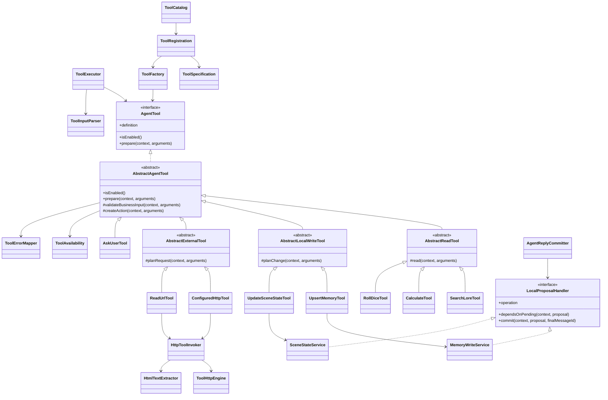

# Agent 工具面向对象架构优化调研

调研日期：2026-11-27。代码基线：`94fa5d46`。状态：一次性架构改造与问题修复方案，可直接交由 AI 完整实施。

本方案围绕 Agent 工具的共同父类型、抽象基类、业务子类、组合对象、延后提案处理器和统一注册目录展开，目标是让新增工具通过实现明确的业务契约并注册一次，就能接入运行、提案提交、配置和展示流程。提示词与配置校验的整理服从对象职责划分，不能仅将分散字符串搬到一个常量文件。

当前已经存在共同的 `AgentTool` 接口，因此具备多态调用基础；缺少的是可复用的工具实现骨架、本地延后提案的多态提交机制，以及围绕工具对象统一组织的规格、提示词、展示、可编辑项和配置目录。推荐保留现有运行引擎，引入 **AgentTool 接口、AbstractAgentTool 共同基类、按执行性质划分的家族基类、具体工具类**，同时以组合方式提供提示词、业务服务、提案处理器、无上下文 HTTP 调用器与可用性检查。

共同基类负责准备动作的统一流程；统一执行器负责授权、确认、超时、幂等、检查点和事务提交。两者不能合并，否则新增工具虽然可以继承，却也容易绕过原有运行约束。

## 当前对象结构与具体问题

| 位置 | 当前实现 | 扩展与维护影响 |
| --- | --- | --- |
| [AgentTool](../app/src/main/java/me/kafuuneko/rpclient/libs/agent/tool/AgentTool.kt#L98) 与 [ToolUserRequestKind](../app/src/main/java/me/kafuuneko/rpclient/libs/agent/tool/AgentTool.kt#L36) | 接口声明定义、启用检查和 `prepare`；确认枚举缺少 `ExternalReadConfirmation` | 缺少共同实现模板；外发读取确认在 [ToolExecutor](../app/src/main/java/me/kafuuneko/rpclient/libs/agent/tool/ToolExecutor.kt#L153) 借用 `ExternalWriteConfirmation` 并通过 `details["externalEffect"] = "read"` 传参，再由 [toQuestionItem](../app/src/main/java/me/kafuuneko/rpclient/feature/agent/AgentUiCoordinator.kt#L478) 拆包还原 |
| [BuiltinAgentTools](../app/src/main/java/me/kafuuneko/rpclient/libs/agent/tool/builtin/BuiltinAgentTools.kt#L31) 与 [prepareWrite](../app/src/main/java/me/kafuuneko/rpclient/libs/agent/tool/builtin/BuiltinAgentTools.kt#L279) | 私有 `LocalTool` 包装闭包；工厂集中组织六组工具、Schema、说明与 `operation` 字符串分派 | 新工具继续扩大工厂、闭包与条件分支，独立领域职责难以定位 |
| [AgentLocalDataRepository](../app/src/main/java/me/kafuuneko/rpclient/libs/room/repository/AgentLocalDataRepository.kt#L185)（`memoryView`、`scene`、`dependsOnPendingProposal`、`commitProposal`） | 按 `operation` 字符串分派无类型 `JsonObject` 提案的预览叠加与最终提交，被 [AgentReplyCommitter](../app/src/main/java/me/kafuuneko/rpclient/libs/agent/runtime/AgentReplyCommitter.kt#L43) 直接调用 | 即使拆掉 `prepareWrite`，新增支持延后提案的本地写入工具仍需修改此处的多处 `operation` 分支 |
| [HttpAgentTools](../app/src/main/java/me/kafuuneko/rpclient/libs/agent/connection/HttpAgentTools.kt#L24) | 匿名 `AgentTool` 实现；同时承担内置工具装配、覆写校验、HTTP 执行、手工测试（[test](../app/src/main/java/me/kafuuneko/rpclient/libs/agent/connection/HttpAgentTools.kt#L67)）及 `android.text.Html`（[L3](../app/src/main/java/me/kafuuneko/rpclient/libs/agent/connection/HttpAgentTools.kt#L3)）网页净化 | 职责交叉；测试入口无法复用 `prepare` 的请求规划；直接依赖 Android `Html` 导致 `ReadUrl` 正文提取无法在纯 JVM 单测覆盖 |
| [BuiltinToolOverrideCodec](../app/src/main/java/me/kafuuneko/rpclient/libs/agent/connection/BuiltinToolOverrideCodec.kt#L27) | 已引入具名装饰器 [OverriddenAgentTool](../app/src/main/java/me/kafuuneko/rpclient/libs/agent/connection/BuiltinToolOverrideCodec.kt#L231) 转发 `isEnabled`，但仍混杂编解码与运行装饰；[L65](../app/src/main/java/me/kafuuneko/rpclient/libs/agent/connection/BuiltinToolOverrideCodec.kt#L65) 直接哈希整段 JSON；[L35](../app/src/main/java/me/kafuuneko/rpclient/libs/agent/connection/BuiltinToolOverrideCodec.kt#L35) 将可调默认键写死为 `limit`/`offset` | 修改纯 UI 字段 `displayName` 会改变 `configurationDigest` 并中断等待中的运行；可调默认参数与 [BuiltinEditor](../app/src/main/java/me/kafuuneko/rpclient/feature/toolsettings/presentation/ToolSettingsUiState.kt#L142) 全链路硬编码，无法按规格扩展 |
| 六处内置工具清单与跨 Feature 耦合 | [TOOL_SPECS](../app/src/main/java/me/kafuuneko/rpclient/feature/agent/AgentUiCoordinator.kt#L590)、[BUILTIN_DISPLAY_ORDER](../app/src/main/java/me/kafuuneko/rpclient/feature/toolsettings/ToolSettingsViewModel.kt#L1329)、[LOCAL_NAMES](../app/src/main/java/me/kafuuneko/rpclient/libs/agent/connection/ToolConfigCodec.kt#L23)、[ConversationToolPolicy](../app/src/main/java/me/kafuuneko/rpclient/libs/room/entity/ConversationToolPolicy.kt#L35)、[PARAMETER_SCHEMAS](../app/src/main/java/me/kafuuneko/rpclient/libs/agent/tool/builtin/BuiltinAgentTools.kt#L480) 与 `AgentLocalDataRepository` 各自维护清单 | 新增内置工具需同步修改多处；`feature/toolsettings` 反向依赖 `feature/agent` 的 `TOOL_LABELS` 与 `AgentToolGroup`；连接缺配置判断与 `AgentToolGroup.titleRes()` 在两处重复实现 |
| [ToolConfigRepository](../app/src/main/java/me/kafuuneko/rpclient/libs/room/repository/ToolConfigRepository.kt#L23) | 数据层反向依赖 `BuiltinAgentTools`，且 [saveOverride](../app/src/main/java/me/kafuuneko/rpclient/libs/room/repository/ToolConfigRepository.kt#L87) 与 [saveBuiltinDraft](../app/src/main/java/me/kafuuneko/rpclient/feature/toolsettings/ToolSettingsViewModel.kt#L941) / `import` 重复创建内置工具并双次校验 | 装配图纠缠；每次覆写校验都要实例化全部内置工具；存在未调用的死方法 `newConnection()` |
| [ToolRegistry](../app/src/main/java/me/kafuuneko/rpclient/libs/agent/tool/ToolRegistry.kt#L33)、[RPClientApp](../app/src/main/java/me/kafuuneko/rpclient/RPClientApp.kt#L206) 与 [ToolExecutor](../app/src/main/java/me/kafuuneko/rpclient/libs/agent/tool/ToolExecutor.kt#L67) | `RPClientApp` 与 `HttpAgentTools` 重复构建内置工具并靠 `filterNot` 静默替换；每次调用都触发全量 `refresh()`；历史版本按 `ConcurrentHashMap.keys` 任意顺序淘汰；[canParallel](../app/src/main/java/me/kafuuneko/rpclient/libs/agent/tool/ToolExecutor.kt#L287) 与 [repeatsWithoutProgress](../app/src/main/java/me/kafuuneko/rpclient/libs/agent/runtime/AgentRuntime.kt#L334) 未按冻结指纹查找定义 | 每次调用查三次 Room 并全量重算指纹；历史淘汰可能误删等待中运行仍在引用的版本；运行中改配置可能导致并行判断或重复读取检测读到新定义 |
| 魔法字符串与超大页面文件 | `"Http"`/`"ReadUrl"`、HTTP 方法、认证模式、绑定目标、步骤类型与 27 个错误码均以裸字符串分散校验；配置解析遇到畸形类型时部分路径漏抛原生异常而非 `ToolConfigValidationException` | 新增类型或错误码极易遗漏分支；`ToolSettingsDialogs`、`ToolSettingsViewModel`、`ToolSettingsLayout`、`AgentConversationPanel` 单文件超千行，维护成本高 |

说明：基线 `94fa5d46` 已经完成了两项早期缺陷修复，不再作为未完成问题重复列出：一是 `BuiltinToolOverrideCodec` 已将匿名包装替换为具名 `OverriddenAgentTool` 并转发 `isEnabled()`；二是 [ToolConfigRestoreValidator](../app/src/main/java/me/kafuuneko/rpclient/libs/agent/connection/ToolConfigRestoreValidator.kt#L19) 已补齐内置覆写的 `validateForSchema` 与工具绑定的 `validateBindings` 校验。

这里需要收拢的是对象职责、领域契约与扩展约定。`AgentToolDefinition` 适合继续保留为 `data class` 值对象；真正需要共享与抽象的是工具准备流程、动作包装、延后提案提交、无上下文外部调用和统一目录。

| 方案 | 适用范围 | 本项目的取舍 |
| --- | --- | --- |
| 接口加轻量受约束适配器 | 极简纯计算或同构配置实例 | 保留给简单只读计算工具，避免为两行业务逻辑强行造深层类 |
| 共同基类加执行家族，并组合业务服务与提案处理器 | 多种工具共享准备与动作包装，同时各自具有领域规则 | 推荐的主体框架 |
| 一个基类包办注册、Prompt、网络、事务和界面 | 会把多个变化原因集中在同一对象 | 不采用；这些职责分别由规格、组合服务、目录及执行器承担 |

## 推荐的工具继承结构



图中名称表示拟新增或演进的架构角色。现有 `AgentTool`、`ToolExecutor`、`ToolHttpEngine`、`AgentReplyCommitter` 等对象继续演进，不要求同时替换所有签名。

### 共同基类的职责

`AbstractAgentTool` 使用模板方法固定准备流程：隔离本次参数副本并合并工厂冻结的默认参数（不改变执行器记录的原始入参指纹），校验实时可用性，执行业务前置校验，再生成 `ToolAction`。`prepare` 使用 `final override`，业务子类通过受保护方法提供差异行为，避免各自复制一遍准备与异常处理逻辑。Kotlin 支持通过 `final override` 限定进一步覆写，也明确提醒不要在基类构造器或初始化块调用可覆写成员。[Kotlin 继承文档](https://kotlinlang.org/docs/inheritance.html)

| 成员或对象 | 负责的内容 | 约束 |
| --- | --- | --- |
| 构造参数中的冻结定义与冻结默认值 | 工具身份、版本、参数契约、执行性质和已校验的可选默认值 | 不通过可覆写 getter 在构造过程中访问子类尚未初始化的状态；默认值为不可变快照 |
| `ToolAvailability` 组合对象 | 全局启停、连接存在性和配置可用性 | `isEnabled()` 直接委托该对象；不替代会话白名单、身份归属或运行授权时钟 |
| `prepare` | 统一准备顺序，返回动作计划 | 不能发送 HTTP、掷骰、提交数据库写入或提前回答用户 |
| `validateBusinessInput` | 条目是否可见、证据是否存在、业务版本是否匹配等前置检查 | 与 JSON Schema 结构校验区分，由子类按需要实现，无前置规则的简单只读工具无需覆写 |
| `createAction` | 将业务行为封装为标准动作 | 家族基类固定动作包装，具体工具只实现业务钩子 |
| `ToolErrorMapper` 组合对象 | 将已知领域失败转换为稳定错误 | 取消必须继续抛出，不能将所有异常都降为可恢复错误 |

参数解析与默认值合并的职责边界明确拆分，避免执行器与基类之间产生契约冲突：

- **执行器侧 `ToolInputParser`**：负责严格 JSON 解析与 `ToolSchemaValidator` 校验，并被手工 HTTP 测试入口复用。`ToolExecutor` 基于模型原始入参计算幂等 `argumentsDigest`，不依赖 `tool is AbstractAgentTool`，也不改动 `AgentToolDefinition` 与 `ToolRegistry.snapshot` 编码。
- **工具侧冻结默认值合并**：工厂在构造工具实例前完成可选默认值的契约校验并冻结传入 `AbstractAgentTool`；`AbstractAgentTool.prepare` 在参数副本上补入缺失键（保留模型显式传入的值及显式 `null`），再交给 `validateBusinessInput` 与 `createAction`。若未来第三方直接实现 `AgentTool`，不受基类默认机制影响。
- **可用性失败语义对齐**：`ToolExecutor.execute` 在调用 `prepare` 前已通过 `tool.handler.isEnabled()` 拦截停用或撤权并返回 `FatalError("tool_authorization_revoked")`。若 `prepare` 期间检测到配置刚被撤权或停用，应抛出明确的撤权异常（由执行器统一映射为 `FatalError("tool_authorization_revoked")`），而缺配置（如尚未绑定连接或未绑定凭据）才返回 `RecoverableError("http_needs_configuration")`，避免两者错误级别错位。

共同基类必须保持无调用状态：不能将当前会话、运行令牌、参数或本次结果保存为可变成员。注册的工具可能被多个会话共用，只读工具还允许受控并发；这些数据应通过方法参数传递，并在本次动作闭包中捕获。构造函数只接收稳定依赖和不可变配置，不执行网络、文件 IO 或数据库业务。

### 按执行性质复用动作包装

| 家族 | 子类实现什么 | 基类生成什么 | 不应由子类处理什么 |
| --- | --- | --- | --- |
| `AbstractReadTool` | `read`，读取本地数据或计算结果 | 延后执行的 `ToolAction.Read` 与标准 `ToolErrorMapper` 异常映射 | 检查点回放、并发调度、结果落盘 |
| `AbstractLocalWriteTool` | `planChange`，返回结果、确认要求及短事务提交动作 | `ToolAction.LocalWrite` | 自行开启长事务、抢先提交、修改运行状态 |
| `AbstractExternalTool` | `planRequest`，基于无上下文外部调用器生成目标、摘要与延后派发计划 | 按冻结 `definition.effect` 返回 `ExternalRead` 或 `ExternalWrite` | 自行跳过外发确认、重发未知结果、使用模型 Provider 的网络权限 |
| `AskUserTool` | 创建问题、选项及等待动作 | 直接实现共同基类的动作钩子 | 持有等待用户的协程、把回答当写入许可 |

`RollDiceTool` 可以复用读取家族的动作包装，但执行性质必须保留 `NonDeterministicRead`，不能因继承名称中有 Read 就变成确定性读取。确定性、并发许可与是否允许重算是显式契约，不能由类名或 HTTP 方法隐式推断。简单的纯读取或纯计算工具（如 `CalculateTool`）不需要为了形式对称而编写空壳前置校验，可以继续复用轻量只读适配器工厂。

### 本地写入与延后提案的对称解耦

本地写入工具包含两段对称生命周期：工具调用阶段的准备与立即提交（`ToolAction.LocalWrite`），以及涉及待生成正文证据的延后提案（`ToolWriteDisposition.Proposed`）在最终回复接受后的统一提交。

当前不仅 `BuiltinAgentTools.prepareWrite` 按 `operation` 字符串分派，[AgentLocalDataRepository](../app/src/main/java/me/kafuuneko/rpclient/libs/room/repository/AgentLocalDataRepository.kt#L185) 的 `memoryView`、`scene`、`dependsOnPendingProposal` 和 `commitProposal` 也全部通过字符串判断分派记忆与剧情提案，并由 [AgentReplyCommitter](../app/src/main/java/me/kafuuneko/rpclient/libs/agent/runtime/AgentReplyCommitter.kt#L43) 直接调用。只重构工具准备端无法消除写入扩展的公共分支。

推荐对称引入 `LocalProposalHandler`（与按 `operation` 索引的 `LocalProposalRegistry`）：

- 记忆领域服务 `MemoryWriteService` 与剧情领域服务 `SceneStateService` 各自实现对应的 `LocalProposalHandler`，承接本领域的提案叠加预览、前序提案依赖检查和最终回复短事务提交。
- `AgentLocalDataRepository` 退化为受控的基础数据访问与证据摘录核验边界（可见消息、世界书、对话搜索、提案检查点读取与逐字证据匹配），不再包含特定写工具的 `operation` 条件分支。
- `AgentReplyCommitter` 在短事务内按提案操作类型委托注册的 `LocalProposalHandler` 提交，并保持既有提案检查点 JSON 键名兼容。
- 涉及待生成正文证据的提案仍由最终回复提交流程验证，不能因为移到 `UpsertMemoryTool` 类中就改为立即写入。

## 继承和组合的边界

推荐继承固定的动作准备流程，推荐组合会变化的业务能力。继承树保持为共同基类、执行家族、业务工具，不继续叠加记忆专用、带确认、带分页、带认证、带日志等多层基类。

| 能力 | 推荐对象关系 | 原因 |
| --- | --- | --- |
| 记忆证据、去重、预览叠加与作用域判断 | `UpsertMemoryTool` 等组合 `MemoryWriteService`（同时实现 `LocalProposalHandler`） | 共享的是记忆领域规则与提案生命周期，不是所有工具的共同基类能力 |
| 剧情修订、预览叠加与证据判断 | `UpdateSceneStateTool` 组合 `SceneStateService`（同时实现 `LocalProposalHandler`） | 与记忆规则分开，彻底消除 `prepareWrite` 与 `commitProposal` 的跨领域字符串分派 |
| HTTP 请求规划、响应映射与网页文本提取 | `ConfiguredHttpTool` 与 `ReadUrlTool` 组合无上下文的 `HttpToolInvoker`、`ToolHttpEngine` 与 `HtmlTextExtractor` | 修改映射不需要新工具子类；手工测试入口可直接复用 `HttpToolInvoker` 而不伪造运行令牌；`HtmlTextExtractor` 剥离 `android.text.Html` 便于 JVM 单测 |
| 提示词和参数说明 | 工具规格组合 `ToolPromptSpec`，由解析器产生冻结文本 | 工具执行方法只处理业务，不拼接模型指令 |
| 全局启用条件与缺配置判定 | 组合 `ToolAvailability`（并统一向界面提供配置就绪状态） | 避免在 `AgentUiCoordinator` 与 `ToolSettingsViewModel` 重复解析连接与凭据 |
| 覆写配置解析 | 工厂在创建工具前解析为冻结 `EffectiveToolConfig` | 消除运行期层层装饰与重复创建内置工具的问题 |
| 授权、事务、超时、幂等与确认 | `ToolExecutor` 调用 `AgentTool` | 必须对所有实现统一生效 |

普通 HTTP 配置不应变成“一种服务商一个子类”。`ConfiguredHttpTool` 的多个实例对应不同配置；只有公网无认证读取等具有独立行为约束的能力，才值得建立 `ReadUrlTool`。

`AgentTool` 接口继续开放，抽象基类作为项目内工具的默认实现。执行器不能依赖 `tool is AbstractAgentTool` 才执行校验，也不能将继承关系当作安全保证。将来第三方适配器直接实现接口时，仍然必须经过同一执行器。

### 移除运行期装饰器，改为构造期冻结

基线 `94fa5d46` 已在 [BuiltinToolOverrideCodec](../app/src/main/java/me/kafuuneko/rpclient/libs/agent/connection/BuiltinToolOverrideCodec.kt#L231) 引入具名装饰器 `OverriddenAgentTool` 并完整委托 `isEnabled()`，且已有单测回归。但该方式仍有两项结构性缺陷：

- 编解码与运行期对象装饰仍混在 `BuiltinToolOverrideCodec` 中，且 Kotlin 的接口转发无法改变被委托对象内部对自身 `definition` 的引用。[Kotlin 委托文档](https://kotlinlang.org/docs/delegation.html)
- `configurationDigest = AgentJson.digest(raw)`（[L65](../app/src/main/java/me/kafuuneko/rpclient/libs/agent/connection/BuiltinToolOverrideCodec.kt#L65)）将纯 UI 展示字段 `displayName` 混入执行契约指纹，修改内置工具展示名会导致等待中的运行以 `tool_contract_changed` 失败。

本次直接移除运行期 `OverriddenAgentTool` 装饰层：统一由 `BuiltinToolOverrideCodec` 解析出 `EffectiveToolConfig`（包含生效说明、参数说明、冻结默认值以及**排除 `displayName` 的执行配置指纹**），再由 `ToolFactory` 在构造期直接创建不可变工具实例。

## 工具规格与统一注册

引入 `ToolSpecification`、`ToolRegistration`、`ToolFactory`、`ToolCatalog` 以及共享领域枚举 `ToolGroup` 和 `EditableDefaultSpec`，为工具对象提供唯一的元数据来源，彻底消除当前散落在六处的内置工具清单与跨 Feature 依赖。

| 对象 | 主要职责 | 不负责 |
| --- | --- | --- |
| `ToolSpecification` | 稳定 ID、模型函数名、版本、结构化 Schema、执行性质、`ToolGroup` 分组、是否默认启用、可调默认参数规格 `EditableDefaultSpec` 及提示词引用 | Room 查询、网络调用、界面状态 |
| `ToolRegistration` | 关联规格、工厂、展示资源元数据与显式稳定排序键 `order` | 执行工具和持久化用户授权 |
| `ToolFactory` | 注入业务服务，将已解析的冻结定义、默认值和配置构造成不可变工具实例 | 从调用参数决定工具身份、自动授予权限 |
| `ToolCatalog` | 发现并按 `(order, toolId)` 确定性排序注册项、检测冲突、提供配置校验与界面目录 | 执行事务、保存凭据、替代运行状态机 |
| `ToolRegistry` | 按配置版本发布冻结目录快照，按指纹查找运行处理器及活跃/等待运行引用的旧版本 | 再次维护一份界面工具名单或逐调用全量查库 |

应用装配层收集工具模块或注册项。继续使用仓库已有的 Koin Classic DSL 和 `getAll` 风格，不为此引入新的依赖注入框架、反射扫描或代码生成插件。当前仓库锁定 Koin `4.0.0-RC1`，实现时必须遵守两条约束：一是每项注册绑定须使用独立具体类型配合 `bind<ToolRegistration>()`（或显式限定符），避免同类型无限定符定义在容器内相互覆盖；二是 `getAll<ToolRegistration>()` 的返回顺序不能当作契约依赖，`ToolCatalog` 必须按 `(order, toolId)` 显式排序，以保持模型请求前缀缓存和单测结果稳定。[Koin 定义文档](https://insert-koin.io/docs/reference/koin-core/definitions/)

收拢后应从目录统一派生：

- 会话工具选择列表、分组（`ToolGroup` 下沉到共享领域层，解除 `feature/toolsettings` 对 `feature/agent` 的反向依赖，且 `ToolGroup.titleRes()` 映射只保留一份）及默认启用集合（替代 [ConversationToolPolicy.kt](../app/src/main/java/me/kafuuneko/rpclient/libs/room/entity/ConversationToolPolicy.kt#L35) 硬编码的 15 项 JSON 字符串，已持久化的旧会话配置保持原样）。
- 连接与工具的缺配置状态（由统一状态解析服务输出，消除 `AgentUiCoordinator` 与 `ToolSettingsViewModel` 的重复解析与 Keystore 探测）。
- 工具设置页的内置条目、展示名与通用可编辑默认项（由 `EditableDefaultSpec` 驱动，替代当前从 `BuiltinToolOverrideCodec` 到 `BuiltinEditor` 写死的 `limit`/`offset` 字段）。
- 模型函数名的保留范围（替代 `ToolConfigCodec.LOCAL_NAMES`）与覆写契约校验（使 `ToolConfigRepository` 依赖只读 `ToolCatalog` 规格而非反向依赖 `BuiltinAgentTools`，消除保存与导入时重复实例化 15 个内置工具及双次校验）。
- 任务卡的工具展示名称：活跃的内置工具与 HTTP 工具均从目录取得展示名；需注意 [ToolInvocation](../app/src/main/java/me/kafuuneko/rpclient/libs/room/entity/AgentRun.kt#L111) 当前仅持久化 `toolId`（`http.<UUID>`）而未快照历史 `toolName`，因此在不改表的前提下，已删除的 HTTP 工具只能回退到明确的“已删除外部工具”中性标签，不能声称仅靠目录即可还原被删 HTTP 工具的原始名称；若后续有明确历史展示需求，再在数据库版本演进中为 `ToolInvocation` 增加名称快照字段。

展示信息在应用注册层以显式 `@StringRes` 资源 ID 关联，不将 `Context` 放入领域对象，也不使用字符串反射寻找资源。界面语言、标题或排序的修改绝不改变执行契约指纹；模型函数名、参数约束、执行性质和生效默认值的变化则必须参与运行兼容性判断。

现有内置工具 ID、`http.<UUID>` 身份、模型函数名和导入后重新分配 ID 的规则保持稳定。新注册项不能依靠 `filterNot` 覆盖同名绑定，静默替换已经获得授权的工具。

## 提示词在对象体系中的归属

工具说明和参数说明直接影响模型如何使用工具，应作为规格的一部分管理，而不是作为 `read`、`planChange`、请求映射等业务方法中的字符串。OpenAI 的工具定义文档也将函数说明、参数说明和使用指导分别作为模型输入的一部分。[Function calling](https://developers.openai.com/api/docs/guides/function-calling)

| 文本类型 | 对象归属 | 用户覆盖位置与空值语义 |
| --- | --- | --- |
| 六组 Agent 主指令、收尾、错误和压缩指令 | 现有 `PromptType` 与预设快照 | 现有提示词预设；继续保留“缺失回退默认、显式空字符串表示省略该段”与既有宏展开规则 |
| 工具说明、参数说明、使用提示 | `ToolPromptSpec`，与工具规格按稳定 ID 关联 | 现有内置工具稀疏覆盖或 HTTP 工具自身配置；内置覆盖延续 `94fa5d46` 已验收规则，空白文本不保存并回退内置默认说明，避免表单留空剥离模型工具文档；不执行宏展开 |
| 内置工具展示名称 `displayName` | 展示层覆盖字段 | 仅用于界面和任务卡展示，不发给模型，**不参与** `configurationDigest` 计算 |
| 外部资料提示及剧情数据包装 | 固定的数据封装组件 | 按版本维护，权限约束仍由执行器和网络层落实 |
| 参数 Schema、协议字段、错误码 | 契约和编解码对象 | 不能当自然语言 Prompt 任意编辑 |
| 按钮、标题、状态提示 | 展示资源 | 默认英文及全部已支持语言资源 |

具体规整方式：

- 以领域组织默认文本，例如记忆工具、检索工具和联网工具各自的默认说明文件；目录统一索引，不创建一个无限增长的字符串总文件。
- 业务工具声明提示词引用，工厂在创建冻结实例前完成默认值与用户覆盖的解析，解析规则只实现一份，编辑器与运行器取得同一份生效投影。
- 主指令随预设，工具说明随工具配置，固定数据包装随版本；统一目录不意味着将它们塞进同一张表。
- 保留角色、人设和会话值的字面插入规则，外部结果不能再次被解释为模板。
- 编辑器显示原始默认值、当前覆盖值和最终生效值，并标明它影响哪个工具或预设。预览使用冻结解析器，不实际发送网络请求。

本次采用类型化 Kotlin 规格及按领域拆分的默认文本文件，沿用已有 Room 覆盖存储；不将长正文迁移到打包 Markdown 资源，也不引入远程 Prompt 配置服务。

## 执行器保留的边界

工具共同基类不拥有整个 Agent 运行。以下步骤继续由执行器及其协作对象统一执行：

- 复核运行令牌、会话白名单、角色及人设归属、契约版本和冻结指纹。
- 通过 `ToolInputParser` 强校验原始参数并计算原始 `argumentsDigest`，不从模型参数读取客户端授权身份。
- 决定是否需要确认，等待用户时释放执行栈与连接。
- 派发前标记调用状态，执行超时和取消收尾。
- 保存完整结果检查点，将本地写入与完成标记放在同一短事务中。
- 回放已有结果，拒绝自动重发未知结果的外部写入。

`ToolAction` 和 `ToolResult` 继续使用有限、可穷尽检查的类型体系。不能为了让所有子类都方便扩展而改成 `Any` 或任意字符串动作；新增执行语义应明确扩展契约，并由执行器审查支持。新增同类业务工具则不应修改执行器。

### 强类型契约收敛与确认语义修复

同步补齐当前存在的几处契约缺口与一致性隐患：

- **显式区分外发读取确认**：在 [ToolUserRequestKind](../app/src/main/java/me/kafuuneko/rpclient/libs/agent/tool/AgentTool.kt#L36) 中显式新增 `ExternalReadConfirmation`，替代 `ToolExecutor` 借用 `ExternalWriteConfirmation` 并在 `details` 内拼接 `"externalEffect": "read"`、再由 `AgentUiCoordinator` 拆包的泄露约定；`ToolResultCodec` 保留对既有检查点编码的向后兼容读取。
- **收敛配置与错误码魔法字符串**：为 HTTP 工具类型（`Http` / `ReadUrl`）、HTTP 方法、认证模式、参数绑定目标、运行步骤类型（`Model` / `Tools` / `Compaction`）及校验/运行错误码引入集中枚举或常量对象，消除跨 7 个文件的裸字符串比对；同步修复 [ToolConfigCodec](../app/src/main/java/me/kafuuneko/rpclient/libs/agent/connection/ToolConfigCodec.kt#L141) 与 [HttpToolConfigCodec](../app/src/main/java/me/kafuuneko/rpclient/libs/agent/connection/HttpToolConfig.kt#L87) 在畸形字段类型时漏抛原生异常而非 `ToolConfigValidationException` 的问题。
- **按冻结指纹查找运行期工具定义**：修复 [ToolExecutor.canParallel](../app/src/main/java/me/kafuuneko/rpclient/libs/agent/tool/ToolExecutor.kt#L287) 与 [AgentRuntime.repeatsWithoutProgress](../app/src/main/java/me/kafuuneko/rpclient/libs/agent/runtime/AgentRuntime.kt#L334) 使用无指纹查询的问题，确保并发判定和重复读取检测始终对齐本轮冻结的工具契约。

### 副作用与外发权限边界

当前 HTTP 定义按方法将 `POST`、`PUT`、`PATCH`、`DELETE` 判为 `ExternalWrite` 并要求用户确认。本次保持该保守确认策略不变，不能因重构为 `AbstractExternalTool` 而放宽确认条件，也不能根据远端自报的只读属性自动授予权限。MCP 规范明确要求将不可信服务的工具注解视为不可信提示；外部元数据不能成为执行授权依据。[MCP Tools](https://modelcontextprotocol.io/specification/2025-11-25/server/tools)

`ReadUrlTool` 继续使用无认证公网访问策略；自定义 HTTP 工具继续使用独立安全 DNS、逐跳校验、解压体积上限和受控凭据读取。共同基类不能将模型 Provider 的内网权限或密钥传播给这些对象。

手工 HTTP 测试入口通过 `ToolInputParser` 与无上下文的 `HttpToolInvoker` 复用参数校验、请求规划、响应映射与安全网络传输，绝不为复用执行器而伪造 `AgentExecutionToken` 或借用聊天身份。

## 版本与数据生命周期

将闭包改为对象后，生命周期必须显式设计，不能把所有类都注册成可变单例。

| 对象 | 建议生命周期 | 状态约束 |
| --- | --- | --- |
| 业务 Repository、网络引擎、无状态领域服务与提案处理器 | 应用共享 | 不保存当前调用身份 |
| 工具规格、默认文本目录与 `ToolCatalog` | 应用版本内稳定 | 按 `(order, toolId)` 固定顺序，内容变化有明确版本或指纹 |
| 由配置产生的工具对象 | 配置版本对应的不可变实例 | 不在等待确认时原位修改 URL、Schema 或默认值 |
| 调用上下文、参数、请求计划和结果 | 单次调用 | 不回填到共享工具实例 |
| 运行快照 | 根运行及本机检查点 | 保存解析后的文本、定义和必要的非敏感配置引用 |

当前旧处理器只保存在 `ToolRegistry.mVersions` 内存中；检查点主要保存工具指纹，并不能重建任意历史处理器。因此“等待期间修改了工具配置，再重启进程”的恢复能力有边界，不能声称已支持任意旧版本续跑。

本次继续保留“不兼容配置变更后明确终止旧运行”的保守语义；不序列化闭包、Koin 对象或凭据正文，全局停用、连接撤销等实时权限始终生效。

目录刷新与版本缓存应满足以下约束：

- `ToolConfigRepository` 维护单调递增的配置版本号（任何连接、工具、覆写变更或导入在事务提交后递增，`AgentDataLifecycle.afterRestore()` 清库恢复后同步重置）；`ToolRegistry.refresh()` 仅在配置版本变化时重编译目录，彻底移除每次工具调用查三次 Room 并全量重算指纹的开销。
- 移除 `RPClientApp` 将内置工具传入 `mBase` 后再由 `HttpAgentTools.create()` 重复构建并靠 `filterNot` 静默替换的冗余路径；内置工具与外部配置由目录按单一路径合成，同名 ID 冲突直接报错。
- 历史版本缓存（`mVersions`）在淘汰时先排除当前活跃及等待中运行引用的 digest，再按最久未用或最早入队顺序回收，替代当前依赖 `ConcurrentHashMap.keys` 任意迭代顺序的淘汰方式。完整备份恢复后继续停止运行、清理检查点及旧目录实例。

存量兼容需要单独约束：

- 类名和包名不是持久化身份。重命名 `UpsertMemoryTool` 不应改变原工具 ID，也不能按反射类名从备份恢复执行对象。
- 原有提示词键、工具配置 JSON 与预设未知键的往返规则继续保留；不能把未知工具类型自动解释为普通 HTTP 工具。
- 保持既有工具定义编码、注册顺序与执行指纹算法（修复 `displayName` 误入指纹除外）；需要改变检查点或交换格式时，显式处理旧格式读取兼容或明确失效，不能用新规则静默重放旧调用。
- 本次改造不新增或修改 Room 数据库表结构与数据库版本。

## 目标目录结构

所有对象均在现有 `:app` 工程包内直接就位，不拆分为多个 Gradle 模块。Android 官方建议按职责保持高内聚与低耦合，优先收拢对象职责而非增加模块数量。[Android 模块化模式](https://developer.android.com/topic/modularization/patterns)

```text
libs/agent/tool/
    AgentTool.kt                         接口与既有动作契约
    ToolInputParser.kt                   原始 JSON 解析与 Schema 校验
    base/                                共同基类、执行家族与错误映射
    catalog/                             规格、分组、可调默认项、注册、工厂与目录
    proposal/                            LocalProposalHandler 与提案提交注册表
    builtin/lore/                        世界书工具对象
    builtin/chat/                        聊天检索工具对象
    builtin/memory/                      记忆工具对象与 MemoryWriteService
    builtin/math/                        计算与骰子工具对象
    builtin/scene/                       剧情工具对象与 SceneStateService
    builtin/interaction/                 提问工具对象
libs/agent/connection/                   ConfiguredHttpTool、ReadUrlTool、HttpToolInvoker 与 HtmlTextExtractor
libs/prompt/tool/                        工具说明及参数说明的默认值与解析
libs/prompt/preset/                      继续承载主指令预设
libs/room/repository/                    继续承载持久化与跨表业务（不再反向依赖工具实现工厂）
feature/agent/                           从统一目录与可用性服务取得展示数据
feature/toolsettings/                    从规格取得可编辑项（不再跨 feature 依赖 feature/agent）
```

原有 `BuiltinAgentTools` 巨型闭包工厂直接拆分为按领域注册的具名工具与服务（无须保留过渡期兼容壳）；`HttpAgentTools` 职责拆清，不再负责创建内置工具和解释内置覆盖。

## 一次性实施清单

以下任务在一次完整实现中全部落地，不做分阶段过渡包装：

### 契约收敛与缺陷修复

- [x] 将 `displayName` 移出 `BuiltinToolOverrideCodec` 的执行配置指纹计算，使修改内置工具展示名不再改变 `configurationDigest` 或中断等待中的运行。
- [x] 在 `ToolUserRequestKind` 中显式补齐 `ExternalReadConfirmation`，消除 `ToolExecutor` 借用 `ExternalWriteConfirmation` + `details["externalEffect"] = "read"` 传参及 `AgentUiCoordinator` 拆包逻辑，并在 `ToolResultCodec` 保留对既有检查点编码的向后兼容读取。
- [x] 收敛核心魔法字符串为强类型枚举或集中常量：HTTP 工具类型（`Http` / `ReadUrl`）、HTTP 方法、认证模式、参数绑定目标、运行步骤类型（`Model` / `Tools` / `Compaction`）、记忆表/状态/分类与校验/运行错误码；修复 `ToolConfigCodec` 与 `HttpToolConfigCodec` 遇到畸形字段类型时漏抛原生异常而非 `ToolConfigValidationException` 的问题。
- [x] 修复 `ToolExecutor.canParallel` 与 `AgentRuntime.repeatsWithoutProgress` 未按冻结 `definitionDigest` 查找定义的问题。

### 工具抽象骨架与领域对象拆分

- [x] 引入 `ToolInputParser`（原始 JSON 解析 + `ToolSchemaValidator` 校验，供 `ToolExecutor` 与手工 HTTP 测试共用）、`AbstractAgentTool`、`AbstractReadTool`、`AbstractLocalWriteTool`、`AbstractExternalTool`、`ToolAvailability` 与 `ToolErrorMapper`；冻结默认值在 `AbstractAgentTool.prepare` 的参数副本上合并，不改变执行器原始 `argumentsDigest` 与 `ToolRegistry.snapshot` 编码；撤权统一对应 `FatalError("tool_authorization_revoked")`。
- [x] 按领域将 15 个内置工具从 `BuiltinAgentTools` 闭包提取为具名工具类（或极简计算工具使用基于同一基类的轻量只读适配器），确保 `RollDiceTool` 显式保留 `NonDeterministicRead`。
- [x] 引入 `LocalProposalHandler` 与提案注册表，将记忆与剧情的写入校验、预览叠加、前序依赖检查与最终回复短事务提交收拢到 `MemoryWriteService` 与 `SceneStateService`，彻底消除 `BuiltinAgentTools.prepareWrite` 与 `AgentLocalDataRepository`（`memoryView`、`scene`、`dependsOnPendingProposal`、`commitProposal`）的 `operation` 字符串分派。
- [x] 抽离无 `ToolExecutionContext` 依赖的 `HttpToolInvoker` 与不依赖 `android.text.Html` 的 `HtmlTextExtractor` 接口（应用层提供 Android 实现，JVM 单测可注入纯实现），由 `ConfiguredHttpTool`、`ReadUrlTool` 与手工 HTTP 测试入口共同复用。

### 统一注册目录、配置与跨层解耦

- [x] 引入 `ToolSpecification`、`ToolRegistration`、`ToolFactory`、`ToolCatalog`、`ToolGroup` 与 `EditableDefaultSpec`；通过 Koin Classic DSL 使用独立具体类型 + `bind<ToolRegistration>()`（或显式限定符）注册，并在 `ToolCatalog` 内按 `(order, toolId)` 显式排序。
- [x] 由 `ToolFactory` 接收已解析的冻结 `EffectiveToolConfig` 直接构造不可变工具实例，移除运行期 `OverriddenAgentTool` 装饰层。
- [x] 删除全部重复清单与重复逻辑：移除 `AgentUiCoordinator.TOOL_SPECS`/`TOOL_LABELS`、`ToolSettingsViewModel.BUILTIN_DISPLAY_ORDER`、`ToolConfigCodec.LOCAL_NAMES`、`ConversationToolPolicy` 硬编码的 15 项默认工具 JSON；解除 `feature/toolsettings` 对 `feature/agent` 的跨模块依赖及 `ToolConfigRepository` 对 `BuiltinAgentTools` 的反向依赖；合并两处重复的连接缺配置判定与 `ToolGroup.titleRes()`；消除覆写保存/导入时的双次内置工具创建与重复校验。
- [x] 将 `BuiltinToolOverrideData`、`ToolSettingsDialogState.BuiltinEditor`、`ToolSettingsViewModel` 与 `ToolSettingsDialogs` 从写死的 `limit`/`offset` 升级为由 `EditableDefaultSpec` 驱动的通用可编辑默认参数模型。

### 提示词归属、可维护性与规范治理

- [x] 将工具默认说明与参数说明收拢到按领域组织的 `ToolPromptSpec` 默认文件中，保留现有六组 Agent 预设及存储键；维持“Prompt 预设空串省略”与“内置工具覆写空白回退默认”两条语义，编辑器与运行器复用同一冻结解析器。
- [x] 按职责拆分超大文件（`ToolSettingsViewModel`、`ToolSettingsDialogs`、`ToolSettingsLayout`、`AgentUiCoordinator`）与超过 80 行的长方法；移除死方法 `ToolConfigRepository.newConnection()`；修复 `ConnectionEditor.maxResponseKiB` 未暴露编辑入口却在加载/保存时按 1024 静默取整篡改原值的问题。
- [x] 按仓库编码规范完成本次触及文件的规范治理：超 16 行方法补齐无数字序号的分步行内注释、修正重复或缺失的 KDoc（如 `OpenAICompatibleToolCodec`、`ToolSettingsLayout`）、统一私有成员 `m` 前缀（如 `LocalMath` 及工具相关类）、将 `RPClientApp` 中 `AgentUiCoordinator` 等多参数构造改为具名实参。

### 目录版本化与运行期缓存治理

- [x] 在 `ToolConfigRepository` 中维护单调配置版本号（事务提交及整库恢复后推进），`ToolRegistry.refresh()` 仅在配置版本变化时重编译目录快照，消除每次 `ToolExecutor.execute` 查三次 Room 并全量重算指纹的问题；移除 `RPClientApp` 与 `HttpAgentTools` 对内置工具的双重装配与 `filterNot` 静默替换。
- [x] 改造 `ToolRegistry` 历史版本缓存（`mVersions`）回收策略：淘汰前排除当前活跃与等待中运行引用的 digest，对无引用版本按有序策略回收；保持整库恢复、人设删除、全局停用、凭据缺失和等待确认的生命周期约束。

## 明确边界（本次不做）

- 不拆分为多个 Gradle 模块，不引入新的依赖注入框架、反射扫描或代码生成插件，不升级 `gradle/libs.versions.toml` 依赖版本。
- 不修改 Room 表结构、数据库版本及迁移脚本（因此不新增 `ToolInvocation` 历史工具名列，已删除 HTTP 工具使用中性回退标签）。
- 不改变 `POST`、`PUT`、`PATCH`、`DELETE` 等 HTTP 写方法的现有确认策略，不基于远端工具注解自动放行权限。
- 不将长说明文本迁移到打包 Markdown 资源，不引入远程 Prompt 配置服务，不为工具说明新增宏展开能力。
- 不在本轮实现 MCP、OAuth、上传、生图或多模态工具结果扩展。
- 不编写违背仓库单测规范的平凡映射、框架本身或纯 Mock 仪式性单测。

## 扩展成本与验收标准

| 扩展任务 | 目标修改范围 | 应保持无需修改的地方 |
| --- | --- | --- |
| 新增本地读取工具 | 读取子类（或轻量读取适配器） 规格 注册项 必要业务测试 | 聊天 ViewModel 执行器 协议 Codec 界面与策略工具名单 |
| 新增本地写入工具（含延后提案） | 写入子类 领域服务与 `LocalProposalHandler` 规格 注册项 证据及事务回归 | 通用授权 确认 持久化幂等流程 `AgentLocalDataRepository` 公共分派 |
| 新增内置可调默认参数 | 规格声明 `EditableDefaultSpec` 与必要校验 | `BuiltinEditor` 表单字段与 UI 代码 |
| 新增普通 HTTP 服务 | 用户配置及映射 | Kotlin 工具子类与运行引擎 |
| 新增特殊外部协议 | 外部工具子类 工厂 传输适配器 | 已有本地工具类与聊天调度 |
| 修改工具说明或展示名 | 说明默认值或现有用户覆盖 | 业务执行方法（修改展示名不影响执行契约指纹） |
| 新增公共执行语义 | 明确修改动作/确认契约和执行器并完成回归 | 不伪装成已有动作或通过 `details` 暗渡字符串标志 |

成功标准：共同基类、提案处理器、无上下文 HTTP 调用器与统一目录均具有可验证的公共行为；业务子类只实现自身职责；注册一次即可完整接入展示、配置、默认策略与执行提交链路；重构前后模型实际收到的工具说明、Schema、工具顺序与执行指纹（除修复 `displayName` 污染指纹外）保持一致。

交付验证要求：

- 复用并全部通过既有 Agent 基础、运行集成、五协议、HTTP 边界、预设编解码及备份恢复测试。
- 补充高价值定向回归：`displayName` 变更不改变执行指纹、`ExternalReadConfirmation` 与旧检查点兼容、撤权错误级别一致、并发参数隔离、延后提案多态提交、单次注册完整接入、配置版本增量刷新与活跃 digest 保护，以及 `HtmlTextExtractor` 净化边界测试。
- 对本次变更的全部 Kotlin 源码执行仓库规定的 Android Studio `formatApply` 与 `formatCheck`，并完成离线 `:app:testDebugUnitTest` 与 `:app:assembleDebug` 编译检查。
